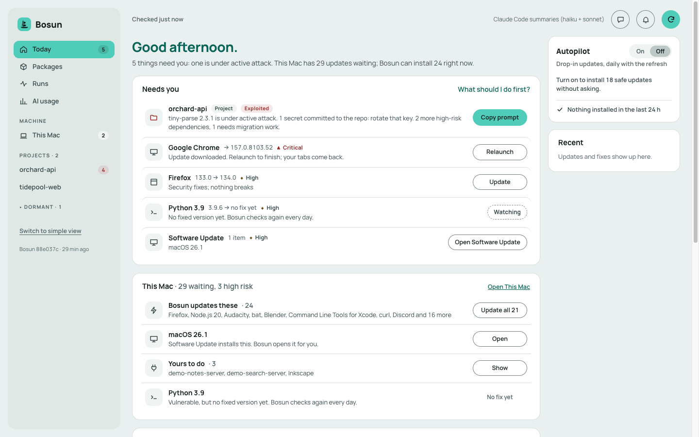

<p align="center"></p>

# Bosun

Bosun is a local dashboard of everything outdated or vulnerable on a computer, organized by **scope**: this
machine, and each project you are building. It is for people who want one place to see what needs updating,
why it matters, and to run the update. Each machine runs its own copy and only looks at itself.



*The dashboard on made-up data (`uv run bosun demo`).*

## Try it

```sh
uv run bosun demo
```

The demo picks a free port and prints a link; open it in your browser. `uv run bosun demo` shows the dashboard on made-up data, with nothing collected from your computer and every action that installs, opens or changes anything refused. Use it for a first look or for screenshots.

## What you need

Required:

- **Python 3.13.** If you have `uv`, it fetches this for you.
- **[uv](https://docs.astral.sh/uv/).** Bosun is started with `uv run`.
- **git.** Bosun finds your projects with it, and updates itself with it.

Optional. Bosun works without them, and says nothing is wrong:

- **Homebrew** (macOS, and Linux if you use Linuxbrew) adds your Homebrew formulae and apps, the vulnerability
  report for what it installed, and the Homebrew runtimes. Without it, Bosun lists the rest of the machine.
- **Claude Code** adds plain-language summaries of release notes, the Ask Bosun assistant, "Let Claude Code try it"
  on a project, and the Claude Code link. Without it the summaries come from built-in rules (the sidebar says "Basic
  summaries") and the other features can't run.

## Install and run

Clone the repository, then run these from its folder. `doctor` changes nothing.

```sh
git clone https://github.com/ThisIsMyPseudonym/bosun.git && cd bosun
```

```sh
uv run bosun doctor             # what this machine has and lacks for Bosun
uv run bosun refresh            # the first check: silent for 2-4 min, then prints what it found as JSON
uv run bosun serve              # starts the dashboard on http://127.0.0.1:8787 (it needs a sign-in: use `open`)
uv run bosun open               # signs you in and shows the dashboard in its own window (starts it first if it isn't running)
uv run bosun install-tasks      # background service: daily refresh and dashboard at login, plus an app icon (per-user, no admin)
```

`install-tasks` installs two LaunchAgents on macOS, systemd user units on Linux and scheduled tasks on Windows.
Paste the output of `uv run bosun doctor` into a bug report. The other commands, the app icon and removal steps
are in [Operating Bosun](docs/operating.md).

## What it does

- Lists outdated and vulnerable software on this machine and in your git projects, in one dashboard.
- Sorts every item into a lane (Do now, Plan, Batch, Later, Watch) by risk and by how hard the update is.
- Rates risk from CISA KEV, CVSS and EPSS, and shows how a flaw is reached and what an attacker gets.
- Runs updates one at a time, and opens a terminal view when an update needs your password or an answer.
- Installs safe, drop-in updates unattended with Autopilot, after a three-day wait.
- Reports the operating system's end of support, pending updates, drivers and firmware, and hands you to the system updater.
- Scans projects for vulnerable dependencies and container base images, and for committed secrets.
- Pins unpinned MCP servers that your AI tools load.
- Writes a prompt for your coding agent, or has Claude Code try a fix on a branch and run the tests.
- Answers questions in the Ask Bosun panel, and works as an MCP server for Claude Code.
- Keeps a history in SQLite that you can query with `bosun query`.

How it decides is in [How Bosun decides](docs/how-it-decides.md); where the data comes from is in [Sources](docs/sources.md).

## Safety in short

- The server listens on `127.0.0.1` only, and every request needs a session cookie that only your account can obtain.
- Upgrade commands are built from validated ids and run as argument lists, never through a shell.
- Autopilot never installs the operating system, firmware, drivers or hardware tools, and waits for a major version jump.
- Nothing is installed unattended until Bosun has seen that version on offer for three days. A click in the dashboard runs at once.
- Replacing an app with a newer version is checked against its developer: the signature must verify and match the
  developer of the copy you had, or the kept copy is put back.
- An agent or the assistant cannot quit apps, open system updaters, push branches or open pull requests unless you
  turn that on. They cannot change their own limits, the Claude budgets or Autopilot, and they never get a password window.
- The assistant changes something only with an approval you give in the panel, once per action.
- Bosun reads public services (OSV.dev, NVD, CISA, endoflife.date, package registries, Homebrew). With Claude Code
  installed, release notes are sent to Claude through your own login.
- A fix made by Claude Code stays on a branch on your machine until you click **Push & create PR**.
- Release notes, repository files and model output are treated as untrusted.

The full list is in [Security](docs/security.md); Autopilot is in [Autopilot](docs/autopilot.md); secrets, MCP servers and the AI features are in [AI tools](docs/ai-tools.md).

## Platforms

macOS is the supported platform. Windows and Linux are experimental: the tests run there in CI, and nothing more is promised.

## Staying current

Run Bosun from a git checkout and it keeps itself up to date. After the daily refresh, it moves the checkout
forward to the newest **release**: a tag named `vMAJOR.MINOR.PATCH`. Releases are signed tags. A running Bosun
installs a release only if its signature and every commit up to it check out against a list of trusted keys in
the repository, and never moves to an older version. Set `BOSUN_SELF_UPDATE=0` to turn this off. The rules in
full are in [Operating Bosun](docs/operating.md#staying-current-in-full).

## Leaving Bosun alone

Bosun looks after its own housekeeping. Each day it prunes what it has written, rotates its logs and keeps a copy
of the database before a new version changes it. When a service it reads is down or slow, the refresh still
finishes, uses the last copy it kept, and says so once in the errors line at the top of the page. What will
eventually need a person is shown in that line and in `bosun doctor`. The details are in
[Operating Bosun](docs/operating.md#what-bosun-does-for-itself-in-full).

## Support

Bosun is provided as is. Issues are welcome, but no response is promised.

## More

- [Documentation index](docs/README.md)
- [SECURITY.md](SECURITY.md): how to report a vulnerability privately
- [CONTRIBUTING.md](CONTRIBUTING.md)
- [CHANGELOG.md](CHANGELOG.md)

## Licence

MIT. See [LICENSE](LICENSE).
