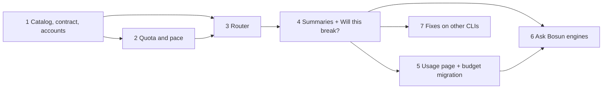

# AI providers: implementation plan

Status: plan, 2026-11-25. Implements `docs/plans/2026-11-25-ai-providers-design.md` (agreed 2026-11-25, on branch
`docs/ai-providers-design`; not yet on this branch). Plan only: no code changes here.

Every task is test first. Tasks are 2-5 minutes each: write the failing test, run it and see the failure named here,
write the least code that passes, run it again, commit. Phases 1-4 are in full detail; 5-7 are task lists to be
expanded into the same form when their turn comes.

## Conventions

- Run one test: `uv run pytest tests/<file>.py::<test> -q`. Run a phase's suite: `uv run pytest tests/test_providers_*.py -q`.
  Run everything before each phase's last commit: `uv run pytest -q` (1252 tests collected today; all must stay green).
- New tests are flat files `tests/test_providers_<module>.py`, not a `tests/providers/` folder: tests import
  `from conftest import ...`, which only works from the `tests/` folder itself.
- A worktree with a new migration must not touch the installed database: run `bosun` commands with
  `BOSUN_DATA_DIR=$(mktemp -d)` (docs/developing.md). Regenerate the data model after each migration:
  `BOSUN_DATA_DIR=$(mktemp -d) uv run bosun db --doc > docs/data-model.md` (`tests/test_data_layer.py` fails while stale).
- Every new column is added to `READABLE` or `HIDDEN` in `src/bosun/query.py` (`tests/test_query.py` fails until it is),
  with a comment beside it in the migration (the data-model doc is generated from those comments).
- Code rules: files under 400 lines, functions under 50, `@dataclass(frozen=True)` for data, `tuple` not `list` in
  frozen fields, explicit errors (no bare `except`; a parser returns `None` or an empty tuple, never raises on bad
  input). Nothing but `src/bosun/providers/run.py` (and, until phases 6-7 land, `assistant.py` and `fixer.py`) starts
  an AI CLI. Never run a real model call in a test; never run a prompt through a CLI to record a fixture.
- Commits: conventional commits, scope `providers` unless stated (`feat(providers): ...`, `test(providers): ...`).

## What exists today (the code this replaces)

| Where | Today | After |
|---|---|---|
| `llm.py` | `claude()` runs `claude -p --output-format json`, `record()` writes `llm_calls`, dollar budgets (`over_budget`, `budgets`, `assistant_left`) | `record()` stays (gains provider/account/job/window_draw/estimated); `claude()` stays only for the fixer until phase 7; budgets go in phase 5 |
| `enrich/summarize.py`, `enrich/explain.py` | build their own `claude` argv, call `llm.claude`, check `llm.over_budget` | call `providers.run.run(job=..., schema=Assessment, tier=...)` (phase 4) |
| `fixer.py` | `claude_fix_argv` + Seatbelt via `--settings`, `llm.claude(purpose="fix")` | unchanged for Claude; other CLIs inside a whole-process jail (phase 7) |
| `assistant.py` | Claude Agent SDK, `llm.record_report("assistant")`, `max_budget_usd` | `AssistantEngine` with `ClaudeSdkEngine` (today's code) and `CliMcpEngine` (phase 6) |
| `server.py` `llm_usage`, `set_llm_budget`; `static/usage.js` | dollars per purpose, three budgets | windows per login, pace, Bosun's draw, tokens as detail (phase 5) |
| `migrations.py` | latest is v8 | v9 `quota_windows` (phase 2), v10 `llm_calls_providers` (phase 4), v11 `retire_budgets` (phase 5) |

## Checked against the installed CLIs (2026-11-25, `--help` only, no prompts)

| Provider | Version here | Headless call Bosun will use | Lockdown flags the contract requires | Login folder variable |
|---|---|---|---|---|
| Claude Code | 2.1.332 | `claude -p --output-format stream-json --verbose --json-schema <s> --tools "" ...` | `--tools`, `--disallowedTools`, `--strict-mcp-config`, `--setting-sources`, `--no-session-persistence`, `--json-schema`, `--output-format`, `--verbose`, `--disable-slash-commands`, `--restricted`, `--permission-prompts` | `CLAUDE_CONFIG_DIR` |
| Codex | 0.172.0 | `codex exec --json --sandbox read-only --ephemeral --skip-git-repo-check --ignore-user-config --ignore-rules --disable <f>... --output-schema <file> -m <model> -` | (from `codex exec --help`) `--sandbox`, `--ephemeral`, `--skip-git-repo-check`, `--ignore-user-config`, `--ignore-rules`, `--disable`, `--output-schema`, `--json` | `CODEX_HOME` |
| Gemini CLI | 0.71.1 | `gemini -p " " --approval-mode plan --policy <toml> -o json -m <model>` (prompt on stdin) | `--approval-mode`, `--policy`, `--output-format` | `GEMINI_CLI_HOME` |
| Grok | 1.0.92 | `grok --prompt-file <f> --output-format json --permission-mode dontAsk --disable-web-search --no-subagents --no-plan --no-memory --verbatim --tools todo_write --disallowed-tools <all> --json-schema <s> -m <model>` | `--permission-mode`, `--disable-web-search`, `--tools`, `--disallowed-tools`, `--no-subagents`, `--no-memory`, `--verbatim`, `--prompt-file`, `--json-schema` | `GROK_HOME` (+ `--leader-socket` per added login) |
| Antigravity | 1.5.17 | `agy --sandbox --disable-slash-commands --mode plan --print-timeout 4m --input-format stream-json --output-format stream-json --json-schema <s> --model <m>` (one NDJSON message on stdin) | `--sandbox`, `--disable-slash-commands`, `--input-format`, `--output-format`, `--print-timeout`, `--json-schema`, `--mode` | none (one login per machine) |
| Muse | 1.4.25 | `muse exec --provider meta --json --prompt-file <f> --workspace <tmp> --disable-shell --disable-write --disable-web-tools --no-session-log --no-foreign-personal-context --disable-request-user-input --model <m>` (from `muse exec --help`) | `--json`, `--prompt-file`, `--workspace`, `--disable-shell`, `--disable-write`, `--disable-web-tools`, `--no-session-log`, `--no-foreign-personal-context`, `--disable-request-user-input` | none |

Overriding variables an added login's call never passes (Coho `ACCOUNT_OVERRIDE_ENV`): Claude
`CLAUDE_CODE_OAUTH_TOKEN`, `ANTHROPIC_API_KEY`, `ANTHROPIC_AUTH_TOKEN`; Codex `CODEX_API_KEY`, `OPENAI_API_KEY`; Grok
`XAI_API_KEY`; Gemini `GEMINI_API_KEY`, `GOOGLE_API_KEY`.

Per-call MCP (needed by `CliMcpEngine`, phase 6): Claude `--mcp-config` + `--strict-mcp-config`; Codex `-c
mcp_servers.bosun.*` with `--ignore-user-config`; Muse `-c KEY=VALUE` (unverified for MCP). Gemini, Grok and
Antigravity have only persistent `mcp add` commands, which would change the user's own setup: they get no `mcp`
capability until a per-call way is verified (open question 5).

## Module map (all new files under `src/bosun/providers/`)

| File | Contents | Phase |
|---|---|---|
| `__init__.py` | docstring: "every AI call goes through here" | 1 |
| `catalog.py` | `Capability`, `Job`, `JOBS`, `ProviderSpec`, `CATALOG`, `spec()`, `capable()` | 1 |
| `argv.py` | `Invocation`, one builder per provider for one-shot `json`/`text` jobs | 1 |
| `contract.py` | `missing_flags`, `parse_version`, `ContractStatus`, `check()` | 1 |
| `accounts.py` | `Login`, `bucket()`, `logins()`, `login_env()`, add/exclude | 1 |
| `windows.py` | `Reading`, `parse_claude`, `parse_codex`, `parse_antigravity`, `window_hours` | 2 |
| `quota.py` | `stale`, `current`, `share`, `pace`, `login_pace`, `line_hit`, `stop_at`, `draw` | 2 |
| `limits.py` | `limit_reading()` (usage-limit replies), `Cooldowns` (429) | 2 |
| `ledger.py` | `quota_windows` reads and writes, Coho seed, once-per-window notices | 2-3 |
| `router.py` | `RoutingSettings`, `Candidate`, `Skip`, `Route`, `plan()`, `attempt()` | 3 |
| `replies.py` | `Reply`, one parser per provider (text or payload, tokens, readings, outcome) | 4 |
| `run.py` | `run()`: route, temp folder, env, invoke, parse, validate, record, fail over | 4 |
| `engines.py` | `AssistantEngine`, `ClaudeSdkEngine`, `CliMcpEngine` | 6 |
| `jail.py` | whole-process Seatbelt/bubblewrap profile and host allow-list proxy | 7 |

The design puts the window and token parsers "in" `catalog.py`; here each spec names its parser and the parsers live
in `windows.py` and `replies.py`, so no file passes 400 lines.

## Conflicts with the design (flagged, not redesigned)

1. **`v_llm_calls` does not exist.** The view is `v_llm_spend` (migrations.py v4). Changing a view means DROP and
   CREATE, which the additive-only rule avoids. Plan: keep `v_llm_spend` as is and add `v_ai_spend` (grouped by
   provider, account, job) in v10.
2. **"A migration maps the old purpose values to jobs"** is an identity map: today's purposes `summarize`, `explain`,
   `fix`, `assistant` are all job names. v10 backfills `job = purpose`, `provider = 'claude'`, `account = 'default'`.
3. **"A migration retires the stored budget settings"**: migrations only add. v11 records the old values and a
   one-time notice and Bosun stops reading them; the three `settings` rows stay so a rolled-back checkout still works.
4. **Grok reports its plan's usage:** `grok usage --json` ("Print your plan's usage limit"). The design lists Grok as
   estimated-only. Plan follows the design (estimated); a `grok usage` probe is open question 2.
5. **Antigravity's `/usage` needs a call of its own:** Bosun passes `--disable-slash-commands` on every prompt call, so
   the reading comes from a separate `agy -p /usage` probe, rate-limited (open question 3).
6. **Claude's windows need `stream-json`, which needs `--verbose`** in print mode. The reply parser accepts both the
   single `json` envelope (every existing test) and `stream-json` lines (the last `result` line is the envelope).
7. **Seatbelt cannot filter network by host name.** "Network only to the package registries and the provider's API
   host" for a whole-process jail needs a local allow-list proxy, with the profile allowing only loopback to it
   (phase 7). Claude's own sandbox does the same internally.
8. **Codex `exec --json` rate limits are unrecorded.** Coho parses `rate_limits` from session `token_count` events and
   the app server; no recorded `exec --json` output exists. The parser accepts every shape Coho knows, and phase 2
   ships it against hand-built fixtures until a recorded one replaces them (risk R3).

## Migration numbers

| Version | Name | Phase | What |
|---|---|---|---|
| 9 | `quota_windows` | 2 | table `quota_windows` (latest reading per login and window) |
| 10 | `llm_calls_providers` | 4 | `llm_calls` + `provider`, `account`, `job`, `window_draw`, `estimated`; backfill; index; view `v_ai_spend` |
| 11 | `retire_budgets` | 5 | settings `ai_budgets_retired` (old values, when) and `ai_budgets_notice` = `pending` |

If another branch (error triage, automations) lands a migration first, renumber before merging; `test_migrations`
checks the sequence.

## Phase dependencies



Phase 6 depends on 5 only because the assistant's dollar cap is removed there.

---

## Phase 1: catalog, contract check, accounts

Depends on: nothing. Migrations: none (logins live in `settings`, contract results in `cache`). Must keep passing:
everything; this phase adds modules and one optional `proc.run` argument. Risks: R1 (a CLI's help changes wording),
R2 (an added login folder the CLI does not recognise).

### Task 1.1: package and jobs

- Files: create `src/bosun/providers/__init__.py`, `src/bosun/providers/catalog.py`, `tests/test_providers_catalog.py`.
- Test first: `test_jobs_declare_what_they_need_and_who_starts_them`.

```python
from bosun.providers.catalog import JOBS, Capability as C

def test_jobs_declare_what_they_need_and_who_starts_them():
    assert JOBS["summarize"].needs == frozenset({C.JSON}) and JOBS["summarize"].background
    assert JOBS["explain"].needs == frozenset({C.JSON}) and not JOBS["explain"].background
    assert JOBS["fix"].needs == frozenset({C.SANDBOXED_AGENT})
    assert JOBS["assistant"].needs == frozenset({C.MCP}) and not JOBS["assistant"].background
    assert JOBS["computer_use"].needs == frozenset({C.MCP, C.VISION})
    assert set(JOBS) == {"summarize", "explain", "triage", "fix", "assistant", "computer_use"}
```

- Run: `uv run pytest tests/test_providers_catalog.py -q` → `ModuleNotFoundError: No module named 'bosun.providers'`.
- Implement: `Capability(StrEnum)` with `TEXT, JSON, SANDBOXED_AGENT, MCP, VISION`; `@dataclass(frozen=True) class Job:
  name: str; needs: frozenset[Capability]; background: bool`; `JOBS: Mapping[str, Job]` (a `MappingProxyType`).
  `triage` is `background=True` (it is also clickable; the router treats a click as foreground, task 3.4).
- Pass: same command → `1 passed`.
- Commit: `feat(providers): declare AI jobs and their capabilities`

### Task 1.2: one spec per CLI

- Files: modify `catalog.py`, `tests/test_providers_catalog.py`.
- Test first: `test_every_cli_has_a_spec_with_its_login_folder_variable`.

```python
from bosun.providers.catalog import CATALOG, spec

def test_every_cli_has_a_spec_with_its_login_folder_variable():
    assert list(CATALOG) == ["claude", "codex", "gemini", "grok", "antigravity", "muse"]
    assert {p: s.home_env for p, s in CATALOG.items()} == {
        "claude": "CLAUDE_CONFIG_DIR", "codex": "CODEX_HOME", "gemini": "GEMINI_CLI_HOME", "grok": "GROK_HOME",
        "antigravity": None, "muse": None}
    assert "ANTHROPIC_API_KEY" in spec("claude").override_env and spec("antigravity").override_env == ()
    assert spec("antigravity").binary == "agy" and spec("claude").light_model == "haiku"
    assert spec("claude").windows == "output" and spec("codex").windows == "output"
    assert spec("antigravity").windows == "probe" and spec("gemini").windows == "estimated"
```

- Run: same file → `ImportError: cannot import name 'CATALOG'`.
- Implement:

```python
@dataclass(frozen=True)
class ProviderSpec:
    id: str
    label: str                  # "Claude Code", "Codex", ...
    binary: str
    capabilities: frozenset[Capability]
    help_args: tuple[str, ...]  # ("--help",) or ("exec", "--help") for Codex
    lockdown_flags: tuple[str, ...]
    home_env: str | None
    override_env: tuple[str, ...]
    default_home: str | None    # "~/.claude", "~/.codex", "~/.gemini", "~/.grok"
    light_model: str
    strong_model: str
    windows: Literal["output", "probe", "estimated"]
    api_hosts: tuple[str, ...]  # for the phase 7 jail: api.anthropic.com, api.openai.com/chatgpt.com, ...
```

  Capabilities now: Claude `TEXT JSON SANDBOXED_AGENT MCP VISION`; Codex `TEXT JSON VISION` (MCP in phase 6,
  SANDBOXED_AGENT in phase 7); Gemini, Grok, Antigravity, Muse `TEXT JSON`. Models: Claude light/strong default to
  `Settings.summary_model`/`Settings.model` at call time (task 4.11 keeps `BOSUN_MODEL*`); other CLIs' models are
  constants in the spec, overridable per provider by `BOSUN_MODEL_<PROVIDER>_LIGHT|STRONG`. Lockdown flags from the
  table above.
- Pass → `2 passed`.
- Commit: `feat(providers): catalog of the six AI CLIs`

### Task 1.3: who is offered which job

- Files: modify `catalog.py`, `tests/test_providers_catalog.py`.
- Test first: `test_a_cli_is_offered_only_the_jobs_its_capabilities_allow`.

```python
def test_a_cli_is_offered_only_the_jobs_its_capabilities_allow():
    assert capable("summarize") == ("claude", "codex", "gemini", "grok", "antigravity", "muse")
    assert capable("fix") == ("claude",)
    assert capable("assistant") == ("claude",)
    assert capable("computer_use") == ("claude",)
```

- Run → `ImportError: cannot import name 'capable'`.
- Implement: `def capable(job: str) -> tuple[str, ...]: return tuple(p for p, s in CATALOG.items() if JOBS[job].needs <= s.capabilities)`.
  Unknown job raises `KeyError` (a programming error, not input).
- Pass → `3 passed`.
- Commit: `feat(providers): offer each job only to capable CLIs`

### Task 1.4: Claude's one-shot argv keeps today's lockdown

- Files: create `src/bosun/providers/argv.py`, `tests/test_providers_argv.py`.
- Test first: `test_claude_json_call_has_no_tools_and_reports_windows`.

```python
from bosun.providers import argv

def test_claude_json_call_has_no_tools_and_reports_windows(tmp_path):
    inv = argv.build("claude", binary="claude", model="haiku", schema={"type": "object"}, system="S",
                     prompt="P", workdir=tmp_path)
    a = inv.argv
    assert a[:2] == ("claude", "-p") and a[a.index("--tools") + 1] == ""
    assert a[a.index("--output-format") + 1] == "stream-json" and "--verbose" in a
    for flag in ("--strict-mcp-config", "--no-session-persistence", "--disable-slash-commands"):
        assert flag in a
    assert a[a.index("--setting-sources") + 1] == "" and a[a.index("--model") + 1] == "haiku"
    assert inv.stdin == "P" and inv.env == {"DISABLE_PROMPT_CACHING": "1"}
```

- Run → `ModuleNotFoundError: bosun.providers.argv`.
- Implement: `@dataclass(frozen=True) class Invocation: argv: tuple[str, ...]; stdin: str | None; env: Mapping[str, str];
  files: tuple[Path, ...]` and `build(provider, *, binary, model, schema, system, prompt, workdir) -> Invocation`
  dispatching to `_claude(...)`; the Claude flag list is today's `summarize.claude_argv` plus `--verbose`,
  `--disallowedTools WebSearch,WebFetch,Bash` (second lock, as Coho) and `--disable-slash-commands`, with
  `stream-json`. `schema` is a dict; Claude gets it inline (`json.dumps(..., separators=(",", ":"))`).
- Pass → `1 passed`.
- Commit: `feat(providers): Claude one-shot argv with stream-json`

### Task 1.5: Codex, Gemini, Grok, Antigravity, Muse argv

One test per provider, same shape; each is its own 2-3 minute red/green/commit.

- Files: modify `argv.py`, `tests/test_providers_argv.py`; create `src/bosun/providers/gemini-no-tools.toml`.
- Tests first (each asserts every flag in `spec(p).lockdown_flags` is in the argv, the model is passed, and the
  prompt never appears in argv):

```python
@pytest.mark.parametrize("provider", ["codex", "gemini", "grok", "antigravity", "muse"])
def test_every_lockdown_flag_bosun_requires_is_passed(provider, tmp_path):
    inv = argv.build(provider, binary=provider, model="m", schema={"type": "object"}, system="S",
                     prompt="SECRET-PROMPT", workdir=tmp_path)
    for flag in spec(provider).lockdown_flags:
        assert flag in inv.argv, flag
    assert not any("SECRET-PROMPT" in a for a in inv.argv)

def test_codex_reads_its_schema_from_a_file_and_the_prompt_from_stdin(tmp_path):
    inv = argv.build("codex", binary="codex", model="gpt-x", schema={"type": "object"}, system="S", prompt="P",
                     workdir=tmp_path)
    schema_file = Path(inv.argv[inv.argv.index("--output-schema") + 1])
    assert schema_file.parent == tmp_path and json.loads(schema_file.read_text()) == {"type": "object"}
    assert inv.argv[-1] == "-" and inv.stdin.startswith("S") and inv.stdin.endswith("P")
    assert inv.argv[inv.argv.index("--sandbox") + 1] == "read-only"

def test_grok_and_muse_take_the_prompt_from_a_file_in_the_temp_folder(tmp_path): ...
def test_antigravity_gets_one_stream_json_message_with_the_text_only_line(tmp_path): ...
```

- Run (`-k lockdown`) → `ValueError: no argv builder for 'codex'` (the dispatcher's explicit error).
- Implement: `_codex`, `_gemini`, `_grok`, `_antigravity`, `_muse`, each under 25 lines. Codex has no system-prompt
  flag: the system text is prepended to stdin (`f"{system}\n\n---\n\n{prompt}"`, Coho `withSystem`). Codex
  `--disable shell_tool unified_exec apps browser_use computer_use plugins` and `-c web_search="disabled"` (Coho
  `CODEX_NO_TOOLS`). Grok's tool list and deny list are Coho's `GROK_NO_TOOLS` plus `--no-memory`, with
  `--system-prompt-override`. Antigravity's stdin is
  `{"event":"user","message":{"role":"user","content":TEXT_ONLY + prompt}}\n` (Coho `agyStdin`). The Gemini policy
  file denies every tool (open question 15); it is copied into `workdir` so the path has no user name in a trace.
  Files written (`schema.json`, `prompt.txt`, policy) go in `Invocation.files`.
- Pass → `9 passed` (5 parametrized + 4).
- Commits: `feat(providers): Codex one-shot argv`, `feat(providers): Gemini one-shot argv with a no-tools policy`,
  `feat(providers): Grok one-shot argv`, `feat(providers): Antigravity one-shot argv`, `feat(providers): Muse one-shot argv`.

### Task 1.6: reading a help listing (port of `cliContract.ts`)

- Files: create `src/bosun/providers/contract.py`, `tests/test_providers_contract.py`.
- Test first: `test_only_whole_flag_tokens_count`.

```python
from bosun.providers.contract import missing_flags, parse_version

def test_only_whole_flag_tokens_count():
    help_text = "  --tools <tools>  Tools\n  --strict-mcp-config\n  see --setting-sources-extra"
    assert missing_flags(help_text, ("--tools", "--strict-mcp-config", "--setting-sources")) == ("--setting-sources",)
    assert missing_flags("[--sandbox|--json]", ("--sandbox", "--json")) == ()

def test_versions_are_read_from_each_clis_own_wording():
    assert parse_version("2.1.332 (Claude Code)") == "2.1.332"
    assert parse_version("codex-cli 0.172.0") == "0.172.0"
    assert parse_version("grok 1.0.92 (b06756fd6256) [stable]") == "1.0.92"
    assert parse_version("Muse Code 1.4.25 (1.4.25-R9361.1)") == "1.4.25"
    assert parse_version("") is None
```

- Run → `ModuleNotFoundError: bosun.providers.contract`.
- Implement: the regex from Coho, `(?:^|[\s,\[(|])FLAG(?=$|[\s,=<\[\]()|])` with `re.M`; `parse_version` with
  `\b(\d+\.\d+(?:\.\d+)?(?:-[0-9A-Za-z.]+)?)\b`, `None` for empty output.
- Pass → `2 passed`.
- Commit: `feat(providers): parse CLI help listings and versions`

### Task 1.7: recorded help per CLI version

- Files: create `tests/fixtures/cli/<provider>/<version>/help.txt` (+ `version.txt`) for claude 2.1.332, codex
  0.172.0 (`exec --help` output), gemini 0.71.1, grok 1.0.92, antigravity 1.5.17, muse 1.4.25 (`exec --help`); copy
  Coho's claude 2.1.310, grok 1.0.70 and antigravity 1.4.7. Create `tests/record_cli_help.py` (a script, not a test:
  runs `<cli> --version` and `<cli> <help_args>` with a 20 s timeout, writes the files; never a prompt).
- Test first: `test_every_recorded_version_lists_every_lockdown_flag` (parametrized over the fixture folders).

```python
FIXTURES = Path(__file__).parent / "fixtures" / "cli"
RECORDED = sorted((p.parent.name, p.name) for p in FIXTURES.glob("*/*") if (p / "help.txt").exists())

@pytest.mark.parametrize("provider,version", RECORDED)
def test_every_recorded_version_lists_every_lockdown_flag(provider, version):
    text = (FIXTURES / provider / version / "help.txt").read_text()
    assert missing_flags(text, spec(provider).lockdown_flags) == ()
```

- Run → fails for Grok 1.0.70 only, which predates `--no-memory` (checked: Claude 2.1.310 and Antigravity 1.4.7
  list every flag Bosun adds): `AssertionError: ('--no-memory',)`.
- Implement: nothing in `src`: mark known-insufficient versions with `pytest.param(..., marks=xfail(strict=True))`
  from a `TOO_OLD = {("grok", "1.0.70"): ("--no-memory",)}` dict, so the test documents that the version fails closed.
- Pass → `9 passed` (8 passed, 1 xfailed). All six current versions were checked by hand on 2026-11-25 against
  every flag in the table above.
- Commit: `test(providers): recorded --help for each CLI version`

### Task 1.8: the contract check fails closed

- Files: modify `contract.py`, `tests/test_providers_contract.py`.
- Test first: three tests, one commit each.

```python
def help_runner(version="2.1.332", help_text=None, rc=0):
    calls = []
    def run(argv, timeout=300, **kw):
        calls.append(tuple(argv))
        if argv[-1] == "--version":
            return proc.Result(tuple(argv), 0, f"{version} (Claude Code)", "")
        return proc.Result(tuple(argv), rc, help_text if help_text is not None else CLAUDE_HELP, "")
    run.calls = calls
    return run

def test_a_new_version_reads_help_once_and_passes(store, monkeypatch):
    run = help_runner(); monkeypatch.setattr(proc, "run", run)
    assert contract.check(store, "claude", "/bin/claude").ok
    assert contract.check(store, "claude", "/bin/claude").ok
    assert sum(1 for c in run.calls if c[-1] == "--help") == 1   # cached per version in the store

def test_a_dropped_flag_fails_closed_and_names_it(store, monkeypatch):
    monkeypatch.setattr(proc, "run", help_runner(help_text=CLAUDE_HELP.replace("--strict-mcp-config", "")))
    got = contract.check(store, "claude", "/bin/claude")
    assert not got.ok and got.missing == ("--strict-mcp-config",)
    assert got.finding == "Claude Code 2.1.332 dropped `--strict-mcp-config`"

def test_unreadable_help_fails_closed_and_is_retried_after_a_minute(store, monkeypatch): ...
```

- Run → `AttributeError: module 'bosun.providers.contract' has no attribute 'check'`.
- Implement: `@dataclass(frozen=True) class ContractStatus: provider: str; version: str | None; ok: bool;
  missing: tuple[str, ...]; finding: str`. `check(store, provider, binary, now=time.time)`: `--version` at most every
  10 minutes (module dict, keyed by binary path); a passing or failing result per `provider|version` in
  `store.cache_put("cli_contract", ...)`; an unreadable help (rc 124/127, empty) is a failure cached for 60 s only.
  Version unreadable → `ok=False, finding="... --version could not be read"`.
- Pass → `5 passed` in the file.
- Commit: `feat(providers): fail closed when a CLI drops a lockdown flag`

### Task 1.9: tests never spawn a real CLI for the contract

- Files: modify `tests/conftest.py`; create `tests/test_providers_fixture.py`.
- Test first: `test_the_suite_treats_every_cli_as_installed_and_passing_unless_asked`.

```python
def test_the_suite_treats_every_cli_as_installed_and_passing_unless_asked(store):
    assert contract.check(store, "codex", "codex").ok

@pytest.mark.real_contract
def test_real_contract_marker_turns_the_shortcut_off(store, monkeypatch):
    monkeypatch.setattr(proc, "run", lambda *a, **k: proc.Result(("x",), 127, "", "command not found"))
    assert not contract.check(store, "codex", "codex").ok
```

- Run → the first fails (`proc.run` is not patched, so a real `codex --version` runs or `ok` is False).
- Implement: an autouse fixture in `conftest.py`, `providers_ready`, that patches `contract.check` to return an `ok`
  status and `accounts.installed` to report every catalog binary, skipped for tests marked `real_contract`; register
  the marker in `pyproject.toml`.
- Pass → `2 passed`; `uv run pytest -q` still green.
- Commit: `test(providers): contract shortcut for the suite with an opt-out marker`

### Task 1.10: logins as buckets

- Files: create `src/bosun/providers/accounts.py`, `tests/test_providers_accounts.py`.
- Test first: `test_each_installed_cli_has_its_default_login_and_added_ones_follow`.

```python
def test_each_installed_cli_has_its_default_login_and_added_ones_follow(store, monkeypatch):
    monkeypatch.setattr(accounts, "installed", lambda: {"claude": "/x/claude", "codex": "/x/codex"})
    store.set_setting(accounts.SETTING, json.dumps([
        {"provider": "claude", "id": "work", "label": "Work", "home": "/Users/me/.claude-work", "excluded": True},
        {"provider": "antigravity", "id": "two", "label": "No", "home": "/tmp/x"},     # agy holds one login: dropped
        {"provider": "claude", "id": "Bad Id", "label": "x", "home": "/tmp"}]))        # malformed: dropped
    got = accounts.logins(store)
    assert [(l.bucket, l.label, l.excluded) for l in got] == [
        ("claude", "Default", False), ("claude@work", "Work", True), ("codex", "Default", False)]
    assert accounts.logins(store, usable=True)[1].bucket == "codex"   # excluded ones left out
```

- Run → `ModuleNotFoundError: bosun.providers.accounts`.
- Implement: `@dataclass(frozen=True) class Login: provider: str; id: str; label: str; home: str | None;
  excluded: bool; binary: str` with `bucket` property (`provider` for `default`, `provider@id` otherwise: Coho's
  `accountBucket`, so Coho's `cli-windows.json` keys match). `installed()` = `shutil.which` per catalog binary.
  Cleaning is Coho's `cleanCliAccounts` (id `^[a-z][a-z0-9-]{1,19}$`, label ≤ 30 chars without control characters,
  absolute home, ≤ 8 per CLI). Bosun never opens a file in a login folder.
- Pass → `1 passed`.
- Commit: `feat(providers): find each CLI's logins as quota buckets`

### Task 1.11: an added login's environment, with overriding variables removed

- Files: modify `src/bosun/proc.py` (`run(..., unset: tuple[str, ...] = ())`), `accounts.py`, `tests/test_providers_accounts.py`.
- Test first:

```python
def test_proc_run_can_remove_a_variable(monkeypatch):
    monkeypatch.setenv("ANTHROPIC_API_KEY", "sk-x")
    r = proc.run([sys.executable, "-c", "import os; print(os.environ.get('ANTHROPIC_API_KEY'))"],
                 unset=("ANTHROPIC_API_KEY",))
    assert r.stdout.strip() == "None"

def test_an_added_login_points_the_cli_at_its_folder_and_drops_other_sign_ins():
    work = accounts.Login("claude", "work", "Work", "/Users/me/.claude-work", False, "claude")
    env, unset = accounts.login_env(work)
    assert env == {"CLAUDE_CONFIG_DIR": "/Users/me/.claude-work"}
    assert set(unset) == {"CLAUDE_CODE_OAUTH_TOKEN", "ANTHROPIC_API_KEY", "ANTHROPIC_AUTH_TOKEN"}
    assert accounts.login_env(accounts.default("claude", "claude")) == ({}, ())

def test_an_added_grok_login_gets_its_own_leader_socket(): ...
```

- Run → `TypeError: run() got an unexpected keyword argument 'unset'`.
- Implement: `_run` builds the env then `for k in unset: env.pop(k, None)`; the span records `unset` names (never
  values). `login_env` per Coho `accountEnv`; `login_args(login, argv)` adds `--leader-socket <home>/leader.sock`
  for an added Grok login's prompt calls (Coho `accountArgs`).
- Pass → `3 passed`; `uv run pytest tests/test_ptyrun.py tests/test_trace.py -q` still green.
- Commit: `feat(providers): run an added login with its own folder and no overriding keys`

### Task 1.12: owner-only actions for logins

- Files: modify `src/bosun/registry.py` (specs `ai_logins` READ `GET /api/ai/logins`; `add_ai_login` and
  `set_ai_login` LOCAL `user_only=True`), `src/bosun/server.py` (bind them), `tests/test_agent_auth.py` (`USER_ONLY`),
  `tests/test_assistant.py` (the user-only list in `test_user_only_actions_are_never_the_assistants_approved_or_not`),
  create `tests/test_providers_actions.py`.
- Test first: `test_only_the_owner_adds_or_excludes_a_login`.

```python
def test_only_the_owner_adds_or_excludes_a_login(client, agent_client, tmp_path):
    home = tmp_path / ".claude-work"; home.mkdir()
    body = {"provider": "claude", "id": "work", "label": "Work", "home": str(home)}
    assert client.post("/api/ai/logins", json=body, headers=H).status_code == 200
    assert agent_client.post("/api/ai/logins", json=body).status_code == 403
    assert client.post("/api/ai/logins/claude/work", json={"excluded": True}, headers=H).json()["excluded"] is True
    assert [l["bucket"] for l in client.get("/api/ai/logins").json()["logins"]][:2] == ["claude", "claude@work"]
```

- Run → `404` (no route).
- Implement: input models validate the same rules as task 1.10 (`Invalid` for a relative or missing folder, a
  provider with no `home_env`, a duplicate id). `ai_logins` returns each login with `installed`, `version`,
  `contract` (`ok`, `finding`), `excluded`. The registry contract test lists the new routes automatically.
- Pass → `1 passed`; `uv run pytest tests/test_agent_auth.py tests/test_assistant.py tests/test_mcp_server.py -q` green.
- Commit: `feat(providers): owner-only actions to add and exclude logins`

### Task 1.13: doctor names each CLI's state

- Files: modify `src/bosun/doctor.py`, `tests/test_doctor.py`.
- Test first: `test_doctor_lists_each_ai_cli_its_version_and_contract`.

```python
def test_doctor_lists_each_ai_cli_its_version_and_contract(probe, monkeypatch):
    monkeypatch.setattr(contract, "check", lambda store, p, b: ContractStatus(p, "1.0", p != "grok",
                        ("--no-memory",) if p == "grok" else (), "Grok 1.0 dropped `--no-memory`" if p == "grok" else ""))
    lines = [str(l) for l in doctor.check(settings, probe)]
    assert any("Claude Code: 1.0" in l for l in lines)
    assert any("Grok" in l and "dropped `--no-memory`" in l and "update it" in l for l in lines)
```

- Run → `AssertionError` (doctor knows only Claude).
- Implement: replace the single Claude line with one line per catalog CLI, `OPTIONAL` when missing or failing,
  linking `docs/runbooks/<provider>-setup.md` (written in phase 5). Doctor uses a store opened read-only; no prompt.
- Pass → green.
- Commit: `feat(doctor): one line per AI CLI with its contract state`

**Phase 1 done when:** `uv run pytest -q` is green, `bosun doctor` lists six CLIs, and no code outside
`providers/` changed behaviour except `proc.run(unset=...)` and doctor.

---

## Phase 2: quota readings and pace

Depends on: phase 1 (`Login.bucket`, `ProviderSpec.windows`). Migration: **v9 `quota_windows`**. Must keep passing:
`tests/test_migrations.py`, `tests/test_query.py`, `tests/test_data_layer.py` (data-model doc), `tests/test_upgrade_path.py`
(`-m upgrade`). Risks: R3 (Codex shape), R4 (pace near a window's start), R5 (Coho file format drifts).

All times are epoch seconds (floats), as everywhere in Bosun.

### Task 2.1: a reading, and Claude's `rate_limit_event`

- Files: create `src/bosun/providers/windows.py`, `tests/test_providers_windows.py`; copy Coho's
  `fixtures/cli-output-claude-2.1.318/stream-json.jsonl` to `tests/fixtures/cli/claude/2.1.318/stream-json.jsonl`.
- Test first:

```python
def test_claudes_recorded_stream_gives_the_weekly_window():
    raw = (FIX / "claude/2.1.318/stream-json.jsonl").read_text()
    assert windows.parse_claude(raw, at=100.0) == (
        windows.Reading("seven_day", "allowed", 0.58, 1794312000.0, 100.0),)

def test_unified_windows_each_become_a_reading_and_a_share_over_one_is_capped():
    line = json.dumps({"type": "rate_limit_event", "rate_limit_info": {"status": "allowed_warning",
        "rateLimitType": "five_hour", "resetsAt": 1800000000, "unifiedWindows": {
            "five_hour": {"utilization": 1.4, "resetsAt": 1800000000},
            "seven_day": {"utilization": 0.2, "resetsAt": 1800500000, "status": "allowed"}}}})
    got = {r.window: r for r in windows.parse_claude(line + "\nnot json\n", at=1.0)}
    assert got["five_hour"].used == 1.0 and got["five_hour"].status == "allowed_warning"
    assert got["seven_day"].used == 0.2

def test_an_unknown_window_name_is_kept_under_its_own_name(): ...   # rateLimitType "seven_day_fable" kept
def test_a_bad_window_name_or_status_is_dropped(): ...              # "../x", status "maybe"
```

- Run → `ModuleNotFoundError: bosun.providers.windows`.
- Implement: `@dataclass(frozen=True) class Reading: window: str; status: Literal["allowed", "allowed_warning",
  "rejected"]; used: float | None; resets_at: float | None; at: float; source: str = "output"`. `parse_claude` is
  `parseClaudeWindows` line for line: name `^[a-z0-9_]{1,40}$` else `"window"`, `_share` (percent or fraction,
  capped at 1), `_time` (epoch s/ms or ISO), the unified entry replacing the top-level one with the worse status.
- Pass → `4 passed`.
- Commit: `feat(providers): read Claude's usage windows from stream-json`

### Task 2.2: Codex's `rate_limits`

- Files: modify `windows.py`; create `tests/fixtures/cli/codex/handmade/exec-json.jsonl` (marked hand-made in a
  `README` beside it: replace with a recording, R3).
- Test first:

```python
def test_codex_primary_is_five_hours_and_secondary_weekly():
    line = json.dumps({"type": "token_count", "rate_limits": {
        "primary": {"used_percent": 42.0, "window_minutes": 300, "resets_at": 1800000000},
        "secondary": {"used_percent": 100, "window_minutes": 10080, "resets_in_seconds": 3600}}})
    got = {r.window: r for r in windows.parse_codex(line, at=1000.0)}
    assert got["five_hour"].used == 0.42 and got["five_hour"].status == "allowed"
    assert got["seven_day"].status == "rejected" and got["seven_day"].resets_at == 4600.0

def test_codex_camel_case_app_server_shape_is_read_too(): ...   # rateLimits.primary.usedPercent, windowDurationMins
```

- Run → `AttributeError: ... no attribute 'parse_codex'`.
- Implement: port `parseCodexRateLimits` + `parseCodexWindowLines` (`windowTypeForMinutes`: 300 → `five_hour`,
  10080 → `seven_day`, 1440 → `one_day`, else `<n>_min`; ≥ 100% rejected, ≥ 90% warning).
- Pass → `2 passed`.
- Commit: `feat(providers): read Codex's rate-limit snapshot`

### Task 2.3: Antigravity's `/usage`

- Files: modify `windows.py`, tests.
- Test first: `test_antigravity_usage_json_and_tab_lines_give_remaining_as_used` (JSON `[{"model": "Gemini 3.8
  Flash", "quotaInfo": {"remainingFraction": 0.25, "resetTime": "2026-11-26T00:00:00Z"}}]` → window
  `quota:gemini-3.8-flash`, used 0.75; TSV `Gemini 3.8 Flash\t10%\t2026-11-26T00:00:00Z` → used 0.9, warning).
- Run → `AttributeError`.
- Implement: port `parseAntigravityUsage` (`source="probe"`).
- Pass → `1 passed`.
- Commit: `feat(providers): read Antigravity's /usage report`

### Task 2.4: stale, current and share

- Files: create `src/bosun/providers/quota.py`, `tests/test_providers_quota.py`.
- Test first:

```python
R = windows.Reading
NOW = 1_800_000_000.0

def test_a_reading_past_its_reset_or_undated_and_a_week_old_is_unknown():
    assert quota.stale(R("five_hour", "allowed", 0.3, NOW - 1, NOW - 100), NOW)
    assert not quota.stale(R("seven_day", "allowed", 0.3, None, NOW - 6 * 86400), NOW)
    assert quota.stale(R("seven_day", "allowed", 0.3, None, NOW - 8 * 86400), NOW)

def test_share_never_makes_a_login_look_like_it_has_room():
    assert quota.share(R("w", "rejected", 0.1, None, NOW)) == 1.0
    assert quota.share(R("w", "allowed_warning", 0.25, None, NOW)) == 0.25   # a figure wins over the warning
    assert quota.share(R("w", "allowed_warning", None, None, NOW)) == 0.8
    assert quota.share(R("w", "allowed", None, None, NOW)) is None         # unknown, not 0% (Coho said 0)
```

- Run → `ModuleNotFoundError: bosun.providers.quota`.
- Implement: `UNDATED_STALE_S = 7 * 86400`; `stale`, `current(readings, now) -> tuple[Reading, ...]`, `share`.
- Pass → `2 passed`.
- Commit: `feat(providers): staleness and share of a usage window`

### Task 2.5: pace

- Files: modify `quota.py`, `windows.py` (`window_hours`), tests.
- Test first (the design's own example):

```python
def test_pace_is_share_used_over_share_of_time_gone():
    six_pm, four_pm = 18 * 3600.0, 16 * 3600.0          # a 5-hour window resetting at 6 pm, read at 4 pm
    assert quota.pace(R("five_hour", "allowed", 0.30, six_pm, four_pm), four_pm) == pytest.approx(0.5)
    assert quota.pace(R("five_hour", "allowed", 0.90, six_pm, four_pm), four_pm) == pytest.approx(1.5)

def test_pace_is_unknown_without_a_length_a_reset_or_a_share():
    assert quota.pace(R("quota:flash", "allowed", 0.5, NOW + 60, NOW), NOW) is None
    assert quota.pace(R("five_hour", "allowed", 0.5, None, NOW), NOW) is None
    assert quota.pace(R("five_hour", "allowed", None, NOW + 60, NOW), NOW) is None

def test_pace_at_the_very_start_of_a_window_is_bounded():
    start = R("five_hour", "allowed", 0.02, NOW + 5 * 3600, NOW)
    assert quota.pace(start, NOW) == pytest.approx(0.02 / quota.MIN_ELAPSED)
```

- Run → `AttributeError: ... 'pace'`.
- Implement: `window_hours` from Coho's `windowHoursOf` (`five_hour` 5, `seven_day*` 168, `one_day` 24, `<n>_min`);
  `elapsed = 1 - (resets_at - now) / (hours * 3600)` clamped to `[MIN_ELAPSED, 1]` with `MIN_ELAPSED = 0.05`
  (open question 13); `pace = share / elapsed`.
- Pass → `3 passed`.
- Commit: `feat(providers): pace of a usage window`

### Task 2.6: a login is judged by its worst window

- Files: modify `quota.py`, tests.
- Test first: `test_login_pace_is_the_worst_current_window_and_none_without_one` (two current windows with paces
  0.4 and 1.2 → 1.2; a stale one at 3.0 ignored; no readings → `None`; a `rejected` window → `math.inf`).
- Run → `AttributeError: ... 'login_pace'`.
- Implement: `login_pace(readings, now) -> float | None`; a rejected current window is `inf` (never picked by pace).
- Pass → `1 passed`.
- Commit: `feat(providers): judge a login by its worst window`

### Task 2.7: the 75% line and the owner's override

- Files: modify `quota.py`, tests.
- Test first:

```python
def test_the_line_names_the_most_used_window_at_or_past_it():
    rs = (R("five_hour", "allowed", 0.74, NOW + 60, NOW), R("seven_day", "allowed", 0.81, NOW + 9000, NOW))
    assert quota.line_hit(rs, NOW, 0.75) == quota.Hit("seven_day", 0.81, NOW + 9000)
    assert quota.line_hit(rs[:1], NOW, 0.75) is None
    assert quota.line_hit((R("w", "allowed", None, None, NOW),), NOW, 0.75) is None   # unknown: nothing to apply

def test_the_override_lifts_the_line_for_one_login_until_its_reset():
    o = quota.Override(bucket="claude", until=NOW + 60)
    assert quota.stop_at("claude", (o,), NOW) == 1.0
    assert quota.stop_at("codex", (o,), NOW) == quota.LINE == 0.75
    assert quota.stop_at("claude", (o,), NOW + 61) == 0.75   # ended at the reset by itself
```

- Run → `AttributeError: ... 'line_hit'`.
- Implement: `LINE = 0.75`; `Hit` frozen (`window`, `used`, `resets_at`); `Override` frozen (`bucket`, `until`);
  `stop_at(bucket, overrides, now)`. The override is per login (open question 8); `until` is that login's latest
  hit window's reset, or 24 hours when undated (set in task 3.10).
- Pass → `2 passed`.
- Commit: `feat(providers): the 75% line and its owner override`

### Task 2.8: each call's draw on a window

- Files: modify `quota.py`, tests.
- Test first: `test_draw_is_the_largest_rise_in_a_window_that_kept_its_reset` (before `{five_hour: 0.30 @ r}`, after
  `five_hour 0.34 @ r` → 0.04; after with reset moved by > 60 s → `None`; no before → `None`; a fall → 0.0).
- Run → `AttributeError: ... 'draw'`.
- Implement: port `windowDraw` (`before: Mapping[str, Reading]`, `after: tuple[Reading, ...]`).
- Pass → `1 passed`.
- Commit: `feat(providers): each call's draw on a usage window`

### Task 2.9: migration v9 `quota_windows`

- Files: modify `src/bosun/migrations.py`, `src/bosun/query.py`, `src/bosun/datamodel.py` (one sentence for the
  table), `docs/data-model.md` (regenerated), `tests/test_migrations.py`.
- Test first:

```python
def test_v9_adds_quota_windows_and_an_older_database_keeps_its_rows(tmp_path):
    path = tmp_path / "bosun.db"
    migrate(sqlite3.connect(path), path, migrations.MIGRATIONS[:8])          # a v8 database
    Store(path)
    db = sqlite3.connect(path)
    cols = {r[1] for r in db.execute("PRAGMA table_info(quota_windows)")}
    assert cols == {"bucket", "provider", "account", "window", "status", "used", "resets_at", "at", "source"}
    assert migrations.current_version(db) == 9 and list(tmp_path.glob("bosun.db.bak-v8"))
```

- Run → `AssertionError` (table missing).
- Implement:

```sql
CREATE TABLE IF NOT EXISTS quota_windows (
    bucket TEXT NOT NULL,                -- a login: claude, or claude@work for an added one
    provider TEXT NOT NULL,              -- claude, codex, gemini, grok, antigravity, muse
    account TEXT NOT NULL DEFAULT 'default',
    window TEXT NOT NULL,                -- five_hour, seven_day, quota:<model>, or limit (a refusal it named)
    status TEXT NOT NULL,                -- allowed, allowed_warning, rejected
    used REAL,                           -- share used, 0 to 1; NULL = the CLI gave no figure
    resets_at REAL,                      -- when it resets (epoch seconds); NULL = not said
    at REAL NOT NULL,                    -- when it was read
    source TEXT NOT NULL DEFAULT 'output',  -- output (a call's own output), probe, coho, limit
    PRIMARY KEY (bucket, window)
);
```

  `Migration(9, "quota_windows", sql=QUOTA_WINDOWS)`. Every column goes in `READABLE` (no secrets).
- Pass → `uv run pytest tests/test_migrations.py tests/test_query.py tests/test_data_layer.py -q` green.
- Commit: `feat(db): migration v9 quota_windows`

### Task 2.10: keeping the latest reading per login and window

- Files: create `src/bosun/providers/ledger.py`, `tests/test_providers_ledger.py`.
- Test first:

```python
def test_the_latest_reading_per_window_is_kept_and_read_back(store):
    ledger.save(store, "claude@work", (R("five_hour", "allowed", 0.3, NOW + 60, NOW),))
    ledger.save(store, "claude@work", (R("five_hour", "allowed", 0.4, NOW + 60, NOW + 5),
                                       R("seven_day", "allowed", 0.1, NOW + 9e5, NOW + 5)))
    got = {r.window: r.used for r in ledger.readings(store, "claude@work")}
    assert got == {"five_hour": 0.4, "seven_day": 0.1}
    assert ledger.readings(store, "codex") == ()

def test_an_older_reading_never_replaces_a_newer_one(store): ...   # at=NOW-10 after at=NOW: ignored
```

- Run → `ModuleNotFoundError: bosun.providers.ledger`.
- Implement: `save(store, bucket, readings)` (`INSERT ... ON CONFLICT(bucket, window) DO UPDATE ... WHERE excluded.at
  >= quota_windows.at` inside `store._tx(write=True)`), `readings(store, bucket)`, `all_readings(store)`. Provider
  and account split from the bucket.
- Pass → `2 passed`.
- Commit: `feat(providers): keep the latest window reading per login`

### Task 2.11: a starting figure from Coho, read-only

- Files: modify `ledger.py`, tests.
- Test first:

```python
def test_coho_seeds_a_login_bosun_has_never_read_and_nothing_else(store, tmp_path):
    f = tmp_path / "cli-windows.json"
    f.write_text(json.dumps({"claude": {"seven_day": {"type": "seven_day", "status": "allowed", "used": 0.6,
                 "resetsAt": "2027-01-01T00:00:00Z", "at": "2026-11-25T10:00:00Z"}}}))
    assert ledger.seed_from_coho(store, "claude", f) == 1
    assert ledger.readings(store, "claude")[0].source == "coho"
    ledger.save(store, "codex", (R("five_hour", "allowed", 0.1, None, NOW),))
    assert ledger.seed_from_coho(store, "codex", f) == 0           # Bosun's own reading wins
    f.write_text("{not json"); assert ledger.seed_from_coho(store, "grok", f) == 0
```

- Run → `AttributeError: ... 'seed_from_coho'`.
- Implement: opens the file read-only (never writes, never locks); path = `BOSUN_COHO_WINDOWS`, else
  `$SIMPLEXITY_HOME/cli-windows.json`, else `~/Library/Application Support/Coho/cli-windows.json` on macOS
  (`~/.local/share/coho/...` on Linux); a missing or malformed file seeds nothing; each entry goes through the same
  `Reading` checks (name, status, cap).
- Pass → `1 passed`.
- Commit: `feat(providers): seed a login's windows from Coho, read-only`

### Task 2.12: a usage-limit reply takes the login out until its reset

- Files: create `src/bosun/providers/limits.py`, `tests/test_providers_limits.py`.
- Test first:

```python
@pytest.mark.parametrize("text,expect_reset", [
    ("You've hit your usage limit. Resets in 4h18m58s", NOW + 4 * 3600 + 18 * 60 + 58),
    ("Claude usage limit reached; resets 3:50pm", "next 15:50 local"),
    ("try again at Oct 24th, 2026 3:05 PM", "that time"),
    ("API Error: Rate limit reached", NOW + 3600),          # exit 0, still a limit; no reset named: an hour
])
def test_a_limit_reply_is_a_rejected_reading_not_an_answer(text, expect_reset): ...

def test_an_answer_that_mentions_limits_is_still_an_answer():
    assert limits.limit_reading('{"headline": "Raises the API rate limit"}', NOW) is None
```

- Run → `ModuleNotFoundError: bosun.providers.limits`.
- Implement: `limit_reading(text, now, tz=local) -> Reading | None` (window `limit`, `rejected`, `source="limit"`),
  matching only Coho's phrasings anchored on "usage limit", "rate limit reached", "resets", "try again at"; never
  on a reply that parsed as the expected JSON (the caller checks the schema first).
- Pass → `5 passed`.
- Commit: `feat(providers): treat usage-limit replies as limits until their reset`

### Task 2.13: 429 cool-downs

- Files: modify `limits.py`, tests.
- Test first: `test_a_rate_limit_cools_the_login_down_30s_doubling` (clock injected: `hit("codex")` → out until
  +30; second hit → +60; a success `clear("codex")` resets the step).
- Run → `AttributeError: ... 'Cooldowns'`.
- Implement: `Cooldowns(clock=time.time)` with a lock; in memory per process (the refresh runs in the dashboard
  process since "single-writer refresh routing"), capped at 15 minutes.
- Pass → `1 passed`.
- Commit: `feat(providers): cool down a rate-limited login`

**Phase 2 done when:** every pure function above is covered (`uv run pytest --cov=bosun.providers tests/test_providers_*.py`
≥ 90% for `windows.py`, `quota.py`, `limits.py`), v9 is in, and the full suite is green.

---

## Phase 3: router

Depends on: phases 1-2. Migrations: none (settings rows `ai_routing`, `ai_quota_overrides`, notice keys).
Must keep passing: everything (nothing calls the router yet). Risks: R6 (an empty route for a background job must
fall back quietly), R7 (failover multiplying cost).

### Task 3.1: routing settings

- Files: create `src/bosun/providers/router.py`, `tests/test_providers_router.py`.
- Test first:

```python
def test_routing_starts_on_default_with_claude_first_and_fix_pinned(store):
    rs = router.settings(store)
    assert rs.mode == "default" and rs.order == () and rs.pins == {"fix": "claude"} and rs.job_modes == {}

def test_routing_settings_drop_what_they_cannot_use(store):
    store.set_setting(router.SETTING, json.dumps({"mode": "balance", "order": ["codex", "../x", "claude@work"],
                      "pins": {"summarize": "nope@!"}, "job_modes": {"explain": "default", "fix": "chaos"}}))
    rs = router.settings(store)
    assert rs.mode == "balance" and rs.order == ("codex", "claude@work")
    assert rs.pins == {"fix": "claude"} and rs.job_modes == {"explain": "default"}
```

- Run → `ModuleNotFoundError: bosun.providers.router`.
- Implement: `@dataclass(frozen=True) class RoutingSettings: mode: Literal["default", "balance"]; order: tuple[str, ...];
  pins: Mapping[str, str]; job_modes: Mapping[str, str]`. An empty `order` means catalog order, default login first.
- Pass → `2 passed`.
- Commit: `feat(providers): routing settings with Claude pinned for fixes`

### Task 3.2: candidates by capability, contract and install

- Files: modify `router.py`, tests.
- Test first:

```python
def ctx(**kw):   # a pure routing context: no store, no clock
    return router.Context(logins=LOGINS, contracts={p: OK for p in CATALOG}, readings={}, cooldowns=frozenset(),
                          overrides=(), now=NOW, settings=router.RoutingSettings.default(), **kw)

def test_only_capable_installed_logins_that_passed_their_contract_are_candidates():
    route = router.plan("fix", ctx(contracts={**ALL_OK, "claude": FAILED}), clicked=True)
    assert route.candidates == () and route.skipped[0] == router.Skip("claude", "contract", "Claude Code 2.1 dropped `--tools`")
    assert [c.bucket for c in router.plan("summarize", ctx()).candidates][:2] == ["claude", "claude@work"]
```

- Run → `AttributeError: ... 'plan'`.
- Implement: `Candidate(provider, bucket, login, pace)`, `Skip(bucket, reason, detail)`, `Route(job, candidates,
  skipped, mode)`, all frozen. `plan(job, ctx, clicked=False) -> Route` filters in this order, recording a `Skip`
  for each: capability, not installed, excluded, contract.
- Pass → `1 passed`.
- Commit: `feat(providers): route only to capable logins that pass their contract`

### Task 3.3: limits and cool-downs leave the pool

- Files: modify `router.py`, tests.
- Test first: `test_a_login_at_its_limit_or_cooling_down_is_not_a_candidate` (a current `rejected` reading → skip
  `limit` with its reset in the detail; a bucket in `cooldowns` → skip `cooldown`; a stale `rejected` reading → back
  in).
- Run → fails (both still candidates).
- Implement: two more filters using `quota.current` and `ctx.cooldowns`.
- Pass → `1 passed`.
- Commit: `feat(providers): logins at their limit or cooling down leave the pool`

### Task 3.4: background jobs stop at the 75% line

- Files: modify `router.py`, tests.
- Test first:

```python
def test_background_work_skips_a_login_at_75_percent_and_a_click_does_not():
    readings = {"claude": (R("five_hour", "allowed", 0.80, NOW + 600, NOW),)}
    bg = router.plan("summarize", ctx(readings=readings))
    assert "claude" not in [c.bucket for c in bg.candidates]
    assert bg.skipped[0].reason == "line" and bg.skipped[0].hit == quota.Hit("five_hour", 0.80, NOW + 600)
    assert router.plan("explain", ctx(readings=readings), clicked=True).candidates[0].bucket == "claude"

def test_the_owners_override_lets_background_work_past_the_line_until_the_reset(): ...
```

- Run → fails (claude still a candidate).
- Implement: a background job that was not clicked uses `quota.line_hit(..., quota.stop_at(bucket, overrides, now))`.
- Pass → `2 passed`.
- Commit: `feat(providers): background jobs stop at the 75% line`

### Task 3.5: default mode follows your order

- Files: modify `router.py`, tests.
- Test first: `test_default_mode_runs_your_choice_then_your_preference_order` (order `("codex", "claude")` → codex
  first, claude second, then the rest in catalog order; a login missing from `order` comes after the listed ones).
- Run → fails (catalog order).
- Implement: stable sort by index in `settings.order` (unlisted at the end, catalog order). The route's `mode` is
  recorded; when the first choice was skipped the route carries `fell_back_from=<bucket>` so the run can say so.
- Pass → `1 passed`.
- Commit: `feat(providers): default routing follows the owner's order`

### Task 3.6: balance by pace

- Files: modify `router.py`, tests.
- Test first:

```python
def test_balance_picks_the_login_furthest_behind_its_pace_and_an_unread_one_ranks_in_the_middle():
    readings = {"claude": (R("five_hour", "allowed", 0.9, NOW + 3600, NOW),),    # pace 1.125
                "codex": (R("five_hour", "allowed", 0.1, NOW + 3600, NOW),)}     # pace 0.125
    rs = dataclasses.replace(router.RoutingSettings.default(), mode="balance")
    order = [c.bucket for c in router.plan("summarize", ctx(readings=readings, settings=rs)).candidates]
    assert order[0] == "codex" and order.index("gemini") < order.index("claude")   # unread: the median, 0.625
```

- Run → fails.
- Implement: unknown pace = median of known paces (0.5 if none known), ties broken by the owner's order.
- Pass → `1 passed`.
- Commit: `feat(providers): balance routing by pace`

### Task 3.7: a pinned job has one candidate and no failover

- Files: modify `router.py`, tests.
- Test first: `test_a_pinned_job_runs_only_there_and_says_why_when_it_cannot` (fix pinned to `claude` → exactly
  one candidate; Claude at its limit → no candidates and the skip names the reset; a pin to an excluded login →
  no candidates, reason `excluded`).
- Run → fails.
- Implement: `pins[job]` (or a per-job `job_modes[job] == "pinned:<bucket>"`) bypasses ordering and keeps only that
  bucket; filters still apply and are reported.
- Pass → `1 passed`.
- Commit: `feat(providers): pinned jobs never fail over`

### Task 3.8: an attempt tries up to three, on the right failures only

- Files: modify `router.py`, tests.
- Test first:

```python
def test_failover_on_limit_rate_limit_empty_or_schema_failure_up_to_three():
    tried = []
    def call(c):
        tried.append(c.bucket)
        return router.Outcome({"claude": "usage_limit", "claude@work": "schema_error", "codex": "empty",
                               "gemini": "ok"}[c.bucket])
    done = router.attempt(route_of("claude", "claude@work", "codex", "gemini"), call)
    assert tried == ["claude", "claude@work", "codex"] and not done.ok    # three, then stop
    assert [a.outcome for a in done.attempts] == ["usage_limit", "schema_error", "empty"]

def test_an_error_or_timeout_does_not_fail_over(): ...   # one attempt, the outcome stands
```

- Run → `AttributeError: ... 'attempt'`.
- Implement: `FAILOVER = frozenset({"usage_limit", "rate_limit", "empty", "schema_error", "not_logged_in"})`
  (`not_logged_in` is "not a candidate" found late: open question 12); `MAX_ATTEMPTS = 3`; `attempt(route, call)`
  returns `Attempted(attempts: tuple[Attempt, ...], result)`; each attempt is a `trace.span("llm_attempt", bucket)`.
  The call function receives one candidate and keeps it for everything it does (escalation included, task 4.11).
- Pass → `2 passed`.
- Commit: `feat(providers): fail over up to three logins on limits and bad replies`

### Task 3.9: one notice per window when background work skips a login

- Files: modify `ledger.py`, `router.py`, tests.
- Test first:

```python
def test_the_first_skip_in_a_window_raises_one_notice(store, monkeypatch):
    sent = []; monkeypatch.setattr(ledger, "deliver", lambda store, title, body: sent.append(title))
    hit = router.Skip("claude", "line", "", hit=quota.Hit("seven_day", 0.78, NOW + 86400))
    ledger.notice_skips(store, (hit,), now=NOW); ledger.notice_skips(store, (hit,), now=NOW + 60)
    assert sent == ["Bosun paused background AI work on Claude Code: weekly limit at 78%"]
    assert "resets" in ledger.notices(store)[0]["body"] and "Let background work go past 75%" in ledger.notices(store)[0]["body"]
```

- Run → `AttributeError: ... 'notice_skips'`.
- Implement: key `ai_notice:<bucket>:<window>:<resets_at or undated>` in `settings` (once ever per key); body names
  the login, window, share, reset (local time) and the override; delivery goes through `notify.deliver` when
  notifications are on, and `notices()` feeds the usage page (phase 5). Old keys are pruned when their reset passed.
- Pass → `1 passed`.
- Commit: `feat(providers): one notice per window when background work is held back`

### Task 3.10: owner-only routing and override actions

- Files: modify `registry.py` (`ai_routing` READ `GET /api/ai/routing`; `set_ai_routing` LOCAL `POST /api/ai/routing`
  `user_only=True`; `set_quota_override` LOCAL `POST /api/ai/override` `user_only=True`), `server.py`,
  `tests/test_agent_auth.py`, `tests/test_assistant.py`, `tests/test_mcp_server.py` (user-only lists),
  `tests/test_providers_actions.py`.
- Test first: `test_routing_and_the_override_are_the_owners_alone` (user sets balance and a pin → read back;
  agent and assistant get 403 / `Forbidden`; the override for `claude` ends at the hit window's reset, or 24 h when
  undated; `{"bucket": "claude", "on": false}` clears it).
- Run → `404`.
- Implement: handlers validate buckets against `accounts.logins`, write `ai_routing` / `ai_quota_overrides` JSON;
  `GUIDANCE` in `mcp_server.py` is unchanged (user-only actions already say "only the user").
- Pass → `1 passed`; the agent, assistant and MCP suites green.
- Commit: `feat(providers): owner-only routing and 75% override actions`

**Phase 3 done when:** `router.py` is pure apart from `settings()` (tests build a `Context` by hand), coverage
≥ 90%, and the full suite is green.

---

## Phase 4: summaries and "Will this break?" on the router

Depends on: phases 1-3. Migration: **v10 `llm_calls_providers`**. Must keep passing: `tests/test_llm.py` (the
budget tests stay until phase 5), `tests/test_scoring_and_summary.py`, `tests/test_server.py`, `tests/test_demo.py`,
`tests/test_query.py`, `tests/test_data_layer.py`, `tests/test_fail_soft.py`, `tests/test_exposure_usage.py`. Risks: R3, R8
(Gemini/Grok/Muse output shapes unrecorded), R9 (schema strictness differs per CLI).

### Task 4.1: migration v10 `llm_calls_providers`

- Files: modify `migrations.py`, `query.py`, `datamodel.py`, `docs/data-model.md`, `tests/test_migrations.py`.
- Test first:

```python
def test_v10_tags_every_old_call_as_claude_and_its_purpose_as_its_job(tmp_path):
    path = tmp_path / "bosun.db"
    db = sqlite3.connect(path); migrate(db, path, migrations.MIGRATIONS[:9])
    db.execute("INSERT INTO llm_calls (ts, purpose, outcome) VALUES (1, 'summarize', 'ok')"); db.commit()
    Store(path)
    row = sqlite3.connect(path).execute("SELECT provider, account, job, window_draw, estimated FROM llm_calls").fetchone()
    assert row == ("claude", "default", "summarize", None, 0)
    assert sqlite3.connect(path).execute("SELECT provider, job, calls FROM v_ai_spend").fetchone() == ("claude", "summarize", 1)
```

- Run → `sqlite3.OperationalError: no such column: provider`.
- Implement: `_llm_calls_providers(db)` adds, when absent: `provider TEXT NOT NULL DEFAULT ''` (-- which CLI: claude,
  codex, gemini, grok, antigravity, muse), `account TEXT NOT NULL DEFAULT ''` (-- which login: default or an added
  one's id), `job TEXT NOT NULL DEFAULT ''` (-- summarize, explain, triage, fix, assistant, computer_use),
  `window_draw REAL` (-- the largest rise in a usage window this call caused, 0 to 1; NULL = unknown),
  `estimated INTEGER NOT NULL DEFAULT 0` (-- 1 = the CLI reports no windows: use counted from calls and tokens);
  backfill `UPDATE llm_calls SET provider='claude', account='default', job=purpose WHERE provider=''`; index
  `llm_calls_by_job (job, ts)`; view `v_ai_spend` (day, provider, account, job, model, calls, cached, skipped,
  tokens, `SUM(window_draw)`, `SUM(estimated)`, cost kept as detail). Columns in `READABLE`; view in `VIEWS` and
  `registry.py`'s `query` description.
- Pass → migrations, query and data-layer suites green.
- Commit: `feat(db): migration v10 provider, login and job on every AI call`

### Task 4.2: `llm.record` writes the new columns

- Files: modify `src/bosun/llm.py`, `tests/test_llm.py`.
- Test first: `test_a_record_names_its_provider_login_job_and_draw` (`llm.record("summarize", outcome="ok",
  provider="codex", account="work", job="summarize", window_draw=0.012, estimated=False)` → row has those values;
  a call without them still writes `claude` / `default` / `job=purpose`, so every existing caller is unchanged).
- Run → `TypeError: record() got an unexpected keyword argument 'provider'`.
- Implement: keyword arguments with those defaults; `record_report` passes them through.
- Pass → `uv run pytest tests/test_llm.py -q` green.
- Commit: `feat(llm): record provider, login, job and window draw`

### Task 4.3: one reply shape for every CLI; Claude first

- Files: create `src/bosun/providers/replies.py`, `tests/test_providers_replies.py`.
- Test first:

```python
def test_claude_stream_json_gives_the_payload_tokens_and_windows():
    raw = (FIX / "claude/2.1.318/stream-json.jsonl").read_text()
    rep = replies.parse("claude", proc.Result(("claude",), 0, raw, ""), at=100.0)
    assert rep.outcome == "ok" and rep.text and rep.readings[0].window == "seven_day"
    assert rep.usage.output_tokens > 0 and not rep.estimated

def test_claude_single_envelope_still_parses():   # every test_llm envelope
    rep = replies.parse("claude", proc.Result(("claude",), 0, json.dumps(envelope()), ""), at=1.0)
    assert rep.payload == GOOD and rep.usage.cost_usd == pytest.approx(0.0132)

@pytest.mark.parametrize("out,rc,outcome", [
    ('{"result": "Not logged in · Please run /login", "is_error": true}', 1, "not_logged_in"),
    ("", 124, "timeout"), ("", 127, "not_found"), ("", 0, "empty"),
    (json.dumps({"type": "result", "subtype": "success", "result": "API Error: Rate limit reached"}), 0, "usage_limit"),
])
def test_claude_failures_are_classified(out, rc, outcome): ...
```

- Run → `ModuleNotFoundError: bosun.providers.replies`.
- Implement: `@dataclass(frozen=True) class Reply: outcome: str; text: str; payload: Any; usage: llm.Usage;
  readings: tuple[Reading, ...]; model: str; estimated: bool; error: str; session_id: str = ""`.
  `parse(provider, result, at)` dispatches; `_claude` reuses `llm._classify` logic on the envelope (single JSON or the
  last `"type":"result"` line), `llm.usage_of`, `windows.parse_claude`, and `limits.limit_reading` on an
  `ok`-classified result text that does not parse as JSON. `payload` = `structured_output` or the result text.
  Outcomes: `ok, empty, schema_error (set by run), usage_limit, rate_limit, not_logged_in, timeout, not_found, error`.
- Pass → `7 passed`.
- Commit: `feat(providers): parse Claude replies, envelope or stream`

### Task 4.4: Codex, Gemini, Grok, Antigravity and Muse replies

One test and one commit per provider. Fixtures are hand-built from each CLI's documented JSON and marked so in
`tests/fixtures/cli/<provider>/handmade/README` until replaced by recordings (R8).

- Files: modify `replies.py` (one `_<provider>` function each, under 40 lines), tests, fixtures.
- Tests first:
  - `test_codex_jsonl_gives_the_last_agent_message_tokens_and_rate_limits`: `item.completed` with
    `item.type == "agent_message"` → text; `turn.completed.usage` (`input_tokens`, `cached_input_tokens`,
    `output_tokens`) → usage; a `rate_limits` event → readings; `turn.failed` / `error` with "usage limit" →
    `usage_limit`.
  - `test_gemini_json_gives_response_and_token_stats_marked_estimated`: `{"response": ..., "stats": {"models":
    {"gemini-x": {"tokens": {"prompt": 10, "candidates": 5}}}}}` → text, usage, `estimated=True`, no readings;
    `"error": {"code": 429}` → `rate_limit`.
  - `test_grok_json_gives_its_answer_marked_estimated`.
  - `test_antigravity_refuses_a_reply_that_used_a_tool`: a stream with a tool step → outcome `error`, error
    "used a tool"; plain text → `ok`, `estimated=True` (windows come from the probe, not the reply).
  - `test_muse_jsonl_gives_its_final_message_marked_estimated`.
- Run (each) → `ValueError: no reply parser for '<provider>'`.
- Implement: the five parsers; unknown or missing fields give `empty` / `error`, never an exception.
- Pass → `5 passed`.
- Commits: `feat(providers): parse Codex replies`, `... Gemini replies`, `... Grok replies`,
  `... Antigravity replies and refuse tool use`, `... Muse replies`.

### Task 4.5: one fake per provider

- Files: create `tests/fake_cli.py`, `tests/test_providers_fake_cli.py`.
- Test first: `test_the_fake_plays_each_clis_recorded_output_and_records_what_it_was_given`.

```python
def test_the_fake_plays_each_clis_recorded_output_and_records_what_it_was_given(monkeypatch):
    fake = FakeCli(monkeypatch)
    fake.reply("codex", fake.recorded("codex", "ok-assessment"))
    r = proc.run(["/opt/homebrew/bin/codex", "exec", "-"], stdin="P", env={"CODEX_HOME": "/h"}, unset=("OPENAI_API_KEY",))
    assert r.ok and "agent_message" in r.stdout
    assert fake.calls[0].provider == "codex" and fake.calls[0].stdin == "P" and fake.calls[0].unset == ("OPENAI_API_KEY",)
    assert proc.run(["git", "status"]).returncode != 999     # anything that is not an AI CLI is passed through
```

- Run → `ModuleNotFoundError: fake_cli`.
- Implement: `FakeCli` patches `proc.run`, dispatches by the argv[0] basename against `CATALOG` binaries, plays a
  queue of scripted `proc.Result`s per provider (helpers: `recorded(provider, name)` reads
  `tests/fixtures/cli/<provider>/**/<name>.*`, `limit(provider, resets_in)`, `bad_json(provider)`, `empty(provider)`),
  passes anything else to the real `proc.run`. `tests/fake_claude.py` stays for the Agent SDK (phase 6 keeps it).
- Pass → `1 passed`.
- Commit: `test(providers): a fake for every AI CLI`

### Task 4.6: `run()` routes, invokes in an empty folder and records one row

- Files: create `src/bosun/providers/run.py`, `tests/test_providers_run.py`.
- Test first:

```python
class Answer(BaseModel):
    headline: str

def test_a_job_runs_on_the_first_candidate_in_an_empty_folder_and_is_recorded(store, fake):
    fake.reply("claude", fake.claude_ok({"headline": "h"}, windows=[("five_hour", 0.30)]))
    with trace.run("refresh"):
        out = run.run(store, "summarize", prompt="P", system="S", schema=Answer, tier="light", item_key="brew:jq")
    assert out.ok and out.payload == Answer(headline="h") and out.login.bucket == "claude"
    call = fake.calls[0]
    assert call.cwd != os.getcwd() and not os.path.exists(call.cwd)   # a temporary folder, gone afterwards
    row = calls(store)[-1]
    assert (row["provider"], row["account"], row["job"], row["outcome"]) == ("claude", "default", "summarize", "ok")
    assert ledger.readings(store, "claude")[0].used == 0.30
```

- Run → `ModuleNotFoundError: bosun.providers.run`.
- Implement (each helper under 50 lines):

```python
@dataclass(frozen=True)
class Outcome:
    ok: bool
    payload: Any
    login: Login | None
    attempts: tuple[router.Attempt, ...]
    reason: str          # why nothing answered: names each login and its reset

def run(store, job, *, prompt, system, schema, tier, item_key="", project="", timeout=240.0, clicked=False,
        pin: Login | None = None, **attrs) -> Outcome:
    route = router.plan(job, router.context(store), clicked=clicked) if pin is None else router.only(pin)
    ledger.notice_skips(store, route.skipped)
    done = router.attempt(route, lambda c: _one(store, job, c, prompt, system, schema, tier, timeout, item_key,
                                                 project, attrs))
    return _outcome(done, route)
```

  `_one`: `tempfile.TemporaryDirectory(prefix="bosun-ai-")`; `ledger.seed_from_coho` before a login's first call;
  `argv.build(...)` with `accounts.login_args`; `proc.run(argv, cwd=tmp, stdin=..., env={**inv.env, **env},
  unset=unset, timeout=timeout)`; `replies.parse`; `schema.model_validate(payload)` (a `ValidationError` →
  `schema_error`); `ledger.save` readings; `limits.Cooldowns.hit` on `rate_limit`; a `usage_limit` saves its `limit`
  reading; `quota.draw(before, after)`; `llm.record(job, provider=..., account=..., job=job, window_draw=...,
  estimated=reply.estimated, model=..., outcome=..., ...)` with output passed through `redact` as today.
- Pass → `1 passed`.
- Commit: `feat(providers): run a job on the router and record it`

### Task 4.7: failover in `run()`

- Files: tests (and fixes in `run.py`).
- Tests first:
  - `test_a_schema_failure_fails_over_to_the_next_login` (claude replies `{"nope": 1}`, codex replies valid → ok on
    codex; two rows, `schema_error` then `ok`; the trace has two `llm_attempt` spans).
  - `test_a_limit_reply_takes_the_login_out_until_its_reset` (claude "Resets in 2h" → a `limit` reading with that
    reset; a second `run` does not call claude).
  - `test_every_candidate_out_names_each_login_and_its_reset` (`reason` like "Claude Code (Default): weekly limit
    used up, resets Sat 2:00 PM; Codex: rate limited, try again in 30 s").
- Run → the first fails if `_one` returns before validating; adjust until green.
- Implement: whatever the three tests need; nothing else.
- Pass → `4 passed` in the file.
- Commit: `feat(providers): fail over and explain when every login is out`

### Task 4.8: the Summarizer runs on providers

- Files: modify `src/bosun/enrich/summarize.py`, `src/bosun/refresh.py` (construction), `tests/test_llm.py`.
- Test first (new, in `tests/test_providers_summaries.py`):

```python
def test_a_summary_comes_from_whichever_cli_the_router_picks(store, fake):
    store.set_setting(router.SETTING, json.dumps({"order": ["codex"]}))
    fake.reply("codex", fake.codex_ok(GOOD))
    out = Summarizer(store, "sonnet", store.path.parent / "sb", routine_model="haiku").summarize(
        Item(Source.BREW, "fd", "fd", "10.3.0", "10.4.0"), "bug fixes")
    assert out.generated_by.startswith("codex:") and fake.calls[0].provider == "codex"
```

- Run → fails (`generated_by == "claude-code:haiku"`: the Summarizer still calls `llm.claude`).
- Implement: `Summarizer._ask` calls `run.run(store, "summarize", prompt=self.prompt(...), system=SYSTEM,
  schema=Assessment, tier="strong" if model == self.model else "light", item_key=..., pin=login, ...)`;
  `generated_by` is `claude-code:<model>` for Claude (unchanged, so cached summaries and existing tests keep their
  label) and `<provider>:<model>` otherwise. The large-model confirmation (`escalated_because`) reuses the first
  call's login (`pin=`), as "a job keeps its login for the whole attempt". `claude=` stays an accepted keyword
  that means "Claude is installed at this path" for the existing tests. The budget checks stay until phase 5.
  `self.problem` is set when `Outcome.reason` says every login is out ("the refresh says so once").
- Pass → `uv run pytest tests/test_providers_summaries.py tests/test_llm.py -q` green (all of today's summarizer
  tests: models, escalation, skip, caching, budget).
- Commit: `refactor(summarize): run release-note summaries through providers`

### Task 4.9: "Will this break?" runs on providers

- Files: modify `src/bosun/enrich/explain.py`, `src/bosun/server.py` (`explain_item` handler error text), tests.
- Test first: `test_will_this_break_is_a_clicked_job_that_ignores_the_line_and_names_each_login_when_out` (Claude at
  80%: still asked because clicked; every login out → `RuntimeError` whose message names each login and reset;
  the explain cache is untouched).
- Run → fails (Explainer builds its own argv).
- Implement: `Explainer.explain` calls `run.run(store, "explain", ..., clicked=True, tier="strong")`;
  `result["model"]` is `<label>:<model>`; the old `--json-schema` argv list is deleted from `explain.py`.
- Pass → `uv run pytest tests/test_llm.py tests/test_server.py tests/test_providers_summaries.py -q` green.
- Commit: `refactor(explain): run "Will this break?" through providers`

### Task 4.10: all logins out during a refresh

- Files: tests (`tests/test_providers_summaries.py`), fixes in `summarize.py`.
- Test first: `test_with_every_login_out_summaries_use_built_in_rules_and_say_so_once` (two items, every login at
  its limit → both `heuristic`, `sm.problem` set once, no CLI spawned for the second item).
- Run → fails if the second item asks again.
- Implement: the Summarizer stops asking for the rest of the refresh once `run` reports nothing left (as today's
  `problem` latch).
- Pass → green.
- Commit: `fix(summarize): stop asking once every login is out for this refresh`

### Task 4.11: settings keep naming Claude's models

- Files: modify `catalog.py` (`models_for(provider, tier, settings)`), `tests/test_providers_catalog.py`.
- Test first: `test_bosun_model_variables_still_choose_claudes_models` (`BOSUN_MODEL=opus`,
  `BOSUN_MODEL_SUMMARIZE=haiku` → Claude strong `opus`, light `haiku`; `BOSUN_MODEL_CODEX_LIGHT=gpt-x-mini` → Codex
  light).
- Run → `AttributeError: ... 'models_for'`.
- Implement as named.
- Pass → `1 passed`.
- Commit: `feat(providers): model per CLI and tier, Claude's from the existing settings`

**Phase 4 done when:** no `claude -p` argv is built outside `providers/argv.py` and `fixer.py`; summaries and
explanations run on any capable CLI under the fakes; the full suite is green; coverage of `providers/` ≥ 80%.

---

## Phase 5: usage page and dollar-budget migration (task level)

Depends on: phase 4. Migration: **v11 `retire_budgets`**. Must keep passing (after the listed rewrites): `test_llm.py`,
`test_assistant.py`, `test_demo.py`, `test_agent_auth.py`, `test_mcp_server.py`, `test_assistant_evals.py` (offline part),
`test_static_js.py`, `test_server.py`, `test_data_layer.py`. Risks: R10 (removing an action changes agents' tool list),
R11 (the demo must still show a full page).

1. **v11 `retire_budgets`**: test that a database with `llm_daily_budget_usd = 4` gets `ai_budgets_retired =
   {"daily_usd": 4.0, ...}` and `ai_budgets_notice = pending`, and that the three rows remain. `feat(db): migration v11 retire dollar budgets`.
2. **`llm.py` loses budgets**: delete `BUDGETED`, `DEFAULT_*`, `SETTING_*`, `BUDGET_ENV`, `budgets`, `assistant_left`,
   `over_budget`; remove their callers in `summarize.py`, `explain.py`, `fixer.py`, `assistant.py`, `server.py`.
   Rewrite `test_summarizer_records_calls_and_stops_at_the_refresh_budget`,
   `test_the_daily_budget_covers_explanations_too`, `test_fixer_refuses_unsandboxed_old_cli_and_over_budget` (keep
   its sandbox and version halves), `test_a_used_up_budget_stops_the_turn_before_the_model_is_called` into
   line-based equivalents (a background summary at 80% is skipped; a clicked one runs). The fixer keeps its own
   per-run `--max-budget-usd` as a runaway guard (open question 9). `refactor(llm): retire dollar budgets for quota windows`.
3. **`set_llm_budget` goes**: remove the spec and handler; update `USER_ONLY` in `test_agent_auth.py`, the lists in
   `test_mcp_server.py` and `test_assistant.py`, and the eval in `test_assistant_evals.py` (it now tries
   `set_quota_override`). `feat(registry)!: replace set_llm_budget with set_quota_override`.
4. **Usage API**: `llm_usage` returns `logins` (each with `windows`: share, pace, reset, source, stale), `bosun_share`
   (sum of `window_draw` per login and window since its reset), `top_jobs` by draw, `estimated` logins (calls and
   tokens), `notices` (task 3.9), `budgets_retired` (once, then `ai_budgets_notice = shown` via a user-only
   `dismiss_ai_notice`), tokens and list-price cost as `detail`. Store gains `llm_draw(...)`; tests extend
   `test_usage_report_adds_up` and `test_usage_endpoints`. `feat(server): usage by quota window and pace`.
5. **`static/usage.js` + `style.css`**: replace the budgets panel with one card per login (window bars at share,
   a tick at 75%, pace, reset time, "Bosun's share"), the override button (owner only), routing controls (mode,
   order, pins) calling `set_ai_routing`, tokens collapsed under "Detail". `tests/test_static_js.py` checks the
   rendering helpers. `feat(ui): usage page shows each login's windows and pace`.
6. **Assistant panel state**: `assistant_state` drops `budget_usd`/`left_usd`, adds the engine's login.
   `refactor(assistant): no dollar cap in the panel state`.
7. **Doctor and environment**: a line when any `BOSUN_*_BUDGET_USD` is still set ("ignored: AI use is now
   measured by your plans' windows"). `feat(doctor): say retired budget variables are ignored`.
8. **Demo**: `demo.py` seeds `quota_windows` (Claude 5-hour 41%, weekly 63%; Codex 5-hour 12%) and provider/account/
   job on its calls; `test_demo_ai_usage_shows_made_up_spend_inside_the_budgets` becomes
   `test_demo_ai_usage_shows_windows_and_pace`. `feat(demo): seed quota windows`.
9. **Docs**: `docs/ai-tools.md`, `docs/operating.md` (environment table), `docs/data-model.md` (regenerated), one
   runbook per CLI `docs/runbooks/<provider>-setup.md` (install, sign in, add a login folder, what fails closed),
   `docs/runbooks/claude-not-logged-in.md` updated. `docs: AI providers and quota windows`.

## Phase 6: Ask Bosun engines (task level)

Depends on: phases 4-5. Migration: none (a turn's provider and login go on its `llm_calls` row; `conversations.model`
keeps the model). Must keep passing: every test in `tests/test_assistant.py` unchanged in what it asserts
(it runs on `ClaudeSdkEngine` with `tests/fake_claude.py`), `test_mcp_server.py`, `test_agent_auth.py`. Risks: R12
(a per-turn token leaking into a trace or the prompt), R13 (Codex's MCP child environment), R14 (approval wait vs.
the CLI's tool timeout).

1. **`AssistantEngine` protocol** (`providers/engines.py`): `start_turn(turn, prompt, tools) -> None`,
   `stream() -> AsyncIterator[Event]`, `stop() -> None`, events `text`, `message`, `result(report)`; test with a
   trivial in-memory engine. `feat(assistant): an engine interface for Ask Bosun`.
2. **`ClaudeSdkEngine`**: move `Assistant.options`, the SDK loop of `_turn` and `_interrupt` into it, unchanged; the
   whole of `test_assistant.py` passes untouched. `refactor(assistant): today's Agent SDK path as ClaudeSdkEngine`.
3. **Engine choice on the router**: `Assistant.ask` routes job `assistant` (clicked); a conversation may move login
   between turns because `compose()` sends history every turn; test a second turn on another login gets the same
   record. `feat(assistant): pick the engine and login per turn`.
4. **Per-turn token**: `AssistantTokens` in the dashboard (`secrets.token_urlsafe(32)`, bound to conversation and
   turn, expires with the turn); never in argv, prompt, trace or log (test greps all four, like
   `test_no_credential_reaches_the_model_the_stream_or_the_database`). `feat(assistant): per-turn token for an MCP engine`.
5. **`bosun mcp --as assistant`**: `cli.py` adds `--as {agent,assistant}`; `mcp_server.Dashboard` sends
   `BOSUN_ASSISTANT_TOKEN` from its environment in a header; `server._refuse_agent` and the action route map a valid
   token to `ActionContext(actor=ASSISTANT, surface="assistant")`, the conversation, and the tool list
   `mcp_server.TIER_PLAIN` + `assistant.helpers()`. Test: no token or a wrong one → refused; a read runs.
   `feat(mcp): serve Bosun's tools as the assistant for one turn`.
6. **Approval through MCP**: a non-read call with an assistant token raises the same approval card through
   `Assistant._ask_approval` (same events, same `messages` rows), blocks the HTTP request until decided (bounded by
   `approvals.TTL_S`), then runs with `ctx.approval` so `Actions.permit` spends it. Test: decline → not run; approve
   → runs once; replaying the same call → refused. `feat(assistant): approval cards for MCP engine tool calls`.
7. **`CliMcpEngine`** for Claude CLI (`--mcp-config` with only `bosun`, `--strict-mcp-config`, `--tools ""`, no
   shell/file/web) and Codex (`-c mcp_servers.bosun.command=...`, `env_vars=["BOSUN_ASSISTANT_TOKEN"]`, read-only
   sandbox, `--ignore-user-config`): streams text from each CLI's JSONL; **Stop** kills the process group and calls
   `approvals.stop`. Codex gains `Capability.MCP` here. `feat(assistant): Ask Bosun on Codex through bosun mcp`.
8. **Integration test**: a fake Codex (a Python script put first on `PATH`) that starts `bosun mcp --as assistant`
   as an MCP client and calls `run_upgrade`; the test proves the card appears, the call waits, and nothing runs
   without a spent approval. `test(assistant): a non-Claude turn needs a spent approval`.
9. **Usage**: each MCP-engine turn writes one `llm_calls` row (job `assistant`, its provider and login, tokens,
   readings, draw). `feat(assistant): count MCP engine turns by window`.

## Phase 7: fixes on other CLIs (task level)

Depends on: phase 4 (router, run). Migration: none. Must keep passing: all of `tests/test_fixer.py` (Claude's path
is unchanged: `--restricted`, the allow-list, `--settings` sandbox, `MIN_CLAUDE_VERSION`). Risks: R15 (host
allow-list needs a proxy), R16 (a CLI's own login folder must be writable inside the jail), R17 (macOS-only tests).

1. **Jail profile** (`providers/jail.py`): build a Seatbelt profile from `fixer.sandbox_settings` (write: worktree,
   throwaway cache, the login's folder; deny read: `SECRET_PATHS`, `data_dir`; network: loopback to the proxy only)
   and the bubblewrap equivalent on Linux; pure, tested as text. `feat(providers): whole-process jail profile`.
2. **Allow-list proxy**: a small CONNECT proxy in a thread allowing only the ecosystem's registry hosts, the
   provider's `api_hosts` and `BOSUN_FIX_ALLOW_HOSTS`; test with a local server. `feat(providers): host allow-list proxy for jailed fixes`.
3. **Codex fix argv**: `codex exec --json --sandbox workspace-write --ephemeral --ignore-user-config --ignore-rules
   --output-schema <FixReport> -C <worktree>` inside `sandbox-exec -f <profile>`; prompt from `fixer.fix_prompt`.
   Codex gains `Capability.SANDBOXED_AGENT` only when the jail is available (macOS, or Linux with bwrap).
   `feat(fixer): Branch + test on Codex inside the jail`.
4. **Fixer on the router**: `fix` stays pinned to Claude by default; a pin to Codex (owner only) routes there;
   Bosun still commits and nothing is pushed. `feat(fixer): route fixes, pinned to Claude by default`.
5. **Sandbox tests (macOS, skipped elsewhere)**: a jailed run that writes outside the worktree, reads `~/.ssh` (a
   temp `HOME`), or reaches a host off the list is refused. `test(fixer): the jail refuses writes, secrets and hosts`.
6. **`llm.claude` retires**: the fixer's Claude call goes through `run.py` with Claude's fix argv; `llm.claude` and
   `ONE_SHOT_ENV` move or go. `refactor(llm): every AI call goes through providers`.
7. **Live check (opt-in)**: `bosun doctor --providers` makes one tiny call per login and records its readings; never
   in CI. Run it once per CLI to replace the hand-made fixtures (R3, R8). `feat(doctor): opt-in live provider check`.

---

## Risks

| # | Risk | Mitigation |
|---|---|---|
| R1 | A CLI changes its help wording and a flag looks dropped | only whole flag tokens count; recorded help per version; fails closed, never open |
| R2 | An added login folder the CLI does not treat as a login | the first call's `not_logged_in` takes it out for an hour and names the fix; the runbook says how to sign in with the variable set |
| R3 | Codex `exec --json` rate-limit shape unrecorded | parser accepts every shape Coho knows; hand-made fixture flagged; record with `doctor --providers` (7.7) |
| R4 | Pace explodes at a window's start | `MIN_ELAPSED = 0.05` |
| R5 | Coho's `cli-windows.json` changes shape | read-only, every entry validated, anything malformed seeds nothing |
| R6 | A background job finds no candidate | summaries fall back to built-in rules; one notice per window; the refresh says so once |
| R7 | Failover multiplies use | at most three attempts; no failover on `error` or `timeout`; every attempt in the trace |
| R8 | Gemini/Grok/Muse/Antigravity output unrecorded | hand-made fixtures flagged; parsers never raise; live check replaces them |
| R9 | Each CLI's schema option is stricter or looser | Bosun validates every reply with Pydantic whatever the CLI did; schema failure fails over |
| R10 | Removing `set_llm_budget` changes agents' tools | listed in release notes; MCP `GUIDANCE` unchanged; the assistant eval updated |
| R11 | Untrusted release notes on a CLI with no tool-off flag (Antigravity) | `--sandbox`, `--mode plan`, empty folder, text-only line, reply refused if a tool step appears (open question 6) |
| R12 | The per-turn token leaks | environment only; redacted pattern added to `redact.py`; test greps argv, prompt, trace, log |
| R13 | Codex does not pass the token to its MCP child | `env_vars` forwarding; verified by the phase 6 integration test before Codex gets `MCP` |
| R14 | An approval outlasts the CLI's MCP tool timeout | set each CLI's tool timeout to `TOOL_TIMEOUT_MS` (Claude `MCP_TOOL_TIMEOUT`, Codex `tool_timeout_sec`) |
| R15 | Seatbelt cannot allow hosts by name | loopback-only profile plus the allow-list proxy |
| R16 | A jailed CLI cannot refresh its own login | the login folder is writable in the profile; nothing else of `$HOME` is |
| R17 | Jail tests only run on macOS | marked and skipped elsewhere; the profile builder is pure and tested everywhere |
| R18 | Migration numbers collide with other branches | renumber before merge; `test_migrations` checks the sequence |

## Open questions (with recommendations)

1. **View name.** The design says `v_llm_calls`; the code has `v_llm_spend`. *Recommend:* keep `v_llm_spend`, add
   `v_ai_spend` (v10).
2. **Grok's plan usage.** `grok usage --json` prints the plan's limit (it needs Grok's background service).
   *Recommend:* ship Grok as estimated (the design), then add it as a probe like Antigravity's once a recording
   shows the shape.
3. **Antigravity's `/usage` probe.** It needs its own `agy -p /usage` call. *Recommend:* probe at most every 15
   minutes, only before routing a background job or opening the usage page, `source = probe`; confirm first (one
   manual run by the owner) that `/usage` spends no quota.
4. **Codex rate limits in `exec --json`.** Unrecorded. *Recommend:* treat Codex as `output` per the design, and if
   the first live check shows no `rate_limits` in `exec --json`, mark it estimated until a probe exists.
5. **Per-call MCP for Gemini, Grok, Antigravity, Muse.** Only persistent `mcp add` commands exist (Muse's `-c` is
   unverified). *Recommend:* `CliMcpEngine` for Claude CLI and Codex only in phase 6; never write the user's CLI
   configuration.
6. **Antigravity on untrusted input.** It has no flag that removes tools. *Recommend:* allow it for `summarize` and
   `explain` with `--sandbox --mode plan`, the text-only line and refusal of any reply with a tool step (Coho's
   rule), last in the default order.
7. **Muse's contract.** Coho checks no flags for Muse. *Recommend:* Bosun requires the nine flags in the table
   (shell, writes, web, session log, personal context, user input all off).
8. **Override scope.** *Recommend:* per login, ending at that login's latest hit window's reset (24 hours when
   undated); one click per login on the usage page.
9. **The fixer's per-run dollar cap.** *Recommend:* keep `--max-budget-usd` (fixed at $3, not a setting) as a
   runaway guard for Claude; "Claude keeps exactly what it has".
10. **Who may change routing and logins.** *Recommend:* `add_ai_login`, `set_ai_login`, `set_ai_routing`,
    `set_quota_override` and `dismiss_ai_notice` are all `user_only`: they decide which company sees the
    machine's data and how much of the owner's plans is spent.
11. **Where Coho's file is.** *Recommend:* `BOSUN_COHO_WINDOWS`, else `$SIMPLEXITY_HOME/cli-windows.json`, else
    Coho's platform data folder (`~/Library/Application Support/Coho` on macOS).
12. **Fail over on `not_logged_in` found at call time.** *Recommend:* yes; it is "not a candidate" discovered late,
    and the login leaves the pool for an hour.
13. **Pace at a window's start.** *Recommend:* `MIN_ELAPSED = 0.05` (the first 15 minutes of a 5-hour window).
14. **The design is not on this branch.** *Recommend:* merge `docs/ai-providers-design` before phase 1 so the plan
    and design sit together.
15. **Gemini's no-tools policy.** Policy-engine wildcards are unverified for 0.71.1. *Recommend:* deny the named
    built-in tools explicitly (shell, file, web, memory, MCP) in `gemini-no-tools.toml`, plus `--approval-mode plan`,
    and add the policy file's own presence to the contract test.
