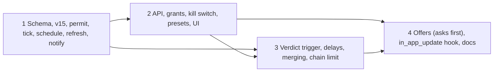

# Automations: implementation plan

Status: plan, 2026-11-27. Implements `docs/plans/2026-11-25-automations-design.md` (agreed 2026-11-26, on branch
`docs/ai-providers-design`; not yet on this branch). Project 3 of 4. Builds on the AI provider layer (project 1) and
error triage (project 2) at `origin/feat/triage-phase4` (commit `a8ee75e`). Plan only: no code changes here.

Every task is test first. Tasks are 2-5 minutes each: write the failing test, run it and see the failure named here,
write the least code that passes, run it again, commit. Phases 1-2 are in full detail; phases 3-4 are task lists to
expand into the same form when their turn comes.

## Conventions

- Run one test: `uv run pytest tests/<file>.py::<test> -q`. Run the automations suite:
  `uv run pytest tests/test_automations_*.py -q`. Run everything before each phase's last commit: `uv run pytest -q`
  (1768 tests collected today, 10 deselected; all must stay green).
- New tests are flat files `tests/test_automations_<module>.py`, not a `tests/automations/` folder: tests import
  `from conftest import ...` and `from fake_cli import FakeCli`, which work only from `tests/` itself.
- A worktree with a new migration must not touch the installed database: run `bosun` commands with
  `BOSUN_DATA_DIR=$(mktemp -d)` (`docs/developing.md`). Regenerate the data model after the migration:
  `BOSUN_DATA_DIR=$(mktemp -d) uv run bosun db --doc > docs/data-model.md` (`tests/test_data_layer.py` fails while
  stale).
- Every new column goes into `READABLE` or `HIDDEN` in `src/bosun/query.py` (`tests/test_query.py` fails until it
  is), with an inline SQL comment in `src/bosun/migrations.py` (used to generate `docs/data-model.md`).
- Every new action in `src/bosun/registry.py` must be bound in `src/bosun/server.py` (`tests/test_registry.py`).
  Every `user_only` action must be listed in `USER_ONLY` in `tests/test_agent_auth.py` and checked in
  `tests/test_assistant.py` and `tests/test_mcp_server.py`. Actions that mutate state or touch the machine belong in
  `registry.DEMO_REFUSED` (`tests/test_demo.py`).
- No action input in `src/bosun/registry.py` may declare a field whose name contains `delay`, `force`, or
  `self_update`, and no action path may contain `self-update` or `selfupdate`
  (`tests/test_selfupdate_delay.py:383-391`).
- Any background loop started in `server.create_app` must be patched off in `tests/conftest.py` (like
  `_no_notification_loop` and `_no_triage_loop`), so tests drive `tick()` synchronously and leak no threads.
- Code rules: files under 400 lines, functions under 50, `@dataclass(frozen=True)` for data, `tuple` not `list` in
  frozen fields, Pydantic `ConfigDict(extra="forbid")` on stored automation definitions, explicit errors (no bare
  `except`). Every stored string passes `redact.text` / `redact.value`. Dashboard JS uses `MC.el({ text })` only,
  never `innerHTML` (`tests/test_static_js.py`). Nothing in tests runs a real AI CLI or makes a model call; use
  `tests/fake_cli.py`.
- Commits: conventional commits with scope `automations` (`feat(automations): ...`, `test(automations): ...`,
  `docs(automations): ...`).

## What exists today (the code this builds on)

| Where | Today | How automations use it |
|---|---|---|
| `registry.py:38-45, 347-513, 584-662` | `Risk`, `SPECS`, `AGENT_TIER_SETTINGS`, `DEMO_REFUSED`, `ActionContext`, `Actions.permit()`, `Actions.run()` with audit + trace | Adds `is_automation()` and the `automation:<id>` branch in `permit()`; every action an automation takes runs through `Actions.run()` |
| `approvals.py:35-118`, `assistant_tools.py:59-108` | In-memory one-call `Approvals` (`request`, `decide(by="user")`, `consume`), `digest(action, body)` | Reused unchanged for "asks first" offers: `decide_offer` requests, decides (`by="user"`), and spends one approval inside `Actions.permit()` in the same click |
| `autopilot.py:50-180` | `WAIT_DAYS = 3`, `KEV_HOLD_HOURS = 24`, `held_until()`, `qualifies()`, `eligible()`, `hands_off()`, `is_on()` | Safety reference for every automation `upgrade` (no skipping the 3-day wait, no major jumps, no drivers/hardware, no ignored/snoozed, no `hands_off`) |
| `actions.py:88-118, 408-520` | `unattended(actor)` (true for any actor except `user`/`cli`/`system`), `brew_drift()`, `Upgrader`, `_still_autopilots()` | Already treats `automation:<id>` as unattended (`brew_drift`, `caskguard`, `storeguard`, pinned versions, no password); `_still_autopilots()` extended for `automation:*` |
| `selfupdate.py:94-101, 212-261`, `tests/test_selfupdate_delay.py:383-391` | `DELAY_HOURS = 24.0`, `update(force=False)`, invariant test banning `delay`/`force`/`self_update` on any action input | Never touched by automations; keeps `SaveAutomationIn` from naming a field `delay_s` (see conflict 3) |
| `refresh.py:323-420, 428-497` | `refresh(..., auto_upgrade=True)` writes `runs(kind='refresh', subject='everything')`; `recheck` / `recheck_project` use separate kinds | Source of full-refresh events (`kind='refresh' AND subject='everything' AND status IN ('ok', 'partial')`); automation refreshes always pass `auto_upgrade=False` |
| `server.py:113-138, 407-435, 613-623, 682-692, 749-775, 889-964, 1083-1086` | Startup recovery, background threads, `_selfupdate_busy()`, action handlers (`upgrade`, `pin_mcp`, `start_fix`, `explain_item`, `refresh`, `relaunch_app`, `open_app`, `triage`) | Starts `Automator` thread (not in demo mode), runs startup recovery, adds automation `upgrade` guards, forwards actor/parent on `relaunch`/`pin`, mounts automation actions |
| `notify.py:110-144, 147-287` | `compose()`, `Notifier.tick()` cursor pattern, quiet-while-watching (`45 s`), `GAP_S = 600 s`, silent when off | Delivers automation `notify` digest lines and offer lines merged with other notifications |
| `store.py:111-182, 263-423, 448-530` | Snapshots, `jobs`, `fixes`, `runs`, `trace()`, `_prune_records()` (`RECORD_DAYS = 365`), `record_action()` | Reads snapshots, jobs, fixes, and runs; prunes terminal `automation_firings` at 365 days |
| `migrations.py:328-363, 404-411, 639-705` | `v_failures`, `v_actions`, `v_triage`; latest migration is **v14** (`triage_last_error`) | **v15 `automations`** adds `automations`, `automation_firings`, indexes, `v_automations`, and `v_automation_firings` |
| `query.py:35-76`, `datamodel.py:15-177` | `VIEWS`, `READABLE`, `HIDDEN`, read-only SQL authorizer, `docs/data-model.md` generator | Exposes `automations`, `automation_firings`, `v_automations`, and `v_automation_firings` to `query` |
| `trace.py:189-218`, `redact.py:104-157` | `trace.run(..., parent=...)`, `redact.text()` / `redact.value()` | Links automation action runs to child jobs/fixes/runs (used for chain depth); redacts all stored reasons/digests |
| `triage/auto.py:64-171, 360-394`, `triage/worker.py:227-341`, `triage/store.py:166-225` | 30 s tick (`Triager.tick()`), cursor in `settings`, `tstore.superseded()`, `triage` rows (`rules`/`cache`/`model`) | Pattern for `Automator`'s single-writer 30 s tick; verdict rows are the source for the phase-3 `verdict` trigger |
| `providers/catalog.py:42-49`, `providers/router.py:207-233, 330-345`, `providers/routing.py:194-236`, `providers/quota.py:87, 151-165`, `providers/run.py:188-215` | `JOBS`, `router.plan()`, 75% line (`LINE = 0.75`), `quota.call_cap()`, `background_calls()`, `run()` | Routes automation AI jobs as background work past no 75% line and within `call_cap` (see conflict 2) |
| `fixer.py:341-437`, `enrich/explain.py:94-126` | `Fixer._choose_login()`, `Fixer.start()`, `Explainer.explain()` | Called by `start_fix` and `explain_item`; currently hardcode `clicked=True` (see conflict 2 and conflict 8) |
| `mcp_server.py:59-88, 114-141`, `cli.py:880-976` | `GUIDANCE`, `tool_specs()`, `USER_ONLY_WORDS`, CLI subcommands | Exposes read-only `list_automations` / `list_automation_firings` to agents and assistant; adds `bosun automations pause|resume` |
| `demo.py:205-223` | `seed()` populates fake items, AI usage, and rules-only triage | Seeds shipped-off presets so demo mode shows the Automations page with disabled switches |
| `static/index.html`, `ui.js:264-279`, `nav.js:36-75`, `app.js:33-56`, `runs.js:48-70`, `today.js:133-170` | Hash router, developer-only sidebar links, Runs actor column, Today `Needs you` panel, DOM-only `el()` | Adds `#/automations` page, dropdown editor, kill switch, renewal control, Runs `"Automation: <name>"` label, and Today offer cards |

## Module map (new files under `src/bosun/automations/`)

| File | Contents | Phase |
|---|---|---|
| `__init__.py` | Package docstring: owner-written trigger → conditions → one action; always through `Actions.permit` | 1 |
| `schema.py` | Pydantic models (`extra="forbid"`) for triggers, conditions, scopes, `AutomationDef`, `ALLOWLIST`, `MODEL_ACTIONS`, `GRANT_TTL_S` (90 d), `grant_digest()`, `grant_expired()`, `describe_scope()` | 1 |
| `store.py` | SQLite CRUD for `automations` and `automation_firings`, kill switch (`automations_paused`), cursors, `recover_running()`, cancel-waiting-on-edit, daily/global/model/in-flight/consecutive-failure/same-work-1h queries | 1, 3, 4 |
| `schedule.py` | Pure local-time schedule slots (`due_slots()`): daily and chosen weekdays at `HH:MM`, DST-safe once per local date, `< 2 h` catch-up vs `missed` | 1 |
| `digest.py` | Pure code-built "What changed" digest (`build_digest()`): diffs two latest snapshots and intervening jobs (new Do now, newly exploited, updated, failed with ready triage cause); no model calls | 1 |
| `match.py` | Pure condition evaluation (`matches_refresh`, `matches_schedule`, `matches_verdict`, `matches_in_app_update`), scope resolution (`resolve_input`), `input_in_scope()`, and Autopilot guard checks | 1, 3, 4 |
| `presets.py` | The four shipped presets (all off): `what_changed`, `nightly_fix`, `retry_when_busy`, `offer_in_app_updates`, idempotent seeding | 2, 3, 4 |
| `engine.py` | `Automator`: single-writer 30 s tick (`tick()`, `run()`, `busy()`), bounded work, dedup, rate limits, cooldown, global cap (30/day, 1 INSTALL in flight), circuit breaker (3 failures in a row), `waiting_quota` + deadlines, delays, 1-minute merging (≤ 20 items), chain depth limit, offers + 24 h expiry | 1-4 |

## Conflicts with the design (flagged, not redesigned)

1. **`triage` is `user_only=True` in `registry.py:367-368`, while the design both puts `triage` on the allow-list and forbids every `user_only` action.**
   The design lists `triage` in the Actions table (`automations-design.md:75`, `Runs on its own: yes`) and says "Never
   available: every `user_only` action" and "`permit` checks: the action is on the allow-list and not `user_only`"
   (lines 82, 118). In `src/bosun/registry.py:367-368`, `triage` is `user_only=True` (tested in
   `tests/test_agent_auth.py:33, 164` and `tests/test_assistant.py:123`), and `server.py:1084-1085` always invokes
   `triager.triage_click(...)` with `clicked=True`. Plan: keep `triage` `user_only=True` and out of
   `AUTOMATION_ALLOWLIST` until decided, since `Triager.tick()` already runs automatic background triage every 30 s
   (open question 1).
2. **The provider router enforces the 75% line and `call_cap` only when `catalog.JOBS[job].background` is `True`; `fix` and `explain` have `background=False` and hardcode `clicked=True`.**
   The design says automations change neither project 1 nor project 2 (`automations-design.md:8-9`), yet requires
   "`start_fix`, `explain_item` and `triage` started by an automation route as background whatever job they are, so a
   login at or past the 75% line is skipped" (lines 126-128). In `src/bosun/providers/catalog.py:44, 46`, `explain`
   and `fix` have `background=False`; `providers/router.py:225` checks `if job.background and not clicked:`;
   `fixer.py:343` and `enrich/explain.py:118` pass `clicked=True`; and `providers/routing.py:226` counts only jobs
   where `j.background` is `True`. Plan: add a backward-compatible `force_background: bool = False` flag to
   `router.plan()` and `providers/run.py:run()`, wire `background=is_automation(ctx.actor)` in `server.py` ->
   `Fixer` / `Explainer`, and include `automation:*` runs in `routing.background_calls()` (open question 2).
3. **`SaveAutomationIn` cannot name a field `delay_s` because `tests/test_selfupdate_delay.py:383-391` forbids `"delay"`, `"force"`, and `"self_update"` on every action input.**
   The design names the column `delay_s` (`automations-design.md:185`). `tests/test_selfupdate_delay.py:388-390`
   asserts `"delay" not in " ".join(spec.input.model_fields)` for every `spec` in `registry.SPECS`. Plan: keep the
   SQLite column name `delay_s` as designed, and name the `SaveAutomationIn` field `wait_s` (mapped to `delay_s` in
   storage), leaving `tests/test_selfupdate_delay.py` untouched (open question 3).
4. **`v_actions` does not include `approved_by` or `approval_id`.**
   The design states "`v_actions` records actor `automation:<id>`, and `approved_by` names you for an offer you
   approved" (`automations-design.md:172`). `v_actions` was created in migration v4 (`migrations.py:359-362`) before
   v5 added `approved_by` and `approval_id` to `audit` (`migrations.py:408-410`), and additive-only migrations do not
   recreate views. Plan: keep `v_actions` unchanged; `approved_by` / `approval_id` are written to `audit` (readable in
   `query.READABLE["audit"]`) and `decided_by` is exposed in `v_automation_firings` (open question 4).
5. **`server.py:upgrade` does not check `autopilot.qualifies` or `autopilot.hands_off` for non-user actors, and `Upgrader._still_autopilots` checks only `actor == AUTOPILOT`.**
   The design requires every Autopilot guard (3-day wait / 24 h KEV, `hands_off`, `caskguard`, `storeguard`,
   `autopilot.qualifies`) to apply to automation upgrades (`automations-design.md:93-96`). Today `server.py:898-911`
   checks only `goback.left_alone` and `autopilot.held_until` for non-user actors, and `actions.py:477` restricts
   `autopilot.eligible` re-checking on parked waiting jobs to `actor == AUTOPILOT`. Plan: add an `is_automation()`
   branch in `server.py:upgrade` and `actions._still_autopilots()` enforcing `autopilot.qualifies`, `hands_off`,
   `held_until`, and `goback.left_alone`, returning skip reasons so the firing records `skipped`, not `failed`.
6. **The 90-day INSTALL grant expiry from review has no column in the Storage table.**
   The Storage table (`automations-design.md:186`) has `grant_digest`, `granted_by`, `granted_at`, while the
   2026-11-26 review decisions (line 255) expire "runs on its own" `INSTALL` grants after 90 days (LOCAL grants never
   expire) with one-click renewal. Plan: compute expiry deterministically as `granted_at + 90 * 86400` whenever
   `mode == "run"` and `SPECS[action].risk == Risk.INSTALL` (tamper-resistant), and expose `grant_expires_at` in
   `v_automations` and API responses (open question 5).
7. **`runs` has no `snapshot_id` or `depth` column, and `_run_relaunch` / `_run_pins` do not forward `actor` or `parent_trace`.**
   `refresh` trigger uses the snapshot id (`automations-design.md:41`), and chain depth tracks runs started by an
   automation (line 142). `runs` (`migrations.py:97-111`) stores neither `snapshot_id` nor `depth`. Plan: match a
   full refresh (`kind='refresh' AND subject='everything' AND status IN ('ok', 'partial')`) to the `snapshot_log` row
   written during `[started, finished]`; resolve chain depth by walking `runs.parent_trace` (≤ 3 hops) into
   `automation_firings.trace_id`; and forward `actor` and `parent` in `server.py:409` (`_run_relaunch`) and
   `server.py:924` (`_run_pins`).
8. **`explain_item` explains only `body.keys[0]`, while its automation scope is "a project and lane".**
   In `src/bosun/server.py:682-688`, `explain_item` accepts `FixIn` (`keys: list[str]`) and calls
   `explainer.explain()` only on `body.keys[0]`. Plan: an `explain_item` automation resolves uncached items in its
   project and lane and calls `explain_item` with one key per call up to `model_jobs_per_day` (default 3), with
   `permit` verifying `len(body.keys) == 1` and the key belongs to that project and lane (open question 6).
9. **Project 4 (`in_app_update` state and action) does not exist yet on `origin/feat/triage-phase4`.**
   Build order step 4 pairs offers with `in_app_update` and project 4's SYSTEM action (`automations-design.md:43, 80,
   162, 248`). Plan: build and test the complete offers pipeline in phase 4 using existing SYSTEM actions
   (`relaunch_app`, `open_app`) and `mode="ask"` automations, and ship the `in_app_update` trigger schema, reader
   hook, and disabled preset stub ready for project 4 (open question 7).
10. **`Notifier` (`notify.py:110-144, 222-270`) has no queue or `compose()` slot for automation digest or offer lines.**
    Plan: add an optional `automations: Sequence[str] = ()` parameter to `notify.compose()` and drain undelivered
    automation notice lines in `Notifier.tick()`, keeping all existing callers and tests unchanged.
11. **Latest migration is v14 (`triage_last_error`), not v12; design doc lives on branch `docs/ai-providers-design`.**
    `migrations.py:690-705` has v12 `triage`, v13 `triage_rule_disputes`, and v14 `triage_last_error`. Automations
    takes **v15**.

## Migration numbers

| Version | Name | Phase | What |
|---|---|---|---|
| 15 | `automations` | 1 | tables `automations` and `automation_firings`, unique index `(automation_id, dedup_key)`, status/due/trace indexes, and views `v_automations` and `v_automation_firings` |

Latest existing migration on `origin/feat/triage-phase4` is **v14** (`triage_last_error`). If another branch lands a
migration first, renumber before merging; `tests/test_migrations.py` checks the sequence.

## Phase dependencies



---

## Phase 1: tables, views, Pydantic models, `permit` branch, engine tick (`schedule`, `refresh`, `notify`)

Depends on: provider layer + error triage (`origin/feat/triage-phase4`). Migration: **v15 `automations`**. Must keep
passing: `tests/test_migrations.py`, `tests/test_query.py`, `tests/test_data_layer.py`, `tests/test_registry.py`,
`tests/test_agent_auth.py`, `tests/test_selfupdate_delay.py`, `tests/test_notify.py`, `tests/test_waiting.py`. Risks:
R1 (permit bypass), R2 (75% line bypassed on `fix`/`explain`), R3 (double run after crash or DST change), R4
(Autopilot waiting period skipped).

### Task 1.1: package, Pydantic definitions, allow-list, grant digest, and 90-day expiry

- Files: create `src/bosun/automations/__init__.py`, `src/bosun/automations/schema.py`,
  `tests/test_automations_schema.py`.
- Test first: `test_definition_rejects_disallowed_actions_system_run_mode_and_checks_90_day_expiry`.

```python
import pytest
from pydantic import ValidationError

from bosun.automations.schema import (
    ALLOWLIST, GRANT_TTL_S, AutomationDef, RefreshConditions, RefreshScope, RefreshTrigger,
    ScheduleConditions, ScheduleTrigger, StartFixScope, grant_digest, grant_expired,
)


def test_definition_rejects_disallowed_actions_system_run_mode_and_checks_90_day_expiry():
    defn = AutomationDef(
        name="Nightly Branch + test",
        trigger=ScheduleTrigger(kind="schedule", time="02:00", days=()),
        conditions=ScheduleConditions(project="https://github.com/me/app", lane="now"),
        action="start_fix",
        scope=StartFixScope(project="https://github.com/me/app", lane="now"),
        mode="run",
    )
    d1 = grant_digest(defn)
    assert len(d1) == 64
    assert grant_digest(defn.model_copy(update={"scope": StartFixScope(project="https://github.com/me/app", lane="batch")})) != d1
    assert not grant_expired("start_fix", "run", granted_at=1000.0, now=1000.0 + GRANT_TTL_S - 1)
    assert grant_expired("start_fix", "run", granted_at=1000.0, now=1000.0 + GRANT_TTL_S)
    assert not grant_expired("start_fix", "ask", granted_at=1000.0, now=1000.0 + GRANT_TTL_S * 2)
    assert not grant_expired("refresh", "run", granted_at=1000.0, now=1000.0 + GRANT_TTL_S * 2)  # LOCAL never expires

    assert "set_autopilot" not in ALLOWLIST and "open_pr" not in ALLOWLIST and "triage" not in ALLOWLIST
    # SYSTEM actions must always ask first; never mode="run"
    with pytest.raises(ValidationError):
        AutomationDef(
            name="Bad relaunch",
            trigger=RefreshTrigger(kind="refresh"),
            conditions=RefreshConditions(),
            action="relaunch_app",
            scope={"app": "chrome"},
            mode="run",
        )
    # Extra fields forbidden
    with pytest.raises(ValidationError):
        RefreshScope(only=None, unknown_field=True)  # type: ignore[call-arg]
```

- Run: `uv run pytest tests/test_automations_schema.py -q` → `ModuleNotFoundError: No module named 'bosun.automations'`.
- Implement: `src/bosun/automations/__init__.py` and `src/bosun/automations/schema.py` with `ConfigDict(extra="forbid")`
  models for all four triggers (`RefreshTrigger`, `ScheduleTrigger` with `HH:MM` + optional weekdays `mon..sun`,
  `VerdictTrigger`, `InAppUpdateTrigger`), per-trigger condition models, per-action scope models (`NotifyScope`,
  `RefreshScope`, `RecheckProjectScope`, `ExplainItemScope`, `UpgradeScope`, `StartFixScope`, `PinMcpScope`,
  `AppActionScope`), `AutomationDef` validating trigger/condition pairing, `ALLOWLIST = frozenset({"notify", "refresh",
  "recheck_project", "explain_item", "upgrade", "start_fix", "pin_mcp", "relaunch_app", "open_app"})`,
  `SYSTEM_ACTIONS = frozenset({"relaunch_app", "open_app"})` (always `mode == "ask"`), `MODEL_ACTIONS =
  frozenset({"start_fix", "explain_item"})`, `GRANT_TTL_S = 90 * 86400`, canonical SHA-256 `grant_digest(defn)`,
  `grant_expired(action, mode, granted_at, now)` (expires `Risk.INSTALL` + `mode == "run"` at 90 d; `LOCAL`/`notify`/
  `ask` never expire), and `describe_scope(defn)` returning one plain sentence for the grant checkbox.
- Pass: `uv run pytest tests/test_automations_schema.py -q` → `1 passed`.
- Commit: `feat(automations): Pydantic models, allow-list, grant digest and 90-day expiry`

### Task 1.2: migration v15 `automations`, views, query allow-list, and pruning

- Files: modify `src/bosun/migrations.py`, `src/bosun/query.py`, `src/bosun/datamodel.py`, `src/bosun/registry.py`
  (`QueryIn` description), `src/bosun/store.py` (`_prune_records`), `docs/data-model.md` (regenerated),
  `tests/test_migrations.py`.
- Test first: `test_v15_adds_automations_tables_views_and_prunes_old_firings`.

```python
import sqlite3

from bosun import migrations, query
from bosun.migrations import migrate
from bosun.store import Store


def test_v15_adds_automations_tables_views_and_prunes_old_firings(tmp_path):
    path = tmp_path / "bosun.db"
    migrate(sqlite3.connect(path), path, migrations.MIGRATIONS[:14])  # a v14 database
    store = Store(path)
    assert migrations.current_version(store._db) == 15
    with store._tx(write=True) as db:
        db.execute(
            "INSERT INTO automations (name, preset, enabled, trigger, conditions, action, scope, mode, "
            "grant_digest, granted_by, granted_at, created, updated) VALUES (?,?,?,?,?,?,?,?,?,?,?,?,?)",
            ("What changed", "what_changed", 1, '{"kind":"refresh"}', "{}", "notify", '{"digest":"what_changed"}',
             "run", "abc", "user", 1000.0, 1000.0, 1000.0),
        )
        aid = db.execute("SELECT last_insert_rowid()").fetchone()[0]
        db.execute(
            "INSERT INTO automation_firings (automation_id, automation_name, event_kind, event_ref, dedup_key, "
            "depth, status, due, created, finished) VALUES (?,?,?,?,?,?,?,?,?,?)",
            (aid, "What changed", "refresh", "snap:1", "refresh:snap:1", 0, "done", 1000.0, 1000.0, 1001.0),
        )
    got_a = query.run(store.path, "SELECT name, action, mode, enabled FROM v_automations")
    got_f = query.run(store.path, "SELECT automation_name, event_kind, status FROM v_automation_firings")
    assert got_a["rows"] == [["What changed", "notify", "run", 1]]
    assert got_f["rows"] == [["What changed", "refresh", "done"]]
    pruned = store._prune_records(now=1001.0 + 400 * 86400)
    assert pruned["automation_firings"] == 1
```

- Run: `uv run pytest tests/test_migrations.py -k v15 -q` → `AssertionError: assert 14 == 15`.
- Implement: add `Migration(15, "automations", sql=AUTOMATIONS)` with:
  - `automations`: `id INTEGER PRIMARY KEY AUTOINCREMENT`, `name TEXT NOT NULL`, `preset TEXT`, `enabled INTEGER NOT
    NULL DEFAULT 0`, `paused_reason TEXT NOT NULL DEFAULT ''`, `trigger TEXT NOT NULL`, `conditions TEXT NOT NULL`,
    `action TEXT NOT NULL`, `scope TEXT NOT NULL`, `mode TEXT NOT NULL`, `delay_s INTEGER NOT NULL DEFAULT 0`,
    `max_per_day INTEGER NOT NULL DEFAULT 6`, `cooldown_s INTEGER NOT NULL DEFAULT 900`,
    `model_jobs_per_day INTEGER NOT NULL DEFAULT 3`, `grant_digest TEXT NOT NULL DEFAULT ''`,
    `granted_by TEXT NOT NULL DEFAULT ''`, `granted_at REAL`, `created REAL NOT NULL`, `updated REAL NOT NULL`
    (inline SQL comment on every column);
  - `automation_firings`: `id INTEGER PRIMARY KEY AUTOINCREMENT`, `automation_id INTEGER NOT NULL`,
    `automation_name TEXT NOT NULL`, `event_kind TEXT NOT NULL`, `event_ref TEXT NOT NULL`,
    `dedup_key TEXT NOT NULL`, `depth INTEGER NOT NULL DEFAULT 0`, `status TEXT NOT NULL`, `due REAL`,
    `deadline REAL`, `input TEXT NOT NULL DEFAULT '{}'`, `trace_id TEXT NOT NULL DEFAULT ''`,
    `reason TEXT NOT NULL DEFAULT ''`, `decided_by TEXT NOT NULL DEFAULT ''`, `decided REAL`,
    `created REAL NOT NULL`, `finished REAL`;
  - unique index `automation_firings_dedup ON automation_firings (automation_id, dedup_key)` plus indexes on
    `(status, due)`, `(automation_id, created DESC)`, and `(trace_id)`;
  - views `v_automations` (including computed `grant_expires_at` for `INSTALL` + `mode='run'` grants) and
    `v_automation_firings`;
  - add both tables to `query.READABLE`, both views to `query.VIEWS`, docs to `datamodel.VIEWS` and `datamodel.TABLES`,
    prune terminal `automation_firings` (`status NOT IN ('scheduled', 'waiting_quota', 'offered', 'running')`) past
    `RECORD_DAYS` in `Store._prune_records()`, and regenerate `docs/data-model.md` with
    `BOSUN_DATA_DIR=$(mktemp -d) uv run bosun db --doc > docs/data-model.md`.
- Pass: `uv run pytest tests/test_migrations.py tests/test_query.py tests/test_data_layer.py -q` → all green.
- Commit: `feat(automations): migration v15 tables, views and pruning`

### Task 1.3: SQLite persistence, crash recovery, kill switch, and caps queries

- Files: create `src/bosun/automations/store.py`, `tests/test_automations_store.py`.
- Test first: `test_dedup_cancel_on_edit_crash_recovery_and_kill_switch`.

```python
from bosun import trace
from bosun.automations import store as astore
from bosun.automations.schema import (
    AutomationDef, NotifyScope, RefreshConditions, RefreshTrigger, grant_digest,
)
from bosun.store import Store


def _defn(name: str = "What changed") -> AutomationDef:
    return AutomationDef(
        name=name, trigger=RefreshTrigger(kind="refresh"), conditions=RefreshConditions(),
        action="notify", scope=NotifyScope(digest="what_changed"), mode="run",
    )


def test_dedup_cancel_on_edit_crash_recovery_and_kill_switch(tmp_path):
    st = Store(tmp_path / "bosun.db")
    trace.configure(st.path, "serve")
    try:
        defn = _defn()
        aid = astore.save(st, defn, enabled=True, grant_digest=grant_digest(defn), granted_by="user", now=100.0)
        # Unique (automation_id, dedup_key) stops duplicate firings
        f1 = astore.insert_firing(st, aid, defn.name, "refresh", "snap:1", "refresh:snap:1",
                                  status="scheduled", due=100.0, now=100.0)
        assert f1 is not None
        assert astore.insert_firing(st, aid, defn.name, "refresh", "snap:1", "refresh:snap:1",
                                    status="scheduled", due=100.0, now=101.0) is None
        # Crash recovery: running without a trace returns to scheduled; running with a finished trace links to it
        astore.set_firing(st, f1, status="running", now=102.0)
        with trace.run("action", subject="upgrade", actor=f"automation:{aid}") as r:
            pass
        f2 = astore.insert_firing(st, aid, defn.name, "refresh", "snap:2", "refresh:snap:2",
                                  status="running", due=100.0, trace_id=r.trace_id, now=103.0)
        assert astore.recover_running(st, now=105.0) == 2
        assert astore.get_firing(st, f1)["status"] == "scheduled"
        assert astore.get_firing(st, f2)["status"] == "done"
        # Edit cancels waiting firings/offers but preserves history
        astore.save(st, _defn("Renamed"), automation_id=aid, enabled=True,
                    grant_digest=grant_digest(_defn("Renamed")), granted_by="user", now=110.0)
        assert astore.get_firing(st, f1)["status"] == "skipped"
        assert astore.get_firing(st, f2)["status"] == "done"
        # Kill switch
        assert not astore.is_paused(st)
        astore.set_paused(st, True)
        assert astore.is_paused(st)
    finally:
        trace.configure(None)
```

- Run: `uv run pytest tests/test_automations_store.py -q` → `ModuleNotFoundError: No module named 'bosun.automations.store'`.
- Implement: `save()`, `get()`, `get_by_preset()`, `list_all()`, `delete()` (cancels waiting/offered firings, preserves
  history), `set_enabled()`, `set_paused_reason()`, `renew_grant()`, `insert_firing()` (catches `IntegrityError` on
  `(automation_id, dedup_key)` and returns `None`), `get_firing()`, `list_firings()`, `set_firing()` (redacting
  `reason` and `input`), `recover_running()`, `is_paused()` / `set_paused()` (setting `automations_paused`),
  `cursor()` / `set_cursor()`, `fired_today()`, `global_fired_today()`, `model_jobs_today()`, `last_fired_at()`,
  `active_install_firing()`, `consecutive_failures()`, and `same_work_recent()` (checks same action + canonical input
  within 3600 s).
- Pass: `uv run pytest tests/test_automations_store.py -q` → `1 passed`.
- Commit: `feat(automations): SQLite store, dedup, crash recovery and kill switch`

### Task 1.4: pure local-time schedule slots across DST and missed-slot catch-up

- Files: create `src/bosun/automations/schedule.py`, `tests/test_automations_schedule.py`.
- Test first: `test_schedule_handles_catchup_missed_weekdays_and_dst_transitions`.

```python
from datetime import datetime
from zoneinfo import ZoneInfo

from bosun.automations.schedule import MISSED_WINDOW_S, due_slots
from bosun.automations.schema import ScheduleTrigger

CHI = ZoneInfo("America/Chicago")


def _ts(y, m, d, h, mi, fold=0):
    return datetime(y, m, d, h, mi, tzinfo=CHI, fold=fold).timestamp()


def test_schedule_handles_catchup_missed_weekdays_and_dst_transitions():
    daily = ScheduleTrigger(kind="schedule", time="02:00", days=())
    # 90 minutes late (< 2 h): fires once
    slots = due_slots(daily, now=_ts(2026, 11, 27, 3, 30), tz=CHI)
    assert [(s.slot_key, s.missed) for s in slots] == [("2026-11-27T02:00", False)]
    # 3 hours late (>= 2 h): recorded as missed
    slots = due_slots(daily, now=_ts(2026, 11, 27, 5, 1), tz=CHI)
    assert [(s.slot_key, s.missed) for s in slots] == [("2026-11-27T02:00", True)]
    assert MISSED_WINDOW_S == 7200
    # Weekday filter: 2026-11-27 is Friday
    mon_only = ScheduleTrigger(kind="schedule", time="02:00", days=("mon",))
    assert due_slots(mon_only, now=_ts(2026, 11, 27, 2, 10), tz=CHI) == ()
    # DST spring-forward (2026-03-08 02:00 jumps to 03:00 in America/Chicago): fires once at 03:05
    spring = ScheduleTrigger(kind="schedule", time="02:30", days=())
    got_spring = due_slots(spring, now=_ts(2026, 3, 8, 3, 5), tz=CHI)
    assert [(s.slot_key, s.missed) for s in got_spring] == [("2026-03-08T02:30", False)]
    # DST fall-back (2026-11-01 01:30 occurs twice): same local date slot key, never doubled
    fall = ScheduleTrigger(kind="schedule", time="01:30", days=())
    first = due_slots(fall, now=_ts(2026, 11, 1, 1, 35, fold=0), tz=CHI)
    second = due_slots(fall, now=_ts(2026, 11, 1, 1, 35, fold=1), tz=CHI)
    assert first[0].slot_key == second[0].slot_key == "2026-11-01T01:30"
```

- Run: `uv run pytest tests/test_automations_schedule.py -q` → `ModuleNotFoundError: No module named 'bosun.automations.schedule'`.
- Implement: `@dataclass(frozen=True) class ScheduleSlot(slot_key: str, scheduled_ts: float, missed: bool)` and
  `due_slots(trigger, *, now, tz=None)` computing today's local-date slot (resolving non-existent spring-forward times
  to the transition instant and ambiguous fall-back times to the first occurrence, always keyed as
  `YYYY-MM-DDTHH:MM` so unique `(automation_id, dedup_key)` fires at most once per local date), marking `missed=True`
  when `now - scheduled_ts >= MISSED_WINDOW_S` (7200 s). Also `next_due(trigger, *, now, tz=None)` for the UI.
- Pass: `uv run pytest tests/test_automations_schedule.py -q` → `1 passed`.
- Commit: `feat(automations): DST-safe local schedule slot computation`

### Task 1.5: condition matching and scope resolution for `refresh` and `schedule`

- Files: create `src/bosun/automations/match.py`, `tests/test_automations_match.py`.
- Test first: `test_refresh_and_schedule_matching_and_scope_validation`.

```python
from bosun.automations.match import input_in_scope, matches_refresh, matches_schedule, resolve_input
from bosun.automations.schema import (
    AutomationDef, RefreshConditions, RefreshScope, RefreshTrigger,
    ScheduleConditions, ScheduleTrigger, StartFixScope,
)
from bosun.models import Item, Source, Vuln
from bosun.registry import FixIn, RefreshIn
from bosun.serialize import item_to_dict
from bosun.store import Store


def test_refresh_and_schedule_matching_and_scope_validation(tmp_path):
    st = Store(tmp_path / "bosun.db")
    old = Item(Source.REPO, "a", "a", "1.0", "1.1", ecosystem="npm", project="p1", project_name="App", lane="batch")
    new_now = Item(Source.REPO, "b", "b", "1.0", "1.2", ecosystem="npm", project="p1", project_name="App",
                   lane="now", vulns_fixed=(Vuln("CVE-2026-1", "rce", 9.8, kev=True),))
    s1 = st.save_snapshot([item_to_dict(old)], [])
    s2 = st.save_snapshot([item_to_dict(old), item_to_dict(new_now)], [])

    assert matches_refresh(st, RefreshConditions(new_in_lanes=("now",)), snapshot_id=s2, prev_snapshot_id=s1)
    assert matches_refresh(st, RefreshConditions(newly_exploited=True), snapshot_id=s2, prev_snapshot_id=s1)
    assert not matches_refresh(st, RefreshConditions(new_in_lanes=("plan",)), snapshot_id=s2, prev_snapshot_id=s1)

    defn = AutomationDef(
        name="Nightly fix", trigger=ScheduleTrigger(kind="schedule", time="02:00", days=()),
        conditions=ScheduleConditions(project="p1", lane="now"),
        action="start_fix", scope=StartFixScope(project="p1", lane="now"), mode="run",
    )
    assert matches_schedule(st, defn.conditions, defn.action)
    resolved = resolve_input(st, defn, event={})
    assert resolved == {"keys": [new_now.key]}
    assert input_in_scope(st, defn, FixIn(keys=[new_now.key]))
    assert not input_in_scope(st, defn, FixIn(keys=[old.key]))  # wrong lane

    ref_defn = AutomationDef(
        name="Scan brew", trigger=ScheduleTrigger(kind="schedule", time="02:00", days=()),
        conditions=ScheduleConditions(), action="refresh", scope=RefreshScope(only=("brew",)), mode="run",
    )
    assert input_in_scope(st, ref_defn, RefreshIn(only=["brew"], auto_upgrade=False))
    assert not input_in_scope(st, ref_defn, RefreshIn(only=["brew"], auto_upgrade=True))  # never auto_upgrade
```

- Run: `uv run pytest tests/test_automations_match.py -q` → `ModuleNotFoundError: No module named 'bosun.automations.match'`.
- Implement: `matches_refresh()`, `matches_schedule()`, `resolve_input()`, and `input_in_scope()` (checking exact
  collector list + `auto_upgrade is False` for `refresh`, project + lane + fixability for `start_fix`, single item in
  project + lane for `explain_item`, listed keys + Autopilot guards for `upgrade`, listed pin keys for `pin_mcp`, and
  exact app for `relaunch_app` / `open_app`).
- Pass: `uv run pytest tests/test_automations_match.py -q` → `1 passed`.
- Commit: `feat(automations): condition matching and scope resolution`

### Task 1.6: code-built "What changed" digest and `Notifier` integration

- Files: create `src/bosun/automations/digest.py`, `tests/test_automations_digest.py`; modify `src/bosun/notify.py`,
  `tests/test_notify.py`.
- Test first: `test_digest_summarizes_changes_without_model_and_merges_into_notifier`.

```python
from bosun import notify
from bosun.automations.digest import build_digest
from bosun.models import Item, Source, Vuln
from bosun.notify import Notifier
from bosun.serialize import item_to_dict
from bosun.store import Store


def test_digest_summarizes_changes_without_model_and_merges_into_notifier(tmp_path):
    st = Store(tmp_path / "bosun.db")
    old = Item(Source.BREW, "jq", "jq", "1.7", "1.7.1", lane="batch")
    fresh = Item(Source.BREW, "curl", "curl", "8.9", "8.11", lane="now",
                 vulns_fixed=(Vuln("CVE-2026-9", "rce", 9.8, kev=True),))
    s1 = st.save_snapshot([item_to_dict(old)], [])
    jid = st.create_job("brew:jq", ["brew", "upgrade", "jq"])
    st.finish_job(jid, "succeeded", "ok")
    s2 = st.save_snapshot([item_to_dict(fresh)], [])

    line = build_digest(st, snapshot_id=s2, prev_snapshot_id=s1)
    assert "curl" in line and "exploited" in line.lower() and "1 updated" in line.lower()

    sent, t = [], [1000.0]
    n = Notifier(st, "http://127.0.0.1:8787/", send=lambda note, url: sent.append(note) or True,
                 pending=lambda: [], clock=lambda: t[0])
    n.tick()  # baseline
    notify.enqueue_automation(st, "What changed", line)
    t[0] += 300
    note = n.tick()
    assert note is not None and "What changed" in f"{note.title} {note.body}" and "curl" in note.body
    # When notifications are off, nothing is delivered (line remains in automation_firings for the page)
    notify.set_on(st, False)
    notify.enqueue_automation(st, "What changed", "2 updated")
    t[0] += 700
    assert n.tick() is None
```

- Run: `uv run pytest tests/test_automations_digest.py -q` → `ModuleNotFoundError: No module named 'bosun.automations.digest'`.
- Implement:
  - `src/bosun/automations/digest.py`: `build_digest(store, snapshot_id, prev_snapshot_id)` compares `snapshot_items`
    between the two snapshots and jobs finished in between, reporting new Do-now items, newly exploited items, updated
    count, and failed items with any already-`done` triage cause. Pure SQL + Python, zero model calls, passes
    `redact.text`.
  - `src/bosun/notify.py`: add `AUTOMATION_QUEUE = "notify_automations"`, `enqueue_automation(store, title, line)`,
    optional `automations: Sequence[tuple[str, str]] = ()` parameter to `compose()`, and drain queued lines in
    `Notifier.tick()` under the existing quiet-while-watching, `GAP_S = 600 s`, and `is_on()` checks.
- Pass: `uv run pytest tests/test_automations_digest.py tests/test_notify.py -q` → all green.
- Commit: `feat(automations): code-built What changed digest and Notifier hook`

### Task 1.7: `Actions.permit` branch for `automation:<id>`

- Files: modify `src/bosun/registry.py`, create `tests/test_automations_permit.py`.
- Test first: `test_permit_enforces_grant_scope_expiry_pause_system_approval_and_blocks_user_only`.

```python
import pytest

from bosun import approvals as approving, registry
from bosun.automations import store as astore
from bosun.automations.schema import (
    GRANT_TTL_S, AutomationDef, RefreshConditions, RefreshTrigger,
    ScheduleConditions, ScheduleTrigger, StartFixScope, grant_digest,
)
from bosun.models import Item, Source
from bosun.registry import SPECS, ActionContext, Actions, Empty, FixIn, Forbidden, OnIn, RelaunchIn
from bosun.serialize import item_to_dict
from bosun.store import Store


def test_permit_enforces_grant_scope_expiry_pause_system_approval_and_blocks_user_only(tmp_path):
    st = Store(tmp_path / "bosun.db")
    it = Item(Source.REPO, "lodash", "lodash", "4.0", "4.17.21", ecosystem="npm", project="p1", lane="now")
    other = Item(Source.REPO, "axios", "axios", "1.0", "1.7", ecosystem="npm", project="p2", lane="now")
    st.save_snapshot([item_to_dict(it), item_to_dict(other)], [])
    book = approving.Approvals()
    actions = Actions(store=st, approvals=book)

    defn = AutomationDef(
        name="Nightly fix", trigger=ScheduleTrigger(kind="schedule", time="02:00", days=()),
        conditions=ScheduleConditions(project="p1", lane="now"),
        action="start_fix", scope=StartFixScope(project="p1", lane="now"), mode="run",
    )
    aid = astore.save(st, defn, enabled=True, grant_digest=grant_digest(defn), granted_by="user", now=1000.0)
    ctx = ActionContext(actor=f"automation:{aid}", surface="automation")

    # Allowed within scope and grant window
    assert actions.permit(SPECS["start_fix"], ctx, FixIn(keys=[it.key])) is None
    # Out-of-scope key refused
    with pytest.raises(Forbidden):
        actions.permit(SPECS["start_fix"], ctx, FixIn(keys=[other.key]))
    # Every user_only action and EXTERNAL action refused
    for name in ("set_autopilot", "set_agent_policy", "set_ai_routing", "set_quota_override",
                 "set_triage_settings", "set_pref", "open_pr"):
        with pytest.raises(Forbidden):
            actions.permit(SPECS[name], ctx, OnIn(on=True) if name == "set_autopilot" else Empty())
    # Kill switch refuses everything
    astore.set_paused(st, True)
    with pytest.raises(Forbidden):
        actions.permit(SPECS["start_fix"], ctx, FixIn(keys=[it.key]))
    astore.set_paused(st, False)
    # Tampered grant digest refused
    with st._tx(write=True) as db:
        db.execute("UPDATE automations SET grant_digest = 'stale' WHERE id = ?", (aid,))
    with pytest.raises(Forbidden):
        actions.permit(SPECS["start_fix"], ctx, FixIn(keys=[it.key]))
    # Expired 90-day INSTALL grant refused
    with st._tx(write=True) as db:
        db.execute("UPDATE automations SET grant_digest = ?, granted_at = ? WHERE id = ?",
                   (grant_digest(defn), 1.0, aid))
    with pytest.raises(Forbidden, match="expired"):
        actions.permit(SPECS["start_fix"], ctx, FixIn(keys=[it.key]))
    # SYSTEM action always requires a spent approval
    sys_defn = AutomationDef(
        name="Offer Chrome", trigger=RefreshTrigger(kind="refresh"), conditions=RefreshConditions(),
        action="relaunch_app", scope={"app": "chrome"}, mode="ask",
    )
    sid = astore.save(st, sys_defn, enabled=True, grant_digest=grant_digest(sys_defn), granted_by="user", now=1000.0)
    sctx = ActionContext(actor=f"automation:{sid}", surface="automation")
    with pytest.raises(Forbidden):
        actions.permit(SPECS["relaunch_app"], sctx, RelaunchIn(app="chrome"))
    asked = book.request("relaunch_app", RelaunchIn(app="chrome"))
    book.decide(asked.id, True, by="user")
    spent = actions.permit(SPECS["relaunch_app"], ActionContext(actor=f"automation:{sid}", surface="automation", approval=asked.id),
                           RelaunchIn(app="chrome"))
    assert spent is not None and spent.decided_by == "user"
```

- Run: `uv run pytest tests/test_automations_permit.py -q` → `Forbidden: start_fix is refused for unknown actor 'automation:1'`.
- Implement: in `src/bosun/registry.py`, add `AUTOMATION_PREFIX = "automation:"`, `is_automation(actor)`, and
  `automation_id(actor)`; in `Actions.permit()` add the `is_automation(ctx.actor)` branch checking in order:
  1. store is present, kill switch `automations_paused` is off;
  2. automation row exists, `enabled == 1`, `paused_reason == ""`, definition parses cleanly;
  3. `grant_digest` matches current definition and `not grant_expired(...)` (90 d for `INSTALL` + `mode == "run"`);
  4. `spec.name` is on `ALLOWLIST`, equals the automation's `action`, and `not spec.user_only` and
     `spec.risk < Risk.EXTERNAL`;
  5. `body is not None` and `input_in_scope(self.store, defn, body, firing_id=ctx.firing_id)`;
  6. if `spec.risk == Risk.SYSTEM` or `defn.mode == "ask"`, spend a one-call approval via `self.approvals.consume(...)`.
  Add optional `firing_id: int | None = None` on `ActionContext` so scope verification for "the failed item, same
  version" reads the firing's resolved origin cleanly.
- Pass: `uv run pytest tests/test_automations_permit.py tests/test_agent_auth.py tests/test_assistant.py -q` → green.
- Commit: `feat(automations): Actions.permit rule for automation actors`

### Task 1.8: Autopilot INSTALL guards in `server.py:upgrade` and `actions._still_autopilots`

- Files: modify `src/bosun/server.py`, `src/bosun/actions.py`, create `tests/test_automations_guards.py`.
- Test first: `test_automation_upgrade_respects_3_day_wait_major_jumps_drivers_and_hands_off`.

```python
import time

from bosun import autopilot, trace
from bosun.automations import store as astore
from bosun.automations.schema import (
    AutomationDef, RefreshConditions, RefreshTrigger, UpgradeScope, grant_digest,
)
from bosun.config import load_settings
from bosun.models import Item, Source
from bosun.registry import ActionContext
from bosun.serialize import item_to_dict
from bosun.server import create_app
from bosun.store import Store


def test_automation_upgrade_respects_3_day_wait_major_jumps_drivers_and_hands_off(tmp_path, monkeypatch):
    monkeypatch.setattr(autopilot, "WAIT_DAYS", 3)
    st = Store(tmp_path / "bosun.db")
    now = time.time()
    fresh = Item(Source.BREW, "jq", "jq", "1.7.0", "1.7.1", lane="batch")
    major = Item(Source.BREW, "node", "node", "20.0.0", "22.0.0", lane="batch")
    driver = Item(Source.WINGET, "Nvidia.Driver", "NVIDIA Driver", "1.0", "1.1", lane="batch", kind="driver")
    ok_item = Item(Source.BREW, "ripgrep", "ripgrep", "14.0.0", "14.1.0", lane="batch")
    st.save_snapshot([item_to_dict(x) for x in (fresh, major, driver, ok_item)], [])
    # Age only major, driver, and ok_item past the 3-day wait; leave fresh inside the wait
    with st._tx(write=True) as db:
        for it in (major, driver, ok_item):
            db.execute("UPDATE offers SET first_seen = ? WHERE item_key = ?", (now - 5 * 86400, it.key))
    st.save_snapshot([item_to_dict(x) for x in (fresh, major, driver, ok_item)], [])

    queued = []
    monkeypatch.setattr("bosun.actions.Upgrader.start",
                        lambda self, item, allow_password=False, actor=None: queued.append((item.key, allow_password, actor)) or 1)
    app = create_app(load_settings(), st, "t" * 32)
    keys = (fresh.key, major.key, driver.key, ok_item.key)
    defn = AutomationDef(
        name="Upgrade list", trigger=RefreshTrigger(kind="refresh"), conditions=RefreshConditions(),
        action="upgrade", scope=UpgradeScope(mode="keys", keys=keys), mode="run",
    )
    aid = astore.save(st, defn, enabled=True, grant_digest=grant_digest(defn), granted_by="user", now=now)
    res = app.state.actions.call("upgrade", {"keys": list(keys)}, ActionContext(actor=f"automation:{aid}", surface="automation"))
    assert queued == [(ok_item.key, False, f"automation:{aid}")]
    skipped_keys = {s["key"] for s in res["skipped"]}
    assert skipped_keys == {fresh.key, major.key, driver.key}
```

- Run: `uv run pytest tests/test_automations_guards.py -q` → `AssertionError` (`major` and `driver` were queued).
- Implement:
  - In `src/bosun/server.py:upgrade()`, when `registry.is_automation(ctx.actor)`, also check
    `autopilot.qualifies(known[k], prefs, skip)` (with `skip = autopilot.hands_off(store, list(known.values()))`) and
    skip non-qualifying items with a plain reason (major jump, driver/hardware, `hands_off`, ignored/snoozed, waiting
    period).
  - In `src/bosun/actions.py:_still_autopilots()`, apply the same `autopilot.eligible` + automation enabled/unpaused
    re-check for `registry.is_automation(job.get("actor") or "")`.
  - In `src/bosun/server.py:_run_relaunch` (line 409) and `_run_pins` (line 924), forward `actor=job.get("actor") or
    None` and `parent=job.get("parent_trace", "")` into `trace.run(...)`.
- Pass: `uv run pytest tests/test_automations_guards.py tests/test_waiting.py tests/test_autopilot.py -q` → all green.
- Commit: `feat(automations): enforce Autopilot guards and actor lineage on automation installs`

### Task 1.9: background routing for automation AI jobs (75% line and `quota.call_cap`)

- Files: modify `src/bosun/providers/router.py`, `src/bosun/providers/routing.py`, `src/bosun/providers/run.py`,
  `src/bosun/fixer.py`, `src/bosun/enrich/explain.py`, `src/bosun/server.py`; create `tests/test_automations_quota.py`.
- Test first: `test_automation_fix_and_explain_respect_75_percent_line_and_call_cap`.

```python
import pytest

from fake_cli import FakeCli
from bosun.enrich.explain import Explainer
from bosun.fixer import Fixer
from bosun.models import Item, Source
from bosun.providers import ledger, quota, router, routing, windows
from bosun.store import Store


def test_automation_fix_and_explain_respect_75_percent_line_and_call_cap(tmp_path, monkeypatch):
    st = Store(tmp_path / "bosun.db")
    now = 10_000.0
    ledger.save(st, "claude", (windows.Reading("five_hour", "allowed", 0.80, now + 3600, now, "output"),), now=now)
    ctx = routing.context(st, now=now)
    # Clicked fix passes 75%; background (automation) fix skips claude at 80%
    assert any(c.bucket == "claude" for c in router.plan("fix", ctx, clicked=True).candidates)
    bg = router.plan("fix", ctx, clicked=False, force_background=True)
    assert not bg.candidates and any(s.bucket == "claude" and s.reason == "line" for s in bg.skipped)

    # Unmeasured login hits quota.call_cap for automation explain
    fake = FakeCli(monkeypatch)
    fake.reply("gemini", fake.gemini_ok({"exposure": "local_only", "answer": "ok", "attack_story": "none",
                                         "preconditions": [], "worst_case": "none", "urgency": "optional",
                                         "break_risk": [], "before_upgrading": []}))
    routing.update(st, pins={"explain": "gemini"})
    with st._tx(write=True) as db:
        for i in range(quota.UNMEASURED_DAILY_CAP):
            db.execute(
                "INSERT INTO llm_calls (ts, purpose, outcome, provider, account, job) VALUES (?, 'summarize', 'ok', 'gemini', 'default', 'summarize')",
                (now - i,),
            )
    exp = Explainer(st, "sonnet", tmp_path)
    it = Item(Source.REPO, "lodash", "lodash", "4.0", "4.17.21", ecosystem="npm", project="p1")
    with pytest.raises(RuntimeError, match="no usage window reported"):
        exp.explain(it, background=True, now=lambda: now)
```

- Run: `uv run pytest tests/test_automations_quota.py -q` → `TypeError: plan() got an unexpected keyword argument 'force_background'`.
- Implement:
  - `providers/router.py`: add `force_background: bool = False` to `plan()`, `_evaluate()`, and `_check_login()`,
    changing line 225 to `if (job.background or force_background) and not clicked:`.
  - `providers/routing.py`: in `background_calls()`, also count `llm_calls` rows joined with `runs` where
    `runs.actor LIKE 'automation:%'`.
  - `providers/run.py`: accept optional `background: bool = False` on `run()` and forward `force_background=background`
    to `router.plan(...)`.
  - `enrich/explain.py`: accept `background: bool = False, now=time.time` on `Explainer.explain()`, passing
    `clicked=not background, background=background`.
  - `fixer.py`: accept `background: bool = False` on `Fixer._choose_login()` and `Fixer.start()`, passing
    `clicked=not background, force_background=background`, and raise a distinct `QuotaHeld(earliest_reset, reason)`
    when every candidate is held by quota so the engine marks the firing `waiting_quota`.
  - `server.py`: in `explain_item` and `start_fix`, pass `background=registry.is_automation(ctx.actor)`.
- Pass: `uv run pytest tests/test_automations_quota.py tests/test_providers_router.py tests/test_fixer.py -q` → all green.
- Commit: `feat(automations): background provider routing for automation fix and explain`

### Task 1.10: `Automator.tick()` engine for `schedule` and `refresh` triggers

- Files: create `src/bosun/automations/engine.py`, `tests/test_automations_engine.py`.
- Test first: `test_engine_tick_runs_refresh_and_schedule_respects_quota_caps_and_circuit_breaker`.

```python
from datetime import datetime
from zoneinfo import ZoneInfo

from fake_cli import FakeCli
from bosun import notify, trace
from bosun.automations import store as astore
from bosun.automations.engine import Automator
from bosun.automations.schema import (
    AutomationDef, NotifyScope, RefreshConditions, RefreshTrigger,
    ScheduleConditions, ScheduleTrigger, StartFixScope, grant_digest,
)
from bosun.config import load_settings
from bosun.models import Item, Source
from bosun.providers import ledger, windows
from bosun.serialize import item_to_dict
from bosun.server import create_app
from bosun.store import Store

CHI = ZoneInfo("America/Chicago")


def test_engine_tick_runs_refresh_and_schedule_respects_quota_caps_and_circuit_breaker(tmp_path, monkeypatch):
    st = Store(tmp_path / "bosun.db")
    trace.configure(st.path, "serve")
    try:
        it = Item(Source.REPO, "lodash", "lodash", "4.0", "4.17.21", ecosystem="npm", project="p1",
                  project_name="App", lane="now")
        s1 = st.save_snapshot([], [])
        with trace.run("refresh", subject="everything", actor="schedule") as r:
            s2 = st.save_snapshot([item_to_dict(it)], [])
            r.note("refresh: 1 items, 0 errors")

        app = create_app(load_settings(), st, "t" * 32)
        # 1. Refresh automation runs notify once (recheck ignored)
        ref_def = AutomationDef(
            name="What changed", trigger=RefreshTrigger(kind="refresh"), conditions=RefreshConditions(),
            action="notify", scope=NotifyScope(digest="what_changed"), mode="run",
        )
        rid = astore.save(st, ref_def, enabled=True, grant_digest=grant_digest(ref_def), granted_by="user")
        eng = Automator(st, load_settings(), app.state.actions, tz=CHI)
        rep = eng.tick(now=r.root.started + 10.0)
        assert rep.ran == 1
        assert eng.tick(now=r.root.started + 20.0).ran == 0  # idempotent: dedup stops second run
        assert astore.list_firings(st, automation_id=rid)[0]["status"] == "done"

        # 2. Nightly schedule past 75% waits as waiting_quota, then skips past its 6-hour deadline
        slot_now = datetime(2026, 11, 27, 2, 5, tzinfo=CHI).timestamp()
        ledger.save(st, "claude", (windows.Reading("five_hour", "allowed", 0.85, slot_now + 3600, slot_now, "output"),),
                    now=slot_now)
        sched_def = AutomationDef(
            name="Nightly fix", trigger=ScheduleTrigger(kind="schedule", time="02:00", days=()),
            conditions=ScheduleConditions(project="p1", lane="now"),
            action="start_fix", scope=StartFixScope(project="p1", lane="now"), mode="run",
        )
        sid = astore.save(st, sched_def, enabled=True, grant_digest=grant_digest(sched_def), granted_by="user", now=slot_now)
        FakeCli(monkeypatch)
        eng.tick(now=slot_now)
        f = astore.list_firings(st, automation_id=sid)[0]
        assert f["status"] == "waiting_quota"
        eng.tick(now=slot_now + 7 * 3600)
        assert astore.get_firing(st, f["id"])["status"] == "skipped"
    finally:
        trace.configure(None)
```

- Run: `uv run pytest tests/test_automations_engine.py -q` → `ModuleNotFoundError: No module named 'bosun.automations.engine'`.
- Implement: `Automator` in `src/bosun/automations/engine.py` with:
  - `TICK_S = 30.0`, `GLOBAL_DAILY_CAP = 30`, `SCHEDULE_DEADLINE_S = 6 * 3600`, `RETRY_DEADLINE_S = 2 * 3600`,
    `CIRCUIT_BREAKER_FAILURES = 3`, `MAX_PER_TICK = 10`;
  - single-writer `_tick_lock`, `busy()`, `tick(now=None)` returning frozen `TickReport`;
  - kill switch short-circuit (waiting firings and offers stay frozen);
  - full-refresh scanner (`runs WHERE kind='refresh' AND subject='everything' AND status IN ('ok', 'partial')`) and
    schedule scanner (`schedule.due_slots`);
  - due firing executor checking rate limits (`max_per_day`, `cooldown_s`, `model_jobs_per_day`), global 30/day cap,
    1 INSTALL in flight at a time, same-work-within-1h dedup, re-checking conditions at due time, calling
    `actions.run(action, body, ActionContext(actor=f"automation:{aid}", surface="automation", firing_id=fid))` (never
    around `Actions.permit`), handling `QuotaHeld` → `waiting_quota` until `earliest_reset` (or `skipped` past
    deadline), treating Autopilot/empty-scope skips as `skipped` (not failures), and tripping the circuit breaker
    after 3 consecutive `failed` firings (pausing the automation and queuing one notification line).
- Pass: `uv run pytest tests/test_automations_engine.py -q` → `1 passed` (plus unit tests for rate limit, cooldown,
  global cap, 1 INSTALL in flight, same-work-1h skip, and 3-failure circuit breaker).
- Commit: `feat(automations): single-writer tick engine for schedule, refresh and notify`

### Task 1.11: wire `Automator` into `server.create_app` and `tests/conftest.py`

- Files: modify `src/bosun/server.py`, `tests/conftest.py`, `tests/test_automations_engine.py`.
- Test first: `test_server_startup_recovers_running_firings_and_demo_never_starts_engine`.

```python
from bosun.automations import store as astore
from bosun.automations.schema import AutomationDef, NotifyScope, RefreshConditions, RefreshTrigger, grant_digest
from bosun.config import load_settings
from bosun.server import create_app
from bosun.store import Store


def test_server_startup_recovers_running_firings_and_demo_never_starts_engine(tmp_path):
    st = Store(tmp_path / "bosun.db")
    defn = AutomationDef(name="Digest", trigger=RefreshTrigger(kind="refresh"), conditions=RefreshConditions(),
                         action="notify", scope=NotifyScope(digest="what_changed"), mode="run")
    aid = astore.save(st, defn, enabled=True, grant_digest=grant_digest(defn), granted_by="user", now=100.0)
    fid = astore.insert_firing(st, aid, defn.name, "refresh", "snap:1", "refresh:snap:1",
                               status="running", due=100.0, now=100.0)
    app = create_app(load_settings(), st, "t" * 32)
    assert app.state.automator is not None
    assert astore.get_firing(st, fid)["status"] == "scheduled"

    demo_s = load_settings()
    demo_s = type(demo_s)(**{**demo_s.__dict__, "demo": True, "self_update": False, "data_dir": tmp_path})
    demo_app = create_app(demo_s, Store(tmp_path / "demo.db"), "t" * 32)
    assert demo_app.state.automator.tick().ran == 0
```

- Run: `uv run pytest tests/test_automations_engine.py -k startup -q` → `AttributeError: 'State' object has no attribute 'automator'`.
- Implement:
  - In `src/bosun/server.py`: call `astore.recover_running(store)` on startup (when writable), construct
    `automator = Automator(store, s, actions)`, attach `app.state.automator = automator`, include
    `automator.busy()` in `_selfupdate_busy()`, and start `threading.Thread(target=automator.run, daemon=True,
    name="automations")` only when `not s.demo and not store.read_only`.
  - In `tests/conftest.py`: add `REAL_AUTOMATOR_RUN` and autouse fixture `_no_automations_loop` patching
    `bosun.automations.engine.Automator.run` off.
- Pass: `uv run pytest tests/test_automations_engine.py -q` → green.
- Commit: `feat(automations): start Automator thread in dashboard with crash recovery`

### Task 1.12: Phase 1 full suite check

- Run: `uv run pytest -q` → all tests green, zero real CLI calls, zero leaked threads.

**Phase 1 done when:** migration v15 applies cleanly, `docs/data-model.md` is regenerated, `Actions.permit` enforces
every rule for `automation:<id>`, Autopilot guards and 75%-line background routing hold on automation jobs, and
`Automator.tick()` runs `schedule` and `refresh` automations idempotently.

---

## Phase 2: Automations page, editor, grants, kill switch; presets "What changed" and "Nightly Branch + test"

Depends on: phase 1. Migration: none. Must keep passing: `tests/test_registry.py`, `tests/test_agent_auth.py`,
`tests/test_assistant.py`, `tests/test_mcp_server.py`, `tests/test_demo.py`, `tests/test_selfupdate_delay.py`,
`tests/test_static_js.py`. Risks: R5 (agent or assistant pausing/editing automations), R6 (`SaveAutomationIn` tripping
`test_selfupdate_delay.py`), R7 (`innerHTML` XSS in dashboard editor/history).

### Task 2.1: shipped presets (all off) and idempotent seeding

- Files: create `src/bosun/automations/presets.py`, `tests/test_automations_presets.py`.
- Test first: `test_presets_ship_disabled_and_seeding_keeps_user_edits`.

```python
from bosun.automations import presets, store as astore
from bosun.store import Store


def test_presets_ship_disabled_and_seeding_keeps_user_edits(tmp_path):
    st = Store(tmp_path / "bosun.db")
    presets.seed(st)
    rows = astore.list_all(st)
    by_preset = {r["preset"]: r for r in rows}
    assert {"what_changed", "nightly_fix"} <= set(by_preset)
    assert all(r["enabled"] == 0 for r in rows)
    # User renames and enables one; re-seeding leaves it untouched
    wc = by_preset["what_changed"]
    astore.set_enabled(st, wc["id"], True)
    presets.seed(st)
    assert len(astore.list_all(st)) == len(rows)
    assert astore.get(st, wc["id"])["enabled"] == 1
```

- Run: `uv run pytest tests/test_automations_presets.py -q` → `ModuleNotFoundError: No module named 'bosun.automations.presets'`.
- Implement: define `PRESETS` (`what_changed`: after full refresh → `notify` digest, `mode="run"`; `nightly_fix`:
  daily 02:00 if project *P* has `now` items → `start_fix`, `mode="run"`, project picked when enabled) and `seed(store)`
  inserting missing presets with `enabled=0` and empty grant (enabling requires saving with an explicit grant). Call
  `presets.seed(store)` on `server.create_app` startup (writable store) and in `demo.seed()`.
- Pass: `uv run pytest tests/test_automations_presets.py -q` → `1 passed`.
- Commit: `feat(automations): shipped-off What changed and Nightly Branch + test presets`

### Task 2.2: read actions `list_automations` and `list_automation_firings` (`Risk.READ`)

- Files: modify `src/bosun/registry.py`, `src/bosun/server.py`, `src/bosun/demo.py`, `src/bosun/mcp_server.py`
  (`GUIDANCE`), `tests/test_demo.py`; create `tests/test_automations_actions.py`.
- Test first: `test_list_automations_and_firings_are_readable_by_user_agents_and_demo`.

```python
from fastapi.testclient import TestClient

from conftest import SESSION_KEY, signed_in
from bosun import auth, demo
from bosun.config import load_settings
from bosun.server import create_app
from bosun.store import Store

TOKEN = "t" * 32


def test_list_automations_and_firings_are_readable_by_user_agents_and_demo(tmp_path):
    st = Store(tmp_path / "bosun.db")
    app = create_app(load_settings(), st, TOKEN)
    user = TestClient(app, base_url="http://127.0.0.1:8787", cookies=signed_in())
    agent = TestClient(app, base_url="http://127.0.0.1:8787")

    r_u = user.get("/api/automations")
    r_a = agent.get("/api/automations", auth=auth.AgentAuth(SESSION_KEY))
    assert r_u.status_code == 200 and r_a.status_code == 200
    assert r_u.json()["paused"] is False
    assert any(a["preset"] == "what_changed" for a in r_u.json()["automations"])
    assert agent.get("/api/automations/firings", auth=auth.AgentAuth(SESSION_KEY)).status_code == 200

    # Demo mode serves presets read-only with demo=True
    s = load_settings()
    s = type(s)(**{**s.__dict__, "demo": True, "self_update": False, "data_dir": tmp_path})
    dst = Store(tmp_path / "demo.db")
    demo.seed(dst)
    dc = TestClient(create_app(s, dst, TOKEN), base_url=f"http://127.0.0.1:{s.port}", cookies=signed_in(s.port))
    body = dc.get("/api/automations").json()
    assert body["demo"] is True and any(a["preset"] == "what_changed" for a in body["automations"])
```

- Run: `uv run pytest tests/test_automations_actions.py -q` → `404`.
- Implement: add `AutomationFiringsIn(_In)` (`automation_id: int | None = None`, `status: str | None = None`,
  `limit: int = Field(100, ge=1, le=500)`), `ActionSpec("list_automations", ..., Risk.READ, Empty, "GET",
  "/api/automations")` and `ActionSpec("list_automation_firings", ..., Risk.READ, AutomationFiringsIn, "GET",
  "/api/automations/firings")` in `registry.py`; bind in `server.py` returning each automation with computed
  `sentence`, `scope_sentence`, `grant_expired`, `grant_expires_at`, `next_due`, `today_count`, `last_fired`, plus
  `paused`, `demo`, `projects`, and `waiting_offers`; add `GUIDANCE["list_automations"]` in `mcp_server.py`.
- Pass: `uv run pytest tests/test_automations_actions.py tests/test_registry.py tests/test_mcp_server.py tests/test_demo.py -q` → green.
- Commit: `feat(automations): read-only list_automations and list_automation_firings actions`

### Task 2.3: owner-only write actions (save, enable, renew, delete, kill switch)

- Files: modify `src/bosun/registry.py`, `src/bosun/server.py`, `tests/test_agent_auth.py` (`USER_ONLY`),
  `tests/test_assistant.py`, `tests/test_mcp_server.py`, `tests/test_demo.py`, `tests/test_automations_actions.py`.
- Test first: `test_automation_write_actions_are_owner_only_check_grant_and_refuse_demo`.

```python
from fastapi.testclient import TestClient

from conftest import SESSION_KEY, signed_in
from bosun import auth
from bosun.automations import store as astore
from bosun.config import load_settings
from bosun.models import Item, Source
from bosun.serialize import item_to_dict
from bosun.server import create_app
from bosun.store import Store

TOKEN = "t" * 32
H = {"x-bosun-token": TOKEN}


def test_automation_write_actions_are_owner_only_check_grant_and_refuse_demo(tmp_path):
    st = Store(tmp_path / "bosun.db")
    st.save_snapshot([item_to_dict(Item(Source.REPO, "a", "a", "1.0", "1.1", ecosystem="npm",
                                        project="p1", project_name="App", lane="now"))], [],
                     meta={"projects": [{"key": "p1", "name": "App", "active": True, "days_since_commit": 1,
                                         "checkouts": ["/tmp/p1"], "has_git": True, "has_remote": True}]})
    app = create_app(load_settings(), st, TOKEN)
    user = TestClient(app, base_url="http://127.0.0.1:8787", cookies=signed_in())
    agent = TestClient(app, base_url="http://127.0.0.1:8787")

    payload = {
        "name": "Nightly fix",
        "trigger": {"kind": "schedule", "time": "02:00", "days": []},
        "conditions": {"project": "p1", "lane": "now"},
        "action": "start_fix",
        "scope": {"project": "p1", "lane": "now"},
        "mode": "run",
        "enabled": True,
        "wait_s": 0,
        "confirm_grant": False,
    }
    # Agent cannot create or pause
    assert agent.post("/api/automations", json={**payload, "confirm_grant": True}, auth=auth.AgentAuth(SESSION_KEY)).status_code == 403
    assert agent.post("/api/automations/pause", json={"on": True}, auth=auth.AgentAuth(SESSION_KEY)).status_code == 403
    # Owner saving INSTALL + run without grant checkbox is refused (400)
    assert user.post("/api/automations", json=payload, headers=H).status_code == 400
    saved = user.post("/api/automations", json={**payload, "confirm_grant": True}, headers=H)
    assert saved.status_code == 200 and saved.json()["grant_digest"]
    aid = saved.json()["id"]
    # Expire the 90-day grant, then renew as owner
    with st._tx(write=True) as db:
        db.execute("UPDATE automations SET granted_at = 1.0 WHERE id = ?", (aid,))
    renewed = user.post(f"/api/automations/{aid}/renew", json={}, headers=H)
    assert renewed.status_code == 200 and renewed.json()["grant_expired"] is False
    # Kill switch and delete
    assert user.post("/api/automations/pause", json={"on": True}, headers=H).json() == {"paused": True}
    assert user.post(f"/api/automations/{aid}/delete", json={}, headers=H).status_code == 200
    assert astore.get(st, aid) is None
```

- Run: `uv run pytest tests/test_automations_actions.py -k write -q` → `405` / `404`.
- Implement: add `SaveAutomationIn` (note: uses `wait_s: int = Field(0, ge=0, le=86400)`, never `delay_s`, per
  conflict 3), `AutomationIdIn`, `AutomationToggleIn`, and `ActionSpec` entries (all `Risk.LOCAL`, `method="POST"`,
  `user_only=True`):
  - `save_automation` (`POST /api/automations`)
  - `set_automation_enabled` (`POST /api/automations/{automation_id}/enabled`)
  - `renew_automation` (`POST /api/automations/{automation_id}/renew`)
  - `delete_automation` (`POST /api/automations/{automation_id}/delete`)
  - `pause_automations` (`POST /api/automations/pause`)
  Add all five to `DEMO_REFUSED` in `registry.py`, to `USER_ONLY` in `tests/test_agent_auth.py` (seeding one row for
  the `{automation_id}` actions like `triage_feedback` does), and to `tests/test_assistant.py:121`. Bind all five in
  `server.py`: `save_automation` validates with `AutomationDef`, requires `confirm_grant=True` whenever `enabled` and
  `mode == "run"` and `SPECS[action].risk > Risk.LOCAL`, stores `grant_digest`/`granted_by="user"`/`granted_at`, and
  cancels waiting firings on edit.
- Pass: `uv run pytest tests/test_automations_actions.py tests/test_agent_auth.py tests/test_assistant.py tests/test_mcp_server.py tests/test_selfupdate_delay.py tests/test_demo.py -q` → all green.
- Commit: `feat(automations): owner-only save, enable, renew, delete and pause actions`

### Task 2.4: CLI `bosun automations pause`, `resume`, and `status`

- Files: modify `src/bosun/cli.py`, create `tests/test_automations_cli.py`.
- Test first: `test_cli_automations_pause_resume_and_read_only_status`.

```python
from bosun.automations import store as astore
from bosun.cli import main
from bosun.store import Store


def test_cli_automations_pause_resume_and_read_only_status(tmp_path, monkeypatch, capsys):
    data = tmp_path / "data"
    monkeypatch.setenv("BOSUN_DATA_DIR", str(data))
    # Status on missing DB does not create the database
    assert main(["automations"]) == 0
    assert not data.exists()
    st = Store(data / "bosun.db")
    assert not astore.is_paused(st)
    assert main(["automations", "pause"]) == 0
    assert astore.is_paused(st) is True
    assert "paused" in capsys.readouterr().out.lower()
    assert main(["automations", "resume"]) == 0
    assert astore.is_paused(st) is False
```

- Run: `uv run pytest tests/test_automations_cli.py -q` → `SystemExit: 2` (unknown subcommand).
- Implement: add `automations` subparser (`action` optional positional `choices=("status", "pause", "resume")`,
  default `"status"`) in `src/bosun/cli.py`; keep `status` read-only (never creates/migrates a missing DB), and have
  `pause` / `resume` call `astore.set_paused(store, True/False)` directly on the local database.
- Pass: `uv run pytest tests/test_automations_cli.py -q` → `1 passed`.
- Commit: `feat(automations): CLI bosun automations pause, resume and status`

### Task 2.5: Runs page actor label ("Automation: <name>")

- Files: modify `src/bosun/server.py` (`list_runs` / `get_trace` attach `actor_label` for `automation:<id>`),
  `src/bosun/static/runs.js`, `tests/test_static_js.py`, `tests/test_automations_actions.py`.
- Test first: extend `tests/test_automations_actions.py` with `test_runs_label_automation_actor_with_name` verifying
  a run with `actor="automation:<id>"` carries `actor_label="Automation: <name>"` (falling back to the name saved on
  `automation_firings` if the rule was deleted), and extend `tests/test_static_js.py` to assert `runs.js` renders
  `r.actor_label || r.actor` via `textContent`.
- Run: `uv run pytest tests/test_automations_actions.py -k actor_label -q` → `KeyError: 'actor_label'`.
- Implement: helper `_decorate_actor(store, run)` in `server.py` resolving `automation:<id>` from `automations` or
  `automation_firings`; render `r.actor_label || r.actor` in `static/runs.js:67`.
- Pass: `uv run pytest tests/test_automations_actions.py tests/test_static_js.py -q` → green.
- Commit: `feat(automations): show Automation name on the Runs page`

### Task 2.6: sidebar navigation and `#/automations` route (developer view)

- Files: create `src/bosun/static/automations.js`, `src/bosun/static/automations.css`; modify
  `src/bosun/static/index.html`, `src/bosun/static/ui.js`, `src/bosun/static/nav.js`, `src/bosun/static/app.js`,
  `tests/test_static_js.py`.
- Test first: extend `tests/test_static_js.py` checking `MC.route.parse()` maps `#/automations` to
  `{ page: "automations" }`, `nav.js` shows **Automations** in developer view only (hidden in simple view), and
  `automations.js` has zero `innerHTML` calls.
- Run: `uv run pytest tests/test_static_js.py -q` → fails on missing route / script.
- Implement: wire `<link rel="stylesheet" href="/static/automations.css">` and `<script src="/static/automations.js">`
  in `index.html`, `#/automations` in `ui.js:264-279` and `app.js:43-47`, sidebar link in `nav.js:55-60` (developer
  view only), and initial `MC.views.automations` shell in `automations.js`.
- Pass: `uv run pytest tests/test_static_js.py -q` → green.
- Commit: `feat(automations): sidebar link and route for Automations page`

### Task 2.7: Automations page list, presets, kill switch, 90-day renewal, and firing history

- Files: modify `src/bosun/static/automations.js`, `src/bosun/static/automations.css`, `tests/test_static_js.py`.
- Test first: Node-based DOM test in `tests/test_static_js.py` (matching `test_usage_rendering_helpers_*`) verifying
  `MC.automationsHelpers`:
  - renders the header **Pause all automations** / **Resume automations** kill switch (disabled in demo mode);
  - renders each rule's plain sentence, switch (disabled in demo mode), mode chip, last fired, next due, and today's
    count;
  - renders a **"Still want this?"** renewal notice with a **Renew** button when `grant_expired` is true;
  - renders the firing history with event, status/reason, and `#/runs/<trace_id>` link;
  - escapes hostile automation names and reasons as plain text (zero `innerHTML`).
- Run: `uv run pytest tests/test_static_js.py -k automations -q` → fails on missing `MC.automationsHelpers`.
- Implement: complete read/list/toggle/renew/pause/history rendering in `static/automations.js` and styles in
  `static/automations.css` (without any bare `.ok`/`.bad`/`.busy`/`.warn` selectors per
  `test_a_tone_word_is_never_a_style_of_its_own`).
- Pass: `uv run pytest tests/test_static_js.py -q` → green.
- Commit: `feat(automations): Automations page list, kill switch, renewal and history`

### Task 2.8: dropdown-only editor and scope grant confirmation

- Files: modify `src/bosun/static/automations.js`, `src/bosun/static/automations.css`, `tests/test_static_js.py`.
- Test first: extend `tests/test_static_js.py` to assert the editor uses `<select>` dropdowns for trigger, conditions,
  action, scope (including picking project *P* for "Nightly Branch + test"), and mode; shows the exact scope grant
  sentence and disables **Save** until the grant checkbox is checked for `INSTALL` + `mode="run"`; and forbids
  choosing `mode="run"` for `SYSTEM` actions.
- Run: `uv run pytest tests/test_static_js.py -k editor -q` → fails on missing editor helper.
- Implement: add `editorPanel` in `static/automations.js` submitting `POST /api/automations` with `wait_s` and
  `confirm_grant`, updating the page immediately on save/delete.
- Pass: `uv run pytest tests/test_static_js.py -q` → green.
- Commit: `feat(automations): dropdown automation editor with scope grant confirmation`

### Task 2.9: end-to-end integration tests for "What changed" and "Nightly Branch + test"

- Files: create `tests/test_automations_presets_e2e.py`.
- Test first: `test_what_changed_and_nightly_fix_presets_end_to_end`:
  - Enables "What changed" via `POST /api/automations` as owner, runs a full refresh snapshot transition, ticks
    `Automator`, verifies one `done` firing and one `Notifier` line (and when notifications are off, line stays in
    firing history and nothing is sent).
  - Enables "Nightly Branch + test" for project `p1` with `confirm_grant=True`, ticks at `02:05` local time with
    `FakeCli` returning a valid `FixReport`, verifies `start_fix` runs with `actor="automation:<id>"` and records an
    `audit` row; then verifies a 75%-line hold moves the firing to `waiting_quota` and skips past its 6-hour deadline.
- Run / Pass: `uv run pytest tests/test_automations_presets_e2e.py -q` → `1 passed`.
- Commit: `test(automations): end-to-end tests for What changed and Nightly Branch + test`

### Task 2.10: Phase 2 full suite check

- Run: `uv run pytest -q` → all tests green.

**Phase 2 done when:** the `#/automations` page, dropdown editor, 90-day renewal, kill switch, and CLI pause all work
end to end, all automation mutations are `user_only=True` and refused in demo mode, and "What changed" and "Nightly
Branch + test" pass end to end.

---

## Phase 3: `verdict` trigger, delays, merging, chain limit; preset "Retry when busy" (task list)

Depends on: phases 1-2 (and project 2's `triage` table / `v_triage`). Migration: none (`automations_verdict_cursor`
lives in `settings`). Must keep passing: `tests/test_triage_*.py`, `tests/test_automations_*.py`,
`tests/test_static_js.py`. Risks: R8 (untrusted verdict text steering an action), R9 (retry loop / chain runaway),
R10 (12-cask lock burst firing 12 upgrades).

1. **Verdict trigger scanning & cursor**: scan `triage` rows (`status='done'`, `source IN ('rules', 'cache', 'model')`)
   joined with `v_failures` after `automations_verdict_cursor` in `Automator.tick()`; event subject is `failure`
   (`job:<id>`, `fix:<id>`, `run:<trace>`), deduped by `(automation_id, dedup_key)`.
   `feat(automations): scan triage verdicts with cursor and dedup`.
2. **Verdict conditions & untrusted-text isolation**: implement `matches_verdict()` (category list, `transient`,
   `needs_person`, min confidence `low < medium < high`, `next_step.kind`, run kind `upgrade`/`fix`/`refresh`, item
   source, project, and optional `source: rules`) and resolve retry input strictly from the failed run's own recorded
   `jobs`/`fixes`/`runs` row (same item and same version), never from verdict text. Add an injection test proving a
   hostile verdict cannot change the action or target item.
   `feat(automations): verdict conditions and untrusted-input isolation`.
3. **Delays & due-time re-check**: schedule verdict firings at `due = created + delay_s` with `deadline = due + 7200`
   (2 h); when due, re-check conditions and `tstore.superseded()` (marking `skipped`, `"fixed since"` if the item was
   updated or a later run succeeded, or `"nothing to do"` if scope is empty).
   `feat(automations): delayed firings with due-time recheck`.
4. **Same-minute merging**: coalesce due firings of one automation in the same minute for `upgrade` (or `pin_mcp`)
   into one action call capped at 20 items (`MERGE_CAP = 20`), linking every merged firing row to the one action
   `trace_id` (a burst of 12 locked casks becomes one retry call).
   `feat(automations): merge due firings in the same minute up to 20 items`.
5. **Chain depth limit**: resolve `(origin_automation_id, origin_depth)` by walking `runs.parent_trace` (≤ 3 hops)
   into `automation_firings.trace_id`; events from depth 0 enter at depth 1 and cannot re-fire the same automation;
   events from depth ≥ 1 never fire any automation (a retry that fails again is never retried again).
   `feat(automations): enforce chain depth limit and block self-retrigger`.
6. **Preset "Retry when busy" & verdict editor dropdowns**: add `retry_when_busy` to `presets.py` (off by default:
   `busy_or_locked`, `transient=True`, `needs_person=False`, `run_kind='upgrade'`, `delay_s=900`, `upgrade` on
   `"the failed item, same version"`, `mode="run"`), and add verdict trigger/condition dropdowns to
   `static/automations.js`.
   `feat(automations): Retry when busy preset and verdict editor`.
7. **Phase 3 integration tests**: in a temp DB, verify a `busy_or_locked` verdict makes one delayed `upgrade` job with
   `actor="automation:<id>"`; its failure fires nothing; 12 verdicts make one merged `upgrade` call; an item updated
   meanwhile is `skipped` ("fixed since"); and a major jump / driver / 3-day-wait item is `skipped` without tripping
   the circuit breaker.
   `test(automations): verdict trigger, delays, merging and chain tests`.

---

## Phase 4: offers ("asks first"), `in_app_update` hook & preset stub, docs, coverage gate (task list)

Depends on: phases 1-3. Migration: none. Must keep passing: full `uv run pytest -q`, `tests/test_agent_auth.py`,
`tests/test_assistant.py`, `tests/test_mcp_server.py`, `tests/test_demo.py`, `tests/test_static_js.py`. Risks: R11
(replay or unauthorized approval of an offer), R12 (SYSTEM action running without a person's click).

1. **Offer creation & 24-hour expiry**: when `mode == "ask"` (mandatory for every `Risk.SYSTEM` action),
   `Automator.tick()` stores `status='offered'` with `deadline = now + 86400`, resolved action input, item names and
   versions, and plain-text reason, and enqueues one `Notifier` line. Later ticks mark offers `expired` after 24 h or
   sooner when conditions no longer hold.
   `feat(automations): offers lifecycle and 24-hour expiry`.
2. **Owner-only `decide_offer` spending one-call approvals through `permit`**: add `decide_offer` (`Risk.LOCAL`,
   `POST /api/automations/firings/{firing_id}/decide`, `user_only=True`; listed in `USER_ONLY` and `DEMO_REFUSED`).
   Decline records `status='declined'`, `decided_by='user'`. Approve re-checks conditions, definition match, and kill
   switch, then in one click calls `approvals.request(action, body)` → `approvals.decide(a.id, True, by="user")` →
   `actions.run(action, body, ActionContext(actor=f"automation:{aid}", surface="automation", approval=a.id,
   firing_id=fid))` so `Actions.permit` spends the approval and records `approved_by="user"` in `audit`.
   `feat(automations): decide_offer via Approvals and Actions.permit`.
3. **Offer cards on Today and Automations page**: render waiting offers at the top of `#/automations` and in Today's
   `Needs you` panel (`static/today.js`) showing the action in plain words, items and versions, exact input, why it
   fired, and **Approve** / **Decline** buttons (DOM-only, zero `innerHTML`, disabled in demo mode).
   `feat(automations): offer cards on Today and Automations`.
4. **`in_app_update` trigger hook & "Offer in-app updates" preset stub**: wire `InAppUpdateTrigger` +
   `matches_in_app_update()` into `Automator.tick()` via a pluggable reader (empty until project 4 ships its state
   table), and add the shipped-off `offer_in_app_updates` preset (`mode="ask"`, `SYSTEM` only).
   `feat(automations): in_app_update trigger hook and preset stub`.
5. **Phase 4 integration tests**: test offer approved runs once (second approve or replay returns `Conflict` /
   `Forbidden`); unanswered offer expires after 24 h; `relaunch_app` and `open_app` are refused without a spent
   approval even if the DB row is edited to `mode="run"`; editing or deleting the rule cancels waiting offers; agent
   and assistant calls to `decide_offer` return 403.
   `test(automations): offer approval, expiry and SYSTEM guard tests`.
6. **Docs**: document automations, 90-day INSTALL grant renewal, kill switch (`bosun automations pause`), and the
   `v_automations` / `v_automation_firings` views in `docs/operating.md`, `docs/security.md`, `docs/ai-tools.md`, and
   verify `docs/data-model.md` is current.
   `docs(automations): document automations, grants, kill switch and views`.
7. **Coverage gate**: run `uv run pytest --cov=bosun.automations tests/test_automations_*.py` (bar ≥ 80% across
   `src/bosun/automations/`) and full `uv run pytest -q`.
   `test(automations): close coverage gaps to >= 80%`.

---

## Risks

| # | Risk | Mitigation |
|---|---|---|
| R1 | An automation bypasses `Actions.permit`, runs a `user_only` action, or widens its scope | `Automator` executes every action via `Actions.run()`; `Actions.permit` independently verifies kill switch, enabled/unpaused state, `grant_digest`, 90-day expiry, allow-list, `not user_only`, `risk < EXTERNAL`, `input_in_scope`, and spent approval for `SYSTEM`/`ask` |
| R2 | Automation `start_fix` or `explain_item` bypasses the 75% quota line or `quota.call_cap` | Explicit `force_background=True` in `router.plan()` and `providers/run.py`, wired from `is_automation(ctx.actor)` in `server.py`, plus `routing.background_calls()` counting `automation:*` runs; tested with `FakeCli` |
| R3 | Dashboard crash or DST clock shift causes double runs or stuck `running` rows | Unique `(automation_id, dedup_key)` index; per-local-date schedule slot keys (`YYYY-MM-DDTHH:MM`); startup `recover_running()` links recorded runs or resets orphan `running` rows to `scheduled`; `_selfupdate_busy()` waits while `automator.busy()` |
| R4 | An automation upgrade skips the 3-day release wait, installs a major jump or driver, or skips self-update delay | `server.py:upgrade` and `actions._still_autopilots` apply every Autopilot guard (`held_until`, `qualifies`, `hands_off`, `goback.left_alone`) to `automation:*`; `selfupdate` is never on the allow-list and no action exposes `delay`/`force`/`self_update` |
| R5 | An agent or the assistant creates, edits, renews, deletes, or pauses an automation or changes agent policy | All automation write actions (`save_automation`, `set_automation_enabled`, `renew_automation`, `delete_automation`, `pause_automations`, `decide_offer`) and `set_agent_policy` are `user_only=True`; guarded by `test_agent_auth.py`, `test_assistant.py`, `test_mcp_server.py` |
| R6 | Adding `delay_s` to `SaveAutomationIn` breaks `tests/test_selfupdate_delay.py:383-391` | Name the action input field `wait_s` (mapped to DB column `delay_s`); keep `test_selfupdate_delay.py` green without modification |
| R7 | Hostile package names, reasons, or verdict text inject HTML/JS on `#/automations` or Today | Build every DOM node with `MC.el({ text })`, zero `innerHTML`, verified by `tests/test_static_js.py` |
| R8 | Prompt-injected triage verdict tries to steer an automation's action or target | Verdict decides only whether a rule matches; action and scope come solely from the owner's saved definition and the failed run's own recorded input; verified by dedicated injection test |
| R9 | Retry loop or runaway automations storm upgrades or model calls | Chain depth limit (depth 0/1 only, never self-retrigger), per-rule `max_per_day` + `cooldown_s` + `model_jobs_per_day`, global 30/day cap, 1 INSTALL in flight, same-work-1h skip, 3-failure circuit breaker, and owner kill switch |
| R10 | A 12-cask lock burst fires 12 separate upgrade calls | Same-minute coalescing merges due `upgrade`/`pin_mcp` firings for one automation into one call (capped at 20 items) |
| R11 | An offer approval is replayed, tampered with, or clicked after edit/expiry | `decide_offer` re-checks offer state, definition match, and conditions, then requests, decides (`by="user"`), and spends a fresh one-call `Approval` inside `Actions.permit`; editing/deleting cancels open offers |
| R12 | Demo mode runs an automation or touches the real machine | `Automator.run` is never started when `s.demo` is true; all automation write actions are in `DEMO_REFUSED`; UI disables all switches and buttons in demo mode |
| R13 | Migration v15 collides with another branch | Renumber before merge; `tests/test_migrations.py` checks sequence |

## Open questions (with recommendations)

1. **`triage` on the automations allow-list vs `user_only=True` (conflict 1).** `registry.py:367-368` makes `triage`
   `user_only=True` and always runs `clicked=True`, while the design both includes `triage` in the Actions table and
   forbids every `user_only` action. *Recommend:* omit `triage` from `AUTOMATION_ALLOWLIST` for now — `Triager.tick()`
   already triages every eligible failure automatically every 30 s, so an automation calling `triage` adds little
   value while keeping `triage` safely `user_only`.
2. **Routing `fix` and `explain` as background for automations (conflict 2).** `catalog.JOBS["fix"]` and
   `JOBS["explain"]` have `background=False`, so `router.py:225` does not apply the 75% line or `call_cap` even when
   `clicked=False`. *Recommend:* accept the small, backward-compatible `force_background: bool = False` flag in
   `providers/router.py` and `providers/run.py` (plus counting `automation:*` in `routing.background_calls()`) so
   user clicks stay unchanged while automation AI jobs obey every background quota guard.
3. **Action input field name for `delay_s` (conflict 3).** `tests/test_selfupdate_delay.py:389-390` forbids `"delay"`
   in any action's top-level input fields. *Recommend:* keep the SQLite column `delay_s` and name the
   `SaveAutomationIn` field `wait_s` so the self-update delay invariant test stays untouched and green.
4. **`approved_by` in `v_actions` vs `audit` (conflict 4).** Additive-only migrations cannot drop/recreate `v_actions`
   to add `approved_by`. *Recommend:* leave `v_actions` unchanged, keep `approved_by`/`approval_id` on `audit` (which
   `query` already reads), and expose `decided_by` on `v_automation_firings`.
5. **90-day INSTALL grant expiry storage (conflict 6).** The Storage table lists `granted_at` with no expiry column,
   while the review decision expires `INSTALL` + `mode="run"` grants after 90 days. *Recommend:* compute expiry
   deterministically as `granted_at + 90 * 86400` in code and in the `v_automations` view (no mutable expiry column),
   with `renew_automation` updating `granted_at` and `granted_by`.
6. **`explain_item` scope "a project and lane" vs one-item handler (conflict 8).** `server.py:explain` only explains
   `body.keys[0]`. *Recommend:* have `Automator` dispatch one `explain_item` call per uncached item in that project
   and lane up to `model_jobs_per_day` (default 3), rather than changing `explain_item`'s HTTP response shape.
7. **Project 4's `in_app_update` trigger and action (conflict 9).** Project 4 is not implemented yet. *Recommend:*
   complete and thoroughly test the full offers ("asks first") pipeline in phase 4 against `relaunch_app` and
   `open_app`, and ship `InAppUpdateTrigger`, the pluggable event reader, and the disabled `offer_in_app_updates`
   preset stub so project 4 plugs in cleanly later.
8. **Merging the design branch.** `docs/plans/2026-11-25-automations-design.md` lives on `docs/ai-providers-design`
   and is not on `feat/triage-phase4` yet. *Recommend:* merge `docs/ai-providers-design` before starting phase 1 so
   the design and plan live side by side in `docs/plans/`.
