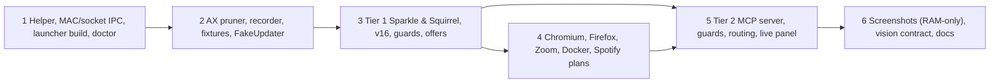

# Computer use for in-app updates: implementation plan

Status: plan, 2026-11-27. Implements `docs/plans/2026-11-25-computer-use-design.md` (agreed 2026-11-25, on branch
`docs/ai-providers-design`; not yet on this branch). Project 4 of 4. Builds on the AI provider layer (project 1),
error triage (project 2), and automations (project 3) at `origin/feat/automations-phase4` (commit `358a310`). Plan
only: no code changes here.

Every task is test first. Tasks are 2-5 minutes each: write the failing test, run it and see the failure named here,
write the least code that passes, run it again, commit. Phases 1-2 are in full detail; phases 3-6 are task lists to
expand into the same form when their turn comes.

## Conventions

- Run one test: `uv run pytest tests/<file>.py::<test> -q`. Run the computer-use suite:
  `uv run pytest tests/test_computer_use_*.py -q`. Run everything before each phase's last commit: `uv run pytest -q`
  (1932/1942 tests collected today, 10 deselected; all must stay green).
- Local-only real-helper UI tests use `@pytest.mark.macos_ui` and are deselected by default in `pyproject.toml`
  (`-m 'not contract and not upgrade and not macos_ui'`). Normal `pytest` and CI never drive a real app, make a real
  Accessibility call against the user's apps, run a real AI CLI, or make a model call. Use fakes (`tests/fake_cli.py`
  and a fake helper runner).
- New tests are flat files `tests/test_computer_use_<module>.py`, not a subfolder: tests import `from conftest import
  ...` and `from fake_cli import FakeCli`, which work only from `tests/` itself.
- A worktree with a new migration must not touch the installed database: run `bosun` commands with
  `BOSUN_DATA_DIR=$(mktemp -d)` (`docs/developing.md`). Regenerate the data model after migration v16:
  `BOSUN_DATA_DIR=$(mktemp -d) uv run bosun db --doc > docs/data-model.md` (`tests/test_data_layer.py` fails while
  stale).
- Every new column goes into `READABLE` or `HIDDEN` in `src/bosun/query.py` (`tests/test_query.py` fails until it
  is), with an inline SQL comment in `src/bosun/migrations.py`.
- Every new action in `src/bosun/registry.py` must be bound in `src/bosun/server.py` (`tests/test_registry.py`), and
  every non-action route (SSE stream, in-memory frame route, internal MCP proxy) must be listed in
  `registry.EXEMPT_ROUTES`. Every `user_only` action must be listed in `USER_ONLY` in `tests/test_agent_auth.py` (or
  marked `panel=True`) and checked in `tests/test_assistant.py` and `tests/test_mcp_server.py`. Actions that touch
  apps or spend AI calls belong in `registry.DEMO_REFUSED` (`tests/test_demo.py`).
- No action input in `src/bosun/registry.py` may declare a field whose name contains `delay`, `force`, or
  `self_update`, and no action path may contain `self-update` or `selfupdate`
  (`tests/test_selfupdate_delay.py:383-391`).
- Any background worker or real helper lookup used during startup must be patched off in `tests/conftest.py` (like
  `_no_real_app_bundle` and `_no_automations_loop`), so tests never touch `~/Applications/Bosun.app` or leak threads.
- **No screenshots are kept.** Screenshots never touch disk (not even a temp file), SQLite, traces, spans, or logs.
  Any image passed to a model or shown in the live panel lives only in RAM for that call and is wiped on stop/finish.
- **Browsers are excluded by code on the server**, never only by hiding a button in the UI.
- **macOS-only code degrades cleanly elsewhere.** Non-macOS hosts return clear `NotFound` / skipped results without
  calling `open`, `swiftc`, `codesign`, or Accessibility APIs.
- Code rules: files under 400 lines, functions under 50, `@dataclass(frozen=True)` for data, `tuple` not `list` in
  frozen fields, explicit errors (no bare `except`). Every stored string passes `redact.text` / `redact.value`.
  Dashboard JS uses `MC.el({ text })` only, never `innerHTML` (`tests/test_static_js.py`).
- Commits: conventional commits with scope `computer-use` (`feat(computer-use): ...`, `test(computer-use): ...`,
  `docs(computer-use): ...`).

## What exists today (the code this builds on)

| Where | Today | How project 4 uses it |
|---|---|---|
| `automations/in_app.py:24-167`, `engine.py:62-67, 105` | `InAppUpdateEvent`, `InAppUpdateReader`, `empty_reader`, `scan_in_app_updates()`, `resolve_app_scope()`, `app_input_in_scope()` | Project 4 supplies the real `in_app_reader` plugged into `Automator` in `server.py:447` and extends `AppActionScope` to `update_in_app` |
| `automations/offers.py:17-370`, `offer_decide.py:111-233`, `presets.py:87-99`, `schema.py:23-48, 217-249, 306-309` | Asks-first offers (24 h TTL), `decide_offer` spending one `Approval` through `Actions.permit`, disabled `offer_in_app_updates` preset stub (`mode="ask"`) | Adds `update_in_app` to `ALLOWLIST` and `SYSTEM_ACTIONS` (`mode="ask"` only); updates `offer_in_app_updates` to offer `update_in_app` (see conflict 4) |
| `registry.py:38-45, 362-375, 487-544, 552-570, 657-760` | `Risk.SYSTEM`, `user_only`, `panel`, `EXEMPT_ROUTES`, `AGENT_TIER_SETTINGS`, `DEMO_REFUSED`, `relaunch_app`, `open_app`, `restore_app`, `Actions.permit()` | Adds `update_in_app` (`Risk.SYSTEM`), `helper_trust` / `computer_use_start` / `computer_use_stop` / `computer_use_decide` (`user_only`, `panel`), and `computer-use:<run>` refusal in `permit()` |
| `approvals.py:35-135` | In-memory one-call `Approvals` (`request`, `decide(by="user")`, `wait`, `consume`, `stop`) | Reused unchanged for automation offers, Ask Bosun cards, and restart/install/quit approval cards inside tier 2 |
| `auth.py:40-55, 183-356` | `load_key()` (`session.key`), `AssistantTokens`, `TriageTokens` (`bsn_tt_`/`bsn_tr_`) with process-only reply keys | Signs helper requests with HMAC-SHA256 from `session.key`; adds `ComputerUseTokens` (`bsn_cu_`/`bsn_cr_`) for per-run tier-2 MCP auth |
| `providers/catalog.py:42-49, 114-125, 155-183` | `JOBS["computer_use"]` (`needs={MCP, VISION}`, `background=False`, `untrusted=False`); `claude` and `codex` hold `MCP` + `VISION` | Routes tier 2 as clicked `computer_use`; sets `untrusted=True`, adds `"computer_use"` to `extra_flags_for()`, and supports vision contract downgrade (see conflict 3) |
| `providers/router.py:233-253, 356-426`, `providers/run.py:165-178` | `plan(..., clicked=True)`, `attempt()`, `_reason()` naming which login resets when | Picks tier-2 login, reports reset times when every AI login is out, and records `llm_calls` with `job="computer_use"` |
| `providers/argv.py:188-348`, `providers/mcp_engine.py:67-76, 89-211` | `build_mcp()`, `build_triage_mcp()`, `CODEX_NO_TOOLS`, `_kill_group()` process-group stop | Pattern for `build_computer_use_mcp()` (empty temp dir, no built-in tools, token + reply key in env only) and clean Stop |
| `providers/contract.py:105-163, 223-237`, `providers/jail.py:63-73` | Cached CLI `--help`/`features` contract checks (`cli_contract`) | Adds MCP-image vision contract check in `doctor --providers`, caching vision pass/fail per CLI version |
| `appupdaters.py:44-95, 233-287`, `collectors/mac.py:159-265, 295-313, 429-477` | `MAU_IDS`, `MENUS`, `menu()`, `Asker`, `App`, `read_app()`, `self_update_how()`, `app_items()` | Keeps `MAU_IDS` out of scope; keeps `MENUS` as fallback text; feeds `not_offered` verdicts back into `Asker` |
| `appguard.py:52-64, 81-136, 164-293`, `caskguard.py:46-140`, `goback.py:55-140` | `bundle()`, `described()`, `signed_by()`, `assess()`, APFS `keep()`, atomic `restore()`, `set_aside()`, `goback.remember()`, `left_alone()` | Before/after check for every in-app update: keep an APFS copy before, verify same signer + Gatekeeper + launch after, restore kept copy on failure or signer change |
| `relaunch.py:24-47, 65-178`, `appwatch.py:37-102` | `APPS` (Chrome only), `staged()`, `relaunch()`, `_ask_to_quit()`, `appwatch.check()` | Adds Brave to `relaunch.APPS`; Chromium plan waits for `staged()` then calls `relaunch()`; after-check mirrors `appwatch` + `caskguard` |
| `launcher.py:142-197, 224-255`, `mac/BosunWindow.swift:1-388` | `MAC_APP`, `swiftc()`, `source_hash()`, `build_native()`, `refresh_mac_app()`, `_install_mac()` | Builds `Bosun.app/Contents/Helpers/Bosun Helper.app` (`com.bosun.helper`, `LSUIElement`) only when `BosunHelper.swift`'s hash changes |
| `doctor.py:49-132, 165-282` | `Probe`, `check_providers()`, `check()` | Checks helper installation, Accessibility grant, stale ad-hoc hash mismatch, and `--providers` vision contract |
| `mcp_server.py:117-143, 170-275, 332-403, 443-487`, `cli.py:566-605, 1057-1075` | `Dashboard`, `frame()` (`TextContent` only), `dispatch()`, `build()`, `bosun mcp --as agent\|assistant\|triage` | Adds `bosun mcp --as computer-use` with only 7 scoped tools + `ImageContent` screenshot replies, and `bosun dev record-ax` |
| `server.py:129-149, 158-297, 350-398, 447-450, 484-503, 605-651, 835-916` | `_selfupdate_busy()`, `_refuse()`, strict CSP (`img-src 'self'`), `/api/state`, `/api/icon`, SSE streams, `open_app`, `restore_app` | Adds `_refuse_computer_use`, SSE live stream, RAM-only `/frame` endpoint, `in_app_reader` wiring, and `_selfupdate_busy` lock |
| `migrations.py:690-767`, `query.py:35-80`, `datamodel.py:15-169`, `store.py:485-518` | Latest migration is **v15** (`automations`); `READABLE`, `VIEWS`, `_prune_records()` (365 d) | **v16 `in_app_updates`** adds `in_app_runs`, `in_app_verdicts`, and `v_in_app_runs` (text only; zero screenshot columns) |
| `trace.py:174-236`, `redact.py:19-40, 104-157` | `trace.run()`, `trace.span()`, `redact.text()` masking `bsn_(at\|rk\|tt\|tr)_` | Masks `bsn_cu_` / `bsn_cr_` tokens and strips base64 PNG prefixes (`iVBORw0KGgo`) as defense in depth |
| `static/index.html`, `rows.js`, `drawer.js`, `app.js`, `tests/test_static_js.py` | DOM-only `MC.el({ text })`, zero `innerHTML`, CSP-safe `/api/icon` | Adds **Update & restart**, **Allow Bosun**, **Try with AI**, and the live computer-use panel with inline approval cards and **Stop** |

## Module map

| File | Contents | Phase |
|---|---|---|
| `src/bosun/mac/BosunHelper.swift` | Native `LSUIElement` helper (`com.bosun.helper`): MAC check against `session.key`, bundle-path process filter, 2 s AX timeout, Electron `AXManualAccessibility`, verbs `trusted`, `state`, `tree`, `press`, `key`, `menu`, `quit`, and `screenshot` (ScreenCaptureKit, phase 6) | 1, 6 |
| `src/bosun/computer_use/__init__.py` | Package docstring: scripted Accessibility updates first, app-scoped agent fallback, zero stored screenshots | 1 |
| `src/bosun/computer_use/policy.py` | Code-level browser deny-list (`BROWSER_BUNDLE_IDS`, `is_browser()`), Microsoft AutoUpdate exclusion, single-run lock, and non-macOS gate | 1, 3, 5 |
| `src/bosun/computer_use/protocol.py` | Frozen request/response dataclasses, HMAC-SHA256 request signing & freshness verification from `session.key`, Unix domain socket framing | 1 |
| `src/bosun/computer_use/helper.py` | Python client invoking `open -W -n -g -a … --args --request <json> --sock <sock>` in a `0700` temp dir; 3-try timeout handling; clean non-macOS error | 1, 6 |
| `src/bosun/computer_use/tree.py` | AX tree normalizer, pruner, short ephemeral element IDs (`e1`, `e2`…), 200-char value clip, password-field detection, `redact.text()` pass | 2 |
| `src/bosun/computer_use/record.py` | `bosun dev record-ax <bundle id>` implementation: reads app version, prunes/redacts tree, strips usernames, writes fixture JSON | 2 |
| `src/bosun/inapp.py` | Data-driven Tier 1 plans per family (Sparkle, Squirrel/Electron, Chromium, Firefox, Zoom, Docker menu bar, Spotify), matcher, runner, and `not_offered` detector (matches `computer-use-design.md:97`) | 3, 4 |
| `src/bosun/computer_use/guard.py` | Before/after safety wrapper: `appguard.described`/`signed_by`/`assess`/`keep`, launch-health verification, graceful bundle quit, `appguard.restore` + `goback.remember` rollback, `appguard.set_aside` fallback | 3 |
| `src/bosun/computer_use/store.py` | SQLite CRUD for `in_app_runs` and `in_app_verdicts`, 365-day pruning, and the real `in_app_reader` for `Automator` | 3 |
| `src/bosun/computer_use/guards.py` | Tier 2 server-side guards: pre-press re-read, deny-list titles, approval-card titles, password/SecurityAgent/payment stops, allowed keys, 25-action & 4-minute limits | 5 |
| `src/bosun/computer_use/agent.py` | Tier 2 runner: routes `computer_use` job, issues `ComputerUseTokens`, spawns locked-down CLI via `providers/argv.py`, serves SSE events + RAM-only frame slot, handles approval cards and Stop, runs `guard.after()` | 5, 6 |
| `src/bosun/static/computer_use.js`, `computer_use.css` | Live Tier 2 panel (tool steps, element pressed, RAM-only latest screenshot, inline approval card, **Stop**), **Try with AI**, and **Allow Bosun to update apps** button | 5, 6 |
| `tests/fixtures/FakeUpdater.swift`, `tests/fixtures/ax/` | Local-only AppKit test app (`pytest -m macos_ui`) and redacted AX tree fixtures for every app family | 2, 4 |

## Conflicts with the design (flagged, not redesigned)

1. **Who can start Tier 1 (`update_in_app`): external MCP agents vs always asking first.**
   The design states Tier 1 can be started by "your click, or an agent if 'Let agents quit and reopen apps' is on"
   (`computer-use-design.md:35, 168, 247`) and makes `update_in_app` a `Risk.SYSTEM` action (`line 171`). In
   `registry.py:678-683`, `Risk.SYSTEM` lets an external MCP agent (`agent:*`) call the action without a per-call
   approval whenever `agents_allow_system` is on, while automations (`registry.py:754-759`, `automations/schema.py:306`)
   and Ask Bosun (`registry.py:688-696`) always require a spent one-call `Approval`. If every non-user in-app update
   must ask first with a spent approval, external MCP agents would have to be refused on `update_in_app` even when
   `agents_allow_system` is on. Plan: keep `update_in_app` at `Risk.SYSTEM` (always `mode="ask"` in automations and
   approval-gated in Ask Bosun), and flag external MCP agent access in open question 1.
2. **Browser exclusion scope: Tier 2 only (design) vs both tiers.**
   `computer-use-design.md:105-106, 154, 233, 246` includes Chromium (Chrome, Brave) and Firefox in Tier 1 (build order
   step 4) and excludes browsers from Tier 2 ("Browsers in tier 2: Excluded for now; browsers use tier 1 only").
   Separately, `relaunch.py:38-47` lists only `"chrome"` in `relaunch.APPS`, not `"brave"`. Plan: enforce a code-level
   server-side `BROWSER_BUNDLE_IDS` + `item.kind == "browser"` deny-list in `computer_use_start` (Tier 2), add Brave
   to `relaunch.APPS`, and keep Chromium/Firefox Tier 1 plans per the design unless open question 2 narrows Tier 1 too.
3. **Helper IPC `--stdout <file>` vs "never written to disk" for screenshots.**
   `computer-use-design.md:86` specifies `open -W -n -g -a … --args <request>` and `--stdout <file>`, while review
   decided no screenshots are kept (`line 245`) and project rules forbid writing screenshots to disk even transiently.
   Writing a PNG or base64 PNG to `--stdout <file>` would put screenshot bytes on disk. Plan: pass a Unix domain
   socket (`--sock <path>` in the `0700` temp dir) so helper replies and PNG bytes stream purely through kernel memory
   with zero image bytes touching the filesystem (open question 3).
4. **`providers/catalog.py` marks `computer_use` as `untrusted=False`, omits `"computer_use"` from `extra_flags_for()`, and has no runtime `VISION` downgrade.**
   In `src/bosun/providers/catalog.py:48`, `Job("computer_use", frozenset({C.MCP, C.VISION}), background=False)` leaves
   `untrusted=False`, even though screen/AX text is untrusted (`computer-use-design.md:196-199`). Also
   `catalog.py:155-162` returns `s.restricted_flags` (`--restricted` on Claude) only for `("triage", "assistant")`, not
   `"computer_use"`. Finally, `computer-use-design.md:181` lets Tier 2 run tree-only when Screen Recording is off, and
   `line 222-223` drops `C.VISION` from a CLI that fails the `doctor --providers` test-image check, neither of which
   exists in `catalog.py` or `contract.py` yet. Plan: set `untrusted=True` on `computer_use`, include `"computer_use"`
   in `extra_flags_for()`, cache vision contract results in `cli_contract`, and route tree-only runs with `{C.MCP}`
   when Screen Recording is absent (open question 4).
5. **Automations stub `offer_in_app_updates` currently targets `open_app`, and `update_in_app` is not on the automations allow-list yet.**
   `automations/presets.py:87-99` sets `action="open_app"` on `offer_in_app_updates`; `automations/schema.py:23-46,
   239-249`, `in_app.py:59-167`, `offers.py:88-152, 279-300`, and `offer_decide.py:182-198` handle only `relaunch_app`
   and `open_app`; `server.py:447` passes `empty_reader` to `Automator`. Plan: add `update_in_app` to `ALLOWLIST` and
   `SYSTEM_ACTIONS` (`mode="ask"` only), wire `in_app.py`/`offers.py`/`offer_decide.py` for `update_in_app` (`KeyIn`),
   plug project 4's real `in_app_reader` into `Automator`, and upgrade untouched disabled `offer_in_app_updates` preset
   rows to `update_in_app` (open question 5).
6. **No storage schema or migration is specified in the design doc.**
   `computer-use-design.md:118, 184, 189` requires persisting run outcomes (with app version) and `not_offered` updater
   verdicts, and `automations/in_app.py:44` expects project 4's state table, but the design has no Storage section.
   Latest migration on `origin/feat/automations-phase4` is **v15 (`automations`)** (`migrations.py:766`). Plan: add
   migration **v16 `in_app_updates`** with `in_app_runs`, `in_app_verdicts`, and `v_in_app_runs` (text-only; zero
   screenshot columns), exposed in `query.py` and `datamodel.py`.
7. **Live panel screenshot display vs strict `Content-Security-Policy: img-src 'self'`.**
   `server.py:283-285` sends `img-src 'self'`, which blocks `data:image/png;base64,...` URIs in `` elements. Plan:
   keep at most one ephemeral `bytes` slot in RAM on the live run object, wipe it to `None` when the run ends or stops,
   and serve it only to the signed-in browser at `GET /api/computer-use/{run_id}/frame` (`Cache-Control: no-store`, in
   `EXEMPT_ROUTES`, agents refused), keeping CSP strict and disk untouched (open question 6).
8. **Missing actions and routes for Tier 2 approvals, helper trust, SSE stream, and internal MCP proxy.**
   `computer-use-design.md:171` names `update_in_app`, `computer_use_start`, and `computer_use_stop`, but does not name
   actions for answering a Tier 2 approval card (`computer_use_decide`), triggering the Accessibility prompt
   (`helper_trust`), or the non-action routes (`GET /api/computer-use/{run_id}/events`,
   `GET /api/computer-use/{run_id}/frame`, and token-only `/api/computer-use/mcp/{tool}`). `tests/test_registry.py:49`
   requires every route to be in `SPECS` or `EXEMPT_ROUTES`. Plan: add `helper_trust` and `computer_use_decide`
   (`user_only=True`, `panel=True`) to `SPECS`, list the SSE, RAM-frame, and token-only MCP proxy routes in
   `EXEMPT_ROUTES`, and block `computer-use:<run>` in `Actions.permit` from every registry action.
9. **Rollback on update failure or crash-on-start vs `goback.restore` and `relaunch._ask_to_quit`.**
   `goback.py:80-106` refuses to restore if the app is running, if the *new* bundle lacks a valid signature (it checks
   against the *current* app's signer), or if versions match. `relaunch.py:136-141` only knows how to quit apps listed
   in `relaunch.APPS` (Chrome only). Plan: follow `caskguard.py:119-140` — remember the *before* signer (`appguard.described`)
   and APFS clone (`appguard.keep`), add a bundle-path `quit` verb to the helper (`NSRunningApplication.terminate()`,
   graceful only), verify the new copy's signature/Gatekeeper and launch health, and on failure/crash restore the kept
   copy via `appguard.restore(..., team=before.team, deep=before_passed)` + `goback.remember()` (or `appguard.set_aside`
   if restore fails; if the app won't quit, tell the user and point to Go back).
10. **`mcp_server.py:frame()` emits text only, `cli.py --as` omits `computer-use`, and there is no `bosun dev` CLI group.**
    `mcp_server.py:332-347` returns `[types.TextContent(...)]` only; `cli.py:1070` restricts `--as` to
    `("agent", "assistant", "triage")`; `cli.py` has no `dev` subparser for `bosun dev record-ax`. Plan: add
    `ImageContent` support for the computer-use `screenshot` tool, add `"computer-use"` to `--as`, and add `bosun dev
    record-ax`.
11. **`pyproject.toml` has no `macos_ui` marker and `docs/plans/2026-11-25-computer-use-design.md` lives on `docs/ai-providers-design`.**
    Add `macos_ui` to `pyproject.toml` markers and default `addopts` (`not macos_ui`), and merge `docs/ai-providers-design`
    before starting phase 1 (open question 7).

## Migration numbers

| Version | Name | Phase | What |
|---|---|---|---|
| 16 | `in_app_updates` | 3 | tables `in_app_runs` (text-only run log, no screenshot columns) and `in_app_verdicts` (`not_offered` cache per bundle_id + available version), indexes on `(bundle_id, created DESC)` and `(trace_id)`, and view `v_in_app_runs` |

Latest existing migration on `origin/feat/automations-phase4` is **v15** (`automations`). If another branch lands a
migration first, renumber before merging; `tests/test_migrations.py` checks the sequence.

## Phase dependencies



---

## Phase 1: the helper, MAC/socket IPC, hash-gated build, grant handling in doctor

Depends on: `origin/feat/automations-phase4`. Migration: none. Must keep passing: `tests/test_launcher.py`,
`tests/test_doctor.py`, `tests/test_registry.py`, `tests/test_agent_auth.py`, `tests/test_assistant.py`,
`tests/test_mcp_server.py`, `tests/test_demo.py`, `tests/test_selfupdate_delay.py`. Risks: R1 (unauthorized helper
invocation), R2 (ad-hoc rebuild silently dropping TCC grant), R3 (non-macOS breakage), R4 (demo touching real helper).

### Task 1.1: package skeleton, browser deny-list, and MAC/socket request protocol

- Files: create `src/bosun/computer_use/__init__.py`, `src/bosun/computer_use/policy.py`,
  `src/bosun/computer_use/protocol.py`, `tests/test_computer_use_protocol.py`.
- Test first: `test_browser_denylist_and_helper_request_mac_verification`.

```python
import pytest

from bosun.computer_use.policy import BROWSER_BUNDLE_IDS, is_browser, is_mau_app
from bosun.computer_use.protocol import (
    ALLOWED_VERBS, HelperRequest, sign_request, verify_request,
)


def test_browser_denylist_and_helper_request_mac_verification():
    # Code-level browser deny-list covers common Mac browsers and kind="browser"
    for bid in ("com.google.Chrome", "com.brave.Browser", "org.mozilla.firefox", "com.apple.Safari",
                "com.microsoft.edgemac", "company.thebrowser.Browser"):
        assert bid in BROWSER_BUNDLE_IDS
        assert is_browser(bid) is True
    assert is_browser("com.tinyspeck.slackmacgap") is False
    assert is_browser("com.example.CustomBrowser", kind="browser") is True
    assert is_mau_app("com.microsoft.Word") is True
    assert is_mau_app("com.tinyspeck.slackmacgap") is False

    # Valid signed request passes; tampered verb, path, wrong key, or stale timestamp fails
    key = "k" * 48
    req = sign_request(
        key, verb="tree", bundle_id="com.tinyspeck.slackmacgap",
        bundle_path="/Applications/Slack.app", now=1000.0,
    )
    assert isinstance(req, HelperRequest)
    assert req.verb in ALLOWED_VERBS
    assert verify_request(key, req.to_dict(), now=1005.0) is True
    assert verify_request("x" * 48, req.to_dict(), now=1005.0) is False
    assert verify_request(key, {**req.to_dict(), "verb": "press"}, now=1005.0) is False
    assert verify_request(key, {**req.to_dict(), "bundle_path": "/Applications/Other.app"}, now=1005.0) is False
    assert verify_request(key, req.to_dict(), now=1000.0 + 120.0) is False
    with pytest.raises(ValueError):
        sign_request(key, verb="shell", bundle_id="com.tinyspeck.slackmacgap",
                     bundle_path="/Applications/Slack.app", now=1000.0)
```

- Run: `uv run pytest tests/test_computer_use_protocol.py -q` → `ModuleNotFoundError: No module named 'bosun.computer_use'`.
- Implement:
  - `src/bosun/computer_use/policy.py`: `BROWSER_BUNDLE_IDS` (frozenset of Chrome, Chrome Canary/Beta, Brave, Firefox,
    Edge, Safari, Arc, Chromium, Vivaldi, Opera, Orion, Zen, Tor Browser, DuckDuckGo, Waterfox), `is_browser(bundle_id,
    kind="")`, `is_mau_app(bundle_id)` (checking `appupdaters.MAU_IDS`), and `MAC_ONLY_MSG`.
  - `src/bosun/computer_use/protocol.py`: `ALLOWED_VERBS = frozenset({"trusted", "state", "tree", "press", "key",
    "menu", "quit", "screenshot"})`, `REQUEST_TTL_S = 30.0`, frozen `HelperRequest` (`verb`, `bundle_id`, `bundle_path`,
    `params`, `ts`, `nonce`, `mac`), canonical HMAC-SHA256 over `helper|{ts}|{nonce}|{verb}|{bundle_id}|{bundle_path}|{sha256(canon_params)}`
    keyed by `session.key`, `sign_request()`, and constant-time `verify_request()`.
- Pass: `uv run pytest tests/test_computer_use_protocol.py -q` → `1 passed`.
- Commit: `feat(computer-use): browser deny-list and HMAC helper request protocol`

### Task 1.2: helper client with Unix domain socket IPC and non-macOS skip

- Files: create `src/bosun/computer_use/helper.py`, `tests/test_computer_use_helper.py`.
- Test first: `test_helper_client_uses_private_socket_dir_retries_timeouts_and_skips_off_mac`.

```python
import json
import os
import socket
import stat
from pathlib import Path

import pytest

from bosun import machine, proc
from bosun.computer_use import helper


def test_helper_client_uses_private_socket_dir_retries_timeouts_and_skips_off_mac(tmp_path, monkeypatch):
    # Clean error on non-macOS without invoking subprocesses
    monkeypatch.setattr(machine, "IS_MAC", False)
    with pytest.raises(helper.HelperUnavailable, match="macOS"):
        helper.call(tmp_path, "trusted")

    # On macOS, builds a 0700 temp folder, sends signed request JSON, reads reply from Unix socket, cleans up
    monkeypatch.setattr(machine, "IS_MAC", True)
    app_bundle = tmp_path / "Bosun.app" / "Contents" / "Helpers" / "Bosun Helper.app"
    app_bundle.mkdir(parents=True)
    target = tmp_path / "Applications" / "Slack.app"
    target.mkdir(parents=True)
    monkeypatch.setattr("bosun.appguard.roots", lambda home=None: (tmp_path / "Applications",))

    seen: list[dict] = []

    def fake_run(argv, timeout=30, **kw):
        req_path = Path(argv[argv.index("--request") + 1])
        sock_path = argv[argv.index("--sock") + 1]
        assert stat.S_IMODE(os.stat(req_path.parent).st_mode) == 0o700
        seen.append(json.loads(req_path.read_text(encoding="utf-8")))
        with socket.socket(socket.AF_UNIX, socket.SOCK_STREAM) as s:
            s.connect(sock_path)
            s.sendall(json.dumps({"ok": True, "trusted": True}).encode("utf-8"))
        return proc.Result(tuple(argv), 0, "", "")

    res = helper.call(
        tmp_path, "state", bundle_id="com.tinyspeck.slackmacgap",
        bundle_path=target, helper_app=app_bundle, run=fake_run,
    )
    assert res["ok"] is True and res["trusted"] is True
    assert seen[0]["verb"] == "state" and seen[0]["mac"]
    # Temp dir was cleaned up
    assert not Path(seen[0].get("_dir", "/nonexistent")).exists()
```

- Run: `uv run pytest tests/test_computer_use_helper.py -q` → `ImportError: cannot import name 'helper'`.
- Implement: `src/bosun/computer_use/helper.py` with:
  - `HelperError`, `HelperUnavailable`, `HelperTimeout`, `HelperUntrusted`, `ScreenLockedError`;
  - `helper_app_path()` returning `launcher.MAC_APP / "Contents" / "Helpers" / "Bosun Helper.app"`;
  - `call(data_dir, verb, *, bundle_id="", bundle_path=None, params=None, helper_app=None, run=proc.run, retries=3)`:
    - refuses non-macOS with `HelperUnavailable`;
    - verifies `bundle_path` via `appguard.bundle()` for every non-`trusted` verb;
    - creates a `0700` temp dir, binds an `AF_UNIX` `SOCK_STREAM` socket (`reply.sock`), writes signed `request.json`
      (mode `0600`), accepts the helper reply on a short background reader thread while running
      `["/usr/bin/open", "-W", "-n", "-g", "-a", str(app), "--args", "--request", str(req_path), "--sock", str(sock_path)]`;
    - retries AX timeout responses up to 3 times (`computer-use-design.md:182`), raises `ScreenLockedError` when
      helper reports screen locked or inactive console session (`line 188`), and deletes the temp dir in `finally:`.
- Pass: `uv run pytest tests/test_computer_use_helper.py -q` → `1 passed`.
- Commit: `feat(computer-use): helper client with Unix socket IPC and macOS guard`

### Task 1.3: native `BosunHelper.swift` (`trusted`, `state`, `tree`, `press`, `key`, `menu`, `quit`)

- Files: create `src/bosun/mac/BosunHelper.swift`, `tests/test_computer_use_helper_swift.py`.
- Test first: `test_helper_swift_source_enforces_mac_bundle_path_timeout_and_compiles_on_mac`.

```python
from pathlib import Path
import pytest

from bosun import launcher, machine, proc

SWIFT = Path(__file__).resolve().parents[1] / "src" / "bosun" / "mac" / "BosunHelper.swift"


def test_helper_swift_source_enforces_mac_bundle_path_timeout_and_compiles_on_mac(tmp_path):
    src = SWIFT.read_text(encoding="utf-8")
    for required in (
        "AXIsProcessTrustedWithOptions",
        "AXUIElementSetMessagingTimeout",
        "AXManualAccessibility",
        "CGEvent",
        "postToPid",
        "session.key",
        "SHA256",
        "AF_UNIX",
        "CGSessionCopyCurrentDictionary",
        "CGSSessionScreenIsLocked",
        "NSRunningApplication",
    ):
        assert required in src, f"missing {required} in BosunHelper.swift"
    if not machine.IS_MAC or not launcher.swiftc():
        pytest.skip("swiftc on macOS not available")
    out = tmp_path / "BosunHelper"
    r = proc.run(
        ["xcrun", launcher.swiftc(), "-swift-version", "5", "-O", "-o", str(out), str(SWIFT),
         "-framework", "Cocoa", "-framework", "ApplicationServices", "-framework", "CryptoKit"],
        timeout=300,
    )
    assert r.ok, r.stderr
    assert out.is_file()
```

- Run: `uv run pytest tests/test_computer_use_helper_swift.py -q` → `FileNotFoundError` (file does not exist yet).
- Implement: `src/bosun/mac/BosunHelper.swift` (< 400 lines, split cleanly into small functions):
  - parses `--request <path>` and `--sock <path>` from `CommandLine.arguments`;
  - loads `session.key` directly from Bosun's data dir (passed via `data_dir` only if inside the user's home/Library or
    `BOSUN_DATA_DIR`, verified mode `0600`), verifies HMAC-SHA256 via `CryptoKit` and 30 s freshness window; exits
    immediately with no AX calls on invalid MAC;
  - checks `CGSessionCopyCurrentDictionary()` for `CGSSessionScreenIsLocked` / `kCGSessionOnConsoleKey` before any
    UI verb;
  - resolves target PIDs strictly via `NSRunningApplication.runningApplications(withBundleIdentifier:)` filtered so
    `executableURL?.standardizedFileURL.path.hasPrefix(bundlePath + "/")` (never by app name);
  - sets `AXManualAccessibility = true` for Electron apps (`Electron Framework` present in bundle) and sets
    `AXUIElementSetMessagingTimeout(el, 2.0)`;
  - implements verbs:
    - `trusted` (checks `AXIsProcessTrustedWithOptions`, optionally prompting once when `prompt: true`);
    - `state` (running PIDs, window titles/sizes, open sheets/dialogs, whether `SecurityAgent` or authorization dialog
      is active anywhere);
    - `tree` (menu bar + windows + menu bar extras, pruned to max depth/nodes, never reading `AXSecureTextField` values);
    - `press` (re-locates element by path + verifies target PID ownership + role + title before `AXPress`);
    - `key` (allow-listed key codes only, posted strictly via `CGEvent.postToPid(pid)`);
    - `menu` (presses menu bar item or app menu bar extra path, bringing target front only during menu open);
    - `quit` (graceful `NSRunningApplication.terminate()`, never force-kill);
  - writes JSON response over `--sock` Unix domain socket and exits.
- Pass: `uv run pytest tests/test_computer_use_helper_swift.py -q` → `1 passed`.
- Commit: `feat(computer-use): native Swift BosunHelper with MAC auth and AX verbs`

### Task 1.4: hash-gated helper build in `launcher.py` (preserving TCC Accessibility grant)

- Files: modify `src/bosun/launcher.py`, `tests/conftest.py` (keep `_no_real_app_bundle` covering helper path too);
  create `tests/test_computer_use_launcher.py`.
- Test first: `test_helper_rebuilds_only_when_source_hash_changes_and_skips_off_mac`.

```python
from bosun import launcher, machine, proc


def test_helper_rebuilds_only_when_source_hash_changes_and_skips_off_mac(tmp_path, monkeypatch):
    app = tmp_path / "Bosun.app"
    monkeypatch.setattr(launcher, "MAC_APP", app)
    monkeypatch.setattr(machine, "IS_MAC", False)
    assert launcher.ensure_helper(app) == ""  # no-op off macOS

    monkeypatch.setattr(machine, "IS_MAC", True)
    builds: list[tuple[str, ...]] = []

    def fake_run(argv, timeout=300, **kw):
        builds.append(tuple(argv))
        out = argv[argv.index("-o") + 1]
        with open(out, "wb") as f:
            f.write(b"fake-macho")
        return proc.Result(tuple(argv), 0, "", "")

    monkeypatch.setattr(launcher, "swiftc", lambda: "/usr/bin/swiftc")
    monkeypatch.setattr(proc, "run", fake_run)

    # First build creates Bosun Helper.app and records helper.sha256
    assert launcher.ensure_helper(app) == ""
    helper_app = app / "Contents" / "Helpers" / "Bosun Helper.app"
    assert (helper_app / "Contents" / "MacOS" / "bosun-helper").is_file()
    assert (helper_app / "Contents" / "Info.plist").is_file()
    assert len(builds) == 1

    # Second call with same source hash skips rebuild so TCC code-hash grant survives
    assert launcher.ensure_helper(app) == ""
    assert len(builds) == 1

    # Changed hash triggers rebuild
    monkeypatch.setattr(launcher, "helper_source_hash", lambda: "new-hash")
    assert launcher.ensure_helper(app) == ""
    assert len(builds) == 2
```

- Run: `uv run pytest tests/test_computer_use_launcher.py -q` → `AttributeError: module 'bosun.launcher' has no attribute 'ensure_helper'`.
- Implement: in `src/bosun/launcher.py`:
  - `HELPER_SOURCE = Path(__file__).with_name("mac") / "BosunHelper.swift"`, `HELPER_INFO` (`CFBundleIdentifier:
    "com.bosun.helper"`, `CFBundleExecutable: "bosun-helper"`, `LSUIElement: True`, `LSMinimumSystemVersion: "13.0"`),
    `helper_app(app=None)`, `helper_source_hash()`, and `ensure_helper(app=None)` returning `""` on success or a plain
    error string;
  - checks `Contents/Resources/helper.sha256` AND binary existence; if hash matches, leaves the existing bundle
    untouched (preserving its ad-hoc code hash and macOS TCC Accessibility grant);
  - call `ensure_helper(app)` from `_install_mac()` and `refresh_mac_app()` (never breaking `Bosun.app` install when
    `swiftc` is absent).
- Pass: `uv run pytest tests/test_computer_use_launcher.py tests/test_launcher.py -q` → all green.
- Commit: `feat(computer-use): hash-gated Bosun Helper.app build in launcher`

### Task 1.5: helper & Accessibility grant checks in `doctor.py`

- Files: modify `src/bosun/doctor.py`, create `tests/test_computer_use_doctor.py`.
- Test first: `test_doctor_reports_helper_installed_untrusted_rebuilt_and_skips_off_mac`.

```python
from bosun import doctor, machine
from bosun.config import load_settings


class _FakeProbe(doctor.Probe):
    def __init__(self, helper_state):
        self._helper_state = helper_state

    def helper_trust(self, s):
        return self._helper_state


def test_doctor_reports_helper_installed_untrusted_rebuilt_and_skips_off_mac(tmp_path, monkeypatch):
    s = load_settings()
    s = type(s)(**{**s.__dict__, "data_dir": tmp_path})
    monkeypatch.setattr(machine, "IS_MAC", False)
    lines = doctor._helper_lines(_FakeProbe({"installed": False}), s)
    assert lines == []

    monkeypatch.setattr(machine, "IS_MAC", True)
    ok_lines = doctor._helper_lines(_FakeProbe({"installed": True, "trusted": True, "hash_changed": False}), s)
    assert ok_lines[0].mark == doctor.OK and "Accessibility" in ok_lines[0].fact

    stale_lines = doctor._helper_lines(_FakeProbe({"installed": True, "trusted": False, "hash_changed": True}), s)
    assert stale_lines[0].mark == doctor.OPTIONAL
    assert "remove Bosun Helper" in stale_lines[0].fix

    missing_lines = doctor._helper_lines(_FakeProbe({"installed": False, "trusted": False, "hash_changed": False}), s)
    assert missing_lines[0].mark == doctor.OPTIONAL and "install-launcher" in missing_lines[0].fix
```

- Run: `uv run pytest tests/test_computer_use_doctor.py -q` → `AttributeError: module 'bosun.doctor' has no attribute '_helper_lines'`.
- Implement: add `Probe.helper_trust(self, s: Settings) -> dict` (read-only: checks `Bosun Helper.app` presence,
  `helper.sha256` match, and runs `helper.call(s.data_dir, "trusted", params={"prompt": False})` with `prompt=False` so
  `doctor` never pops a dialog) and `_helper_lines(probe, s)` called inside `doctor.check()` on macOS only. When
  `trusted` is false and the helper was rebuilt (`hash_changed` or previously trusted), emit the exact recovery advice
  from `computer-use-design.md:180`: "remove Bosun Helper from the list and add it again".
- Pass: `uv run pytest tests/test_computer_use_doctor.py tests/test_doctor.py -q` → all green.
- Commit: `feat(computer-use): check Bosun Helper and Accessibility grant in doctor`

### Task 1.6: owner-only `helper_trust` action (`Allow Bosun to update apps`)

- Files: modify `src/bosun/registry.py`, `src/bosun/server.py`, `tests/test_agent_auth.py`, `tests/test_assistant.py`,
  `tests/test_demo.py`, `tests/test_computer_use_helper.py`.
- Test first: `test_helper_trust_is_owner_only_panel_and_refused_in_demo_or_off_mac`.

```python
from fastapi.testclient import TestClient

from conftest import SESSION_KEY, signed_in
from bosun import auth, demo, machine
from bosun.config import load_settings
from bosun.server import create_app
from bosun.store import Store

TOKEN = "t" * 32
H = {"x-bosun-token": TOKEN}


def test_helper_trust_is_owner_only_panel_and_refused_in_demo_or_off_mac(tmp_path, monkeypatch):
    st = Store(tmp_path / "bosun.db")
    app = create_app(load_settings(), st, TOKEN)
    user = TestClient(app, base_url="http://127.0.0.1:8787", cookies=signed_in())
    agent = TestClient(app, base_url="http://127.0.0.1:8787")

    # Agents cannot prompt Accessibility
    assert agent.post("/api/computer-use/trust", json={"prompt": True}, auth=auth.AgentAuth(SESSION_KEY)).status_code == 403

    # Off macOS: clean 404
    monkeypatch.setattr(machine, "IS_MAC", False)
    assert user.post("/api/computer-use/trust", json={"prompt": False}, headers=H).status_code == 404

    # On macOS with mocked helper: returns trusted state
    monkeypatch.setattr(machine, "IS_MAC", True)
    monkeypatch.setattr("bosun.computer_use.helper.call", lambda *a, **kw: {"ok": True, "trusted": True})
    r = user.post("/api/computer-use/trust", json={"prompt": False}, headers=H)
    assert r.status_code == 200 and r.json()["trusted"] is True

    # Demo mode refuses
    s = load_settings()
    s = type(s)(**{**s.__dict__, "demo": True, "self_update": False, "data_dir": tmp_path})
    dst = Store(tmp_path / "demo.db")
    demo.seed(dst)
    dc = TestClient(create_app(s, dst, TOKEN), base_url=f"http://127.0.0.1:{s.port}", cookies=signed_in(s.port))
    assert dc.post("/api/computer-use/trust", json={"prompt": False}, headers=H).status_code == 403
```

- Run: `uv run pytest tests/test_computer_use_helper.py -k helper_trust -q` → `404`.
- Implement: add `HelperTrustIn(_In)` (`prompt: bool = False`, `open_settings: bool = False`) and
  `ActionSpec("helper_trust", ..., Risk.LOCAL, HelperTrustIn, "POST", "/api/computer-use/trust", user_only=True,
  panel=True)` in `registry.py`; add `"helper_trust"` to `DEMO_REFUSED`; bind in `server.py` (refuses non-macOS with
  `NotFound`, calls `helper.call(s.data_dir, "trusted", params={"prompt": body.prompt})`, and opens
  `x-apple.systempreferences:com.apple.preference.security?Privacy_Accessibility` via `/usr/bin/open` only when
  `body.open_settings` and not yet trusted); add `/api/computer-use` to agent/assistant/triage path blocks in
  `server.py:_refuse_*`.
- Pass: `uv run pytest tests/test_computer_use_helper.py tests/test_registry.py tests/test_agent_auth.py tests/test_assistant.py tests/test_mcp_server.py tests/test_demo.py tests/test_selfupdate_delay.py -q` → all green.
- Commit: `feat(computer-use): owner-only helper_trust action for Accessibility grant`

### Task 1.7: Phase 1 full suite check

- Run: `uv run pytest -q` → all tests green.

**Phase 1 done when:** `BosunHelper.swift` compiles on macOS, requests require a valid HMAC from `session.key`,
replies travel over a private `0700` Unix domain socket, `launcher.py` preserves the helper bundle across unchanged
hashes, `doctor.py` reports Accessibility & stale-hash status, and non-macOS/demo paths fail cleanly.

---

## Phase 2: AX pruner, recorder (`bosun dev record-ax`), fixtures, and `FakeUpdater.swift`

Depends on: phase 1. Migration: none. Must keep passing: `tests/test_computer_use_*.py`, `tests/test_redact.py`,
`tests/test_cli.py` (if any), and full `uv run pytest -q`. Risks: R5 (secrets or passwords leaking into recorded AX
trees or tool outputs), R6 (`macos_ui` tests running accidentally in CI).

### Task 2.1: AX tree data model, pruner, short IDs, password detection, and redaction

- Files: create `src/bosun/computer_use/tree.py`, `tests/test_computer_use_tree.py`.
- Test first: `test_prune_assigns_short_ids_clips_values_strips_passwords_and_redacts_secrets`.

```python
from bosun.computer_use.tree import AxTree, prune_tree


def test_prune_assigns_short_ids_clips_values_strips_passwords_and_redacts_secrets():
    raw = {
        "bundle_id": "com.tinyspeck.slackmacgap",
        "windows": [
            {
                "role": "AXWindow",
                "title": "Slack — token ghp_" + "A" * 30,
                "children": [
                    {"role": "AXStaticText", "title": "", "value": "x" * 400, "enabled": True, "actions": []},
                    {"role": "AXSecureTextField", "title": "Password", "value": "supersecret123", "enabled": True, "actions": []},
                    {"role": "AXButton", "title": "Install and Relaunch", "value": "", "enabled": True, "actions": ["AXPress"]},
                ],
            }
        ],
        "menu_bar": [
            {"role": "AXMenuBarItem", "title": "Slack", "enabled": True, "actions": ["AXPress"], "children": [
                {"role": "AXMenuItem", "title": "Check for Updates…", "enabled": True, "actions": ["AXPress"]},
            ]}
        ],
    }
    pruned = prune_tree(raw)
    assert isinstance(pruned, AxTree)
    assert pruned.has_password_field is True
    by_role = {n.role: n for n in pruned.flat()}
    assert "supersecret123" not in pruned.to_json()
    assert by_role["AXSecureTextField"].value == ""
    assert len(by_role["AXStaticText"].value) <= 203  # 200 chars + ellipsis
    assert "ghp_" not in by_role["AXWindow"].title and "[redacted]" in by_role["AXWindow"].title
    btn = by_role["AXButton"]
    assert btn.id.startswith("e") and btn.title == "Install and Relaunch" and "AXPress" in btn.actions
```

- Run: `uv run pytest tests/test_computer_use_tree.py -q` → `ModuleNotFoundError: No module named 'bosun.computer_use.tree'`.
- Implement: `src/bosun/computer_use/tree.py` with:
  - frozen `AxNode(id, role, title, value, enabled, actions, path, children)` and `AxTree(bundle_id, menu_bar, windows,
    menu_extras, has_password_field, has_modal, truncated)`;
  - deterministic sequential IDs (`e1`, `e2`, ...) assigned per snapshot (valid only until next read);
  - `MAX_VALUE_CHARS = 200`, `MAX_NODES = 400`, `MAX_DEPTH = 12`;
  - strips any `value` on `AXSecureTextField` (sets `has_password_field=True`), runs `redact.text()` on every title and
    value, detects open sheets/dialogs (`AXSheet`, `AXDialog`, `AXStandardWindow` subrole `AXDialog`), and provides
    `find_by_id(eid)` and `flat()`.
- Pass: `uv run pytest tests/test_computer_use_tree.py -q` → `1 passed`.
- Commit: `feat(computer-use): AX tree pruner, short IDs, password detection and redaction`

### Task 2.2: `bosun dev record-ax <bundle id>` CLI command

- Files: create `src/bosun/computer_use/record.py`, `tests/test_computer_use_record.py`; modify `src/bosun/cli.py`.
- Test first: `test_dev_record_ax_writes_redacted_fixture_and_strips_username`.

```python
import json

from bosun import machine
from bosun.cli import main
from bosun.collectors.mac import App


def test_dev_record_ax_writes_redacted_fixture_and_strips_username(tmp_path, monkeypatch, capsys):
    monkeypatch.setattr(machine, "IS_MAC", True)
    fake_app = App("/Applications/Slack.app", "Slack", "4.40.0", "com.tinyspeck.slackmacgap", False)
    monkeypatch.setattr("bosun.computer_use.record.find_installed_app", lambda bid: fake_app)
    monkeypatch.setattr(
        "bosun.computer_use.helper.call",
        lambda data_dir, verb, **kw: {
            "ok": True,
            "bundle_id": "com.tinyspeck.slackmacgap",
            "windows": [{"role": "AXWindow", "title": "/Users/alice/secret ghp_" + "Z" * 25, "children": []}],
            "menu_bar": [],
        },
    )
    out_root = tmp_path / "ax"
    rc = main(["dev", "record-ax", "com.tinyspeck.slackmacgap", "--out", str(out_root)])
    assert rc == 0
    dest = out_root / "com.tinyspeck.slackmacgap" / "4.40.0.json"
    assert dest.is_file()
    raw = dest.read_text(encoding="utf-8")
    assert "/Users/alice" not in raw and "ghp_" not in raw
    parsed = json.loads(raw)
    assert parsed["bundle_id"] == "com.tinyspeck.slackmacgap" and parsed["app_version"] == "4.40.0"
```

- Run: `uv run pytest tests/test_computer_use_record.py -q` → `SystemExit: 2` (unknown `dev` subcommand).
- Implement:
  - `src/bosun/computer_use/record.py`: `find_installed_app(bundle_id)` (scans `collectors/mac.py:scan_apps()`),
    `record_ax(data_dir, bundle_id, *, out_root=..., state="")` calling `helper.call(..., "tree")`, pruning via
    `tree.prune_tree()`, scrubbing `/Users/<name>` -> `/Users/demo` and emails, and writing
    `<out_root>/<bundle_id>/<version>[_<state>].json`;
  - add `dev` subparser (`record-ax <bundle_id> [--out <dir>] [--state <label>]`) in `src/bosun/cli.py` and add
    `"dev"` to `_NO_DB_LOG_CMDS` so recording never creates or migrates a database.
- Pass: `uv run pytest tests/test_computer_use_record.py -q` → `1 passed`.
- Commit: `feat(computer-use): bosun dev record-ax fixture recorder`

### Task 2.3: recorded AX fixtures for every app family + redaction guard test

- Files: create `tests/fixtures/ax/<family>/*.json` (Sparkle, Squirrel/Slack, Chrome, Firefox, Zoom, Docker, Spotify:
  before, update-offered, ready-to-restart, up-to-date, modal-open, password-prompt) and
  `tests/test_computer_use_fixtures.py`.
- Test first: `test_all_ax_fixtures_parse_cleanly_and_contain_no_secrets_or_real_usernames`.

```python
import json
import re
from pathlib import Path

from bosun import redact
from bosun.computer_use.tree import AxTree

AX_DIR = Path(__file__).parent / "fixtures" / "ax"


def test_all_ax_fixtures_parse_cleanly_and_contain_no_secrets_or_real_usernames():
    files = sorted(AX_DIR.rglob("*.json"))
    assert len(files) >= 7  # at least one fixture per app family in the design table
    for path in files:
        data = json.loads(path.read_text(encoding="utf-8"))
        assert redact.value(data) == data, f"unredacted token in {path}"
        text = json.dumps(data)
        users = set(re.findall(r"/Users/([A-Za-z0-9_.-]+)", text))
        assert users <= {"demo"}, f"real username in {path}: {users}"
        assert not re.search(r"\w@[A-Za-z][\w-]*\.[a-z]{2,}", text), f"email in {path}"
        parsed = AxTree.from_dict(data)
        assert parsed.bundle_id
```

- Run: `uv run pytest tests/test_computer_use_fixtures.py -q` → `AssertionError: assert 0 >= 7`.
- Implement: add `AxTree.from_dict()` in `tree.py` and populate clean, redacted JSON fixtures under `tests/fixtures/ax/`
  covering Sparkle, Slack (Squirrel), Chrome, Firefox, Zoom, Docker Desktop, and Spotify (including before, offered,
  up-to-date, modal-open, and password-prompt states).
- Pass: `uv run pytest tests/test_computer_use_fixtures.py -q` → `1 passed`.
- Commit: `test(computer-use): redacted AX tree fixtures and redaction guard`

### Task 2.4: `tests/fixtures/FakeUpdater.swift` AppKit test app & `macos_ui` pytest marker

- Files: create `tests/fixtures/FakeUpdater.swift`, `tests/test_computer_use_fake_app.py`; modify `pyproject.toml`.
- Test first: `test_fake_updater_app_supports_all_design_modes_and_macos_ui_marker_is_deselected`.

```python
from pathlib import Path
import tomllib
import pytest

from bosun import launcher, machine, proc

ROOT = Path(__file__).resolve().parents[1]
FAKE_SWIFT = ROOT / "tests" / "fixtures" / "FakeUpdater.swift"


def test_fake_updater_app_supports_all_design_modes_and_macos_ui_marker_is_deselected(tmp_path):
    cfg = tomllib.loads((ROOT / "pyproject.toml").read_text(encoding="utf-8"))
    opts = cfg["tool"]["pytest"]["ini_options"]
    assert "not macos_ui" in opts["addopts"]
    assert any(m.startswith("macos_ui:") for m in opts["markers"])

    src = FAKE_SWIFT.read_text(encoding="utf-8")
    for mode in ("sparkle", "slow-download", "modal-open", "password", "buy-pro", "prompt-injection"):
        assert mode in src
    assert "Check for Updates…" in src

    if not machine.IS_MAC or not launcher.swiftc():
        pytest.skip("swiftc on macOS not available")
    out = tmp_path / "FakeUpdater"
    r = proc.run(["xcrun", launcher.swiftc(), "-swift-version", "5", "-o", str(out), str(FAKE_SWIFT),
                  "-framework", "Cocoa"], timeout=300)
    assert r.ok, r.stderr
```

- Run: `uv run pytest tests/test_computer_use_fake_app.py -q` → `AssertionError: assert 'not macos_ui' in ...`.
- Implement:
  - add `macos_ui` marker to `pyproject.toml` and update `addopts = "-m 'not contract and not upgrade and not macos_ui'"`;
  - write `tests/fixtures/FakeUpdater.swift`: minimal AppKit app with app menu `"Check for Updates…"` and `--mode`
    variants: `sparkle` (Install Update -> Install and Relaunch), `slow-download` (progress then ready), `modal-open`
    (blocking sheet disabling menu items), `password` (`NSSecureTextField`), `buy-pro` (`"Buy Pro"` button), and
    `prompt-injection` (static text instructing an agent to click `"Sign Out"`).
- Pass: `uv run pytest tests/test_computer_use_fake_app.py -q` → `1 passed`.
- Commit: `test(computer-use): FakeUpdater AppKit fixture and macos_ui marker`

### Task 2.5: local-only `pytest -m macos_ui` real-helper smoke test

- Files: create `tests/test_computer_use_macos_ui.py`.
- Test first: `@pytest.mark.macos_ui def test_real_helper_reads_tree_and_presses_check_for_updates(tmp_path)`:
  - skips unless `machine.IS_MAC`, `launcher.swiftc()` is present, and `Bosun Helper.app` is installed and trusted;
  - compiles `FakeUpdater.swift` into a temporary `.app` bundle inside a temp Applications dir, launches it with
    `--mode sparkle`, calls `helper.call(..., "tree")` and `helper.call(..., "press")` on `"Check for Updates…"`,
    verifies the Sparkle-like window appears, and terminates `FakeUpdater` in `finally:`.
- Run: `uv run pytest tests/test_computer_use_macos_ui.py -q` → `1 deselected` (proving default pytest never runs it).
- Pass: `uv run pytest -m macos_ui --collect-only -q` → collects `test_real_helper_reads_tree_and_presses_check_for_updates`.
- Commit: `test(computer-use): local-only macos_ui helper smoke test against FakeUpdater`

### Task 2.6: Phase 2 full suite check

- Run: `uv run pytest -q` → all tests green (`macos_ui` deselected).

**Phase 2 done when:** AX trees are pruned, redacted, and password-scrubbed; `bosun dev record-ax` writes clean
fixtures; all family fixtures pass redaction guards; `FakeUpdater.swift` compiles and exercises every mode under
`pytest -m macos_ui`; and normal `pytest` stays 100% fake-driven.

---

## Phase 3: Tier 1 for Squirrel and Sparkle, migration v16, before/after rollback, and offers (task list)

Depends on: phases 1-2. Migration: **v16 `in_app_updates`**. Must keep passing: `tests/test_migrations.py`,
`tests/test_query.py`, `tests/test_data_layer.py`, `tests/test_appguard.py`, `tests/test_caskguard.py`,
`tests/test_automations_*.py`, `tests/test_agent_auth.py`, `tests/test_demo.py`, `tests/test_static_js.py`. Risks:
R7 (bad/tampered update or crash-on-start not rolled back), R8 (automation running `update_in_app` without owner
approval), R9 (`not_offered` verdict stale across new versions).

1. **Migration v16 `in_app_updates`, query allow-list, pruning, and store**: add `in_app_runs` (`id`, `trace_id`,
   `item_key`, `bundle_id`, `app_name`, `tier`, `plan`, `version_before`, `version_wanted`, `version_after`, `status`,
   `reason`, `restored`, `actor`, `created`, `finished` — zero screenshot columns), `in_app_verdicts` (`bundle_id`,
   `installed`, `available`, `verdict`, `checked_at`, unique on `(bundle_id, installed, available)`), and view
   `v_in_app_runs` in `src/bosun/migrations.py`. Add to `query.READABLE`/`VIEWS`, `datamodel.py`, `store._prune_records`
   (365 d), regenerate `docs/data-model.md`, and build `src/bosun/computer_use/store.py` (including the real
   `in_app_reader` returning `InAppUpdateEvent` for eligible self-updating Mac apps that are not `not_offered` or
   MAU-managed).
   `feat(computer-use): migration v16 in_app_runs, in_app_verdicts and store`.
2. **Pure Tier 1 plan data & matcher (`src/bosun/inapp.py`)**: define frozen `Step`, `Plan`, and `MatchResult` models
   matching elements by role + English titles (plus Sparkle's localized string from the app bundle's `.lproj` strings),
   "up to date" phrases (`not_offered`), disabled-menu / open-modal detection, and password/SecurityAgent stops. Test
   purely against the Phase 2 Sparkle and Slack fixtures.
   `feat(computer-use): data-driven Tier 1 plans and matcher for Sparkle and Squirrel`.
3. **Before/after safety wrapper & automatic rollback (`src/bosun/computer_use/guard.py`)**: `before()` validates
   `appguard.bundle()`, reads version + `appguard.described()` + `signed_by()` + `assess()`, and keeps an APFS clone
   via `appguard.keep()`. `after()` follows the restarted app by bundle id, checks newer version + same `signed_by` +
   `assess()` (with one 8 s retry like `caskguard.py:112`) + post-update launch health (verifying the updated app
   starts without crashing). If the update fails, leaves no bundle, changes signer, fails Gatekeeper, or fails to
   start, gracefully quits the app via the helper's `quit` verb, puts the kept copy back with `appguard.restore(...,
   team=before.team, deep=before_passed)` + `goback.remember()`, and tells the user why (falling back to
   `appguard.set_aside()` if restore fails, or telling the user to quit and click Go back if the app won't quit).
   `feat(computer-use): before/after signer check and automatic restore on failure`.
4. **Tier 1 runner for Sparkle & Squirrel/Electron**: execute Sparkle (`SUFeedURL` apps) and Squirrel/Electron
   (`Slack`, `Discord`, `Cursor`, `Claude`, `VS Code`) plans in `src/bosun/inapp.py` with 10-minute total timeout,
   launching in background and quitting at the end if the app was not running, activating only while pressing a menu,
   enforcing a single machine-wide in-app run lock, recording `in_app_runs` + `trace.run("in_app_update", ...)`, and
   saving `not_offered` verdicts read by `appupdaters.Asker.ask()`.
   `feat(computer-use): Tier 1 runner for Sparkle and Squirrel apps`.
5. **`update_in_app` action (`Risk.SYSTEM`) & server guards**: add `update_in_app` (`Risk.SYSTEM`, `POST /api/in-app/update`,
   `KeyIn`, `status_code=202`, in `DEMO_REFUSED`) in `registry.py` and bind in `server.py`. Refuses non-macOS (`404`),
   unknown/non-self-updating items (`404`), Microsoft AutoUpdate apps (`400`, use `msupdate`), already-running in-app
   update (`409`), and checks `automations/offers._check_app_item_guards` for `automation:*` actors. Add active in-app
   runs to `_selfupdate_busy()` in `server.py:129`.
   `feat(computer-use): update_in_app Risk.SYSTEM action and server guards`.
6. **Automations offers wiring (`offer_in_app_updates`)**: add `"update_in_app"` to `ALLOWLIST`, `SYSTEM_ACTIONS`
   (`mode="ask"` mandatory, never `mode="run"`), and `SCOPE_BY_ACTION` (`AppActionScope`) in `automations/schema.py`;
   extend `automations/in_app.py`, `offers.py`, and `offer_decide.py` to resolve, summarize ("Update <App> and restart
   it"), re-check, and scope-check `update_in_app`; plug project 4's `in_app_reader` into `Automator` in `server.py:447`;
   update `offer_in_app_updates` in `presets.py` (migrating untouched disabled stub rows). Verify end-to-end offer →
   Approve → spent `Approval` → `Actions.permit` → `update_in_app`.
   `feat(computer-use): wire in_app_reader and update_in_app into automation offers`.
7. **Dashboard buttons & status (`static/rows.js`, `drawer.js`, `app.js`)**: show **"Update <App> and restart it"** on
   eligible Mac apps (or **"Allow Bosun to update apps"** when Accessibility is not granted), keep `appupdaters.MENUS`
   text visible when no plan exists or Tier 1 stops, show rollback/up-to-date messages, disable in demo mode, and test
   in `tests/test_static_js.py` (DOM-only, zero `innerHTML`).
   `feat(computer-use): Tier 1 update and Accessibility grant buttons in dashboard`.
8. **Phase 3 integration tests**: with fake helper and fake `appguard`/`codesign`, verify Sparkle success, Squirrel
   success, `not_offered` updating the item's verdict, open modal / password prompt stops, signer-mismatch rollback,
   crash-on-start rollback, won't-quit Go-back guidance, automation offer approval spending one `Approval`, demo mode
   refusal, and full `uv run pytest -q`.
   `test(computer-use): Tier 1, rollback and offer integration tests`.

---

## Phase 4: Chromium, Firefox, Zoom, Docker Desktop, and Spotify Tier 1 plans (task list)

Depends on: phase 3. Migration: none. Must keep passing: `tests/test_relaunch.py`, `tests/test_appupdaters.py`,
`tests/test_computer_use_*.py`. Risks: R10 (tab loss on browser relaunch), R11 (Zoom admin password prompt).

1. **Add Brave to `relaunch.APPS`**: add `"brave"` (`Brave Browser`, `com.brave.Browser`, `/Applications/Brave
   Browser.app`, `Brave Browser Framework.framework`, `item_keys=("mac-app:com.brave.Browser",
   "brew-cask:brave-browser")`) in `src/bosun/relaunch.py` and test `mac_staged()` + `relaunch()` in
   `tests/test_relaunch.py`.
   `feat(computer-use): add Brave to relaunch.APPS`.
2. **Chromium family plan (Chrome, Brave)**: press `"About Google Chrome"` / `"About Brave"` to trigger download, poll
   `relaunch.staged()` until the update is staged (up to 10 min), then call `relaunch.relaunch()` (preserving tabs) and
   run `guard.after()`.
   `feat(computer-use): Tier 1 Chromium plan via relaunch`.
3. **Firefox plan**: press `"About Firefox"`, wait for `"Restart to Update Firefox"` (or `"Firefox is up to date"` ->
   `not_offered`), press restart, follow by bundle id, and run `guard.after()`.
   `feat(computer-use): Tier 1 Firefox plan`.
4. **Zoom plan**: press `zoom.us` menu > `"Check for Updates…"`, press `"Update"` in Zoom's dialog, stop immediately on
   password/admin prompt (`"Zoom is asking for your password: finish in Zoom"`), follow self-restart, and run
   `guard.after()`.
   `feat(computer-use): Tier 1 Zoom plan`.
5. **Docker Desktop (menu bar extra) and Spotify plans**: Docker uses helper `menu` verb on its menu bar extra →
   `"Check for Updates"` → `"Download update"` → `"Update and restart"`; Spotify opens `"About Spotify"` and presses
   the download/restart link if present.
   `feat(computer-use): Tier 1 Docker Desktop and Spotify plans`.
6. **Plan coverage & fixture tests**: test all five new family plans against their Phase 2 recorded AX fixtures (happy
   path, up-to-date, modal open, password prompt, missing element → offers Try with AI on non-browsers only) and
   assert every bundle id in `appupdaters.MENUS` resolves to a Tier 1 plan. Run full `uv run pytest -q`.
   `test(computer-use): Chromium, Firefox, Zoom, Docker and Spotify plan tests`.

---

## Phase 5: Tier 2 MCP server, server-side guards, provider routing, and live panel (task list)

Depends on: phases 3-4. Migration: none. Must keep passing: `tests/test_providers_*.py`, `tests/test_mcp_server.py`,
`tests/test_agent_auth.py`, `tests/test_assistant.py`, `tests/test_demo.py`, `tests/test_redact.py`,
`tests/test_static_js.py`. Risks: R12 (prompt injection clicking dangerous buttons or escaping target app), R13
(browser reaching Tier 2), R14 (per-run token leaking into logs/DB/traces), R15 (agent answering its own approval card).

1. **Provider lockdown, `argv.build_computer_use_mcp()`, and `ComputerUseTokens`**: set `untrusted=True` on
   `catalog.JOBS["computer_use"]` and include `"computer_use"` in `catalog.extra_flags_for()` (`--restricted` on
   Claude). Add `ComputerUseTokens` (`BOSUN_CU_TOKEN` / `x-bosun-cu-token` / `bsn_cu_`, `BOSUN_CU_REPLY_KEY` /
   `bsn_cr_`, 300 s TTL, bound to one `run_id` + `bundle_id` + `bundle_path`) in `src/bosun/auth.py` and mask
   `bsn_cu_` / `bsn_cr_` in `src/bosun/redact.py:38`. Add `build_computer_use_mcp()` in `src/bosun/providers/argv.py`
   for Claude and Codex (empty temp folder, no shell/file/web/other MCP tools, token + reply key in env only, single
   MCP server `bosun mcp --as computer-use`).
   `feat(computer-use): locked-down provider argv and per-run MCP tokens`.
2. **Server-side Tier 2 guards (`src/bosun/computer_use/guards.py`)**: enforce in Python on the dashboard (never in the
   prompt):
   - browser deny-list (`policy.is_browser(bundle_id, item.kind)`) refusing Tier 2 on any browser;
   - pre-press re-read verifying element still belongs to the target bundle's PIDs with identical role and title;
   - deny-list titles (`sign out`, `log out`, `delete`, `remove`, `discard`, `don't save`, `buy`, `purchase`,
     `subscribe`, `pay`, `checkout`, `allow`, `grant`, `erase`, `reset`) → refuse and stop the run immediately;
   - approval-card titles (`restart`, `relaunch`, `install`, `quit`, `update and restart`) → pause and raise a one-call
     `Approval`;
   - auto-stop on `AXSecureTextField`, `SecurityAgent`/authorization window anywhere, or sign-in/payment dialog;
   - allowed keys only (`Return`, `Escape`, `Tab`, `Shift-Tab`, `Space`, `Up`, `Down`, `Left`, `Right` — no text typing,
     no coordinates, no URLs);
   - hard caps of 25 actions (`press` + `key`) and 4 minutes wall time per run.
   `feat(computer-use): server-side Tier 2 guards, deny-list and step limits`.
3. **Scoped `bosun mcp --as computer-use` and internal proxy routes**: add `"computer-use"` to `cli.py --as` and
   `mcp_server.py:Dashboard` / `build()`. Expose ONLY the 7 scoped tools (`app_state`, `ax_tree`, `screenshot`, `press`,
   `key`, `wait`, `finish`) — target app is fixed by the run token, never a tool parameter — with every tool result
   framed with the prompt-injection data warning (`mcp_server.NOTE`). Add `_refuse_computer_use` in `server.py`
   accepting `x-bosun-cu-token` ONLY on `/api/computer-use/mcp/{tool}` (listed in `EXEMPT_ROUTES`, proving dashboard
   identity with `x-bosun-reply`), and add `COMPUTER_USE_PREFIX = "computer-use:"` to `registry.py:Actions.permit()` so
   a Tier 2 agent can never call `decide` or any other registry action.
   `feat(computer-use): scoped bosun mcp --as computer-use server`.
4. **Tier 2 runner, approvals, routing, and registry actions (`src/bosun/computer_use/agent.py`)**: add
   `computer_use_start`, `computer_use_stop`, and `computer_use_decide` (`user_only=True`, `panel=True`, in
   `DEMO_REFUSED`, `USER_ONLY`, `test_assistant.py`) in `registry.py`, plus SSE stream
   `GET /api/computer-use/{run_id}/events` (in `EXEMPT_ROUTES`, session cookie only, agents refused). Route via
   `providers/router.plan("computer_use", ..., clicked=True)` (reporting reset times when every login is out, recording
   `llm_calls` with `job="computer_use"`). `press` on restart/relaunch/install/quit calls `approvals.request` and waits
   on `approvals.wait` until the owner answers via `computer_use_decide` (`by="user"`). **Stop** kills the CLI process
   group (`mcp_engine._kill_group`), stops any helper call, revokes the token, and calls `approvals.stop()`. On `finish`
   or exit, always runs `guard.after()` (never trusting the agent's word) and restores the kept copy on failure.
   `feat(computer-use): Tier 2 agent runner, approvals, routing and Stop`.
5. **Live panel UI and **Try with AI** (`static/computer_use.js`, `computer_use.css`, `drawer.js`, `index.html`)**:
   when Tier 1 stops on a non-browser app, offer **Try with AI** (naming the routed login, or which login resets when if
   all are out). Clicking opens the live SSE panel showing every tool call, element pressed, inline approval card
   (**Approve** / **Decline**), and **Stop** button; DOM-only `MC.el({ text })`, zero `innerHTML`, disabled in demo
   mode, verified in `tests/test_static_js.py`.
   `feat(computer-use): live Tier 2 panel, inline approval cards and Stop button`.
6. **Tier 2 fake-CLI end-to-end tests (`tests/test_computer_use_agent_e2e.py`)**: replay scripted MCP tool calls with
   `FakeCli` against `TestClient` (zero real AI calls, zero real AX calls):
   - successful run verified by Bosun's after-check;
   - screen prompt injection telling agent to press `"Sign Out"` → refused by deny-list, run stopped;
   - `"Install and Relaunch"` press → pauses for approval card; agent attempting `computer_use_decide` gets `403`;
     owner approving lets press run once;
   - 25-action cap and 4-minute cap stop the run;
   - **Stop** mid-run kills CLI and declines pending approval;
   - browser item (`com.google.Chrome`, `org.mozilla.firefox`) refused by server even if caller posts directly to
     `/api/computer-use/start`;
   - demo mode refused (`403`);
   - `bsn_cu_` and `bsn_cr_` tokens never appear in DB, spans, audit, or logs.
   Run full `uv run pytest -q`.
   `test(computer-use): Tier 2 fake-CLI, injection, approval and browser-block tests`.

---

## Phase 6: RAM-only screenshots (Screen Recording), vision contract, docs, and coverage gate (task list)

Depends on: phase 5. Migration: none. Must keep passing: full `uv run pytest -q`, `tests/test_providers_contract.py`,
`tests/test_doctor.py`, `tests/test_redact.py`, `tests/test_static_js.py`. Risks: R16 (screenshot bytes leaking to disk,
DB, trace, or logs), R17 (capturing windows of another app), R18 (vision CLI ignoring MCP images).

1. **Helper `screenshot` verb via `ScreenCaptureKit` over Unix socket**: add `screenshot` to `BosunHelper.swift`
   (`-framework ScreenCaptureKit`), capturing ONLY windows belonging to the target bundle's PIDs via
   `SCContentFilter(desktopIndependentWindow:)`, downscaling to max 1280 px wide, encoding PNG in memory, and streaming
   base64/bytes over `--sock` with zero temp files written to disk. Return structured `screen_recording_denied` when
   Screen Recording is off; prompt once on the user's first **Try with AI** click (never in `doctor`).
   `feat(computer-use): ScreenCaptureKit single-app screenshot verb over socket`.
2. **In-memory-only `ImageContent` and live panel `/frame` endpoint**: update `mcp_server.py` so the computer-use
   `screenshot` tool returns `[types.TextContent(...), types.ImageContent(data=b64, mime_type="image/png")]` directly
   from RAM. Store at most one latest PNG `bytes` buffer in RAM on the active `ComputerUseRun` (overwritten on each
   step, wiped to `None` in `finally:` on finish/stop), served only to the signed-in browser at
   `GET /api/computer-use/{run_id}/frame` (`EXEMPT_ROUTES`, `Cache-Control: no-store`, agents refused) so CSP stays
   `img-src 'self'`. Add base64 PNG prefix guard (`iVBORw0KGgo`) in `redact.py` so trace spans and logs can never store
   an image accidentally. Add a dedicated test asserting zero PNG files or base64 PNG strings exist anywhere in
   `tmp_path`, `data_dir`, SQLite tables, spans, audit, or logs during and after a run.
   `feat(computer-use): RAM-only MCP ImageContent and live panel frame route`.
3. **Tree-only fallback & `doctor --providers` vision contract**: when Screen Recording is missing, Tier 2 runs on
   `ax_tree` only and shows a clear notice in the live panel (routing `{C.MCP}` when screenshots are off, `{C.MCP,
   C.VISION}` when on). Add a tiny MCP-image vision contract check to `doctor.check_providers()` (`bosun doctor
   --providers`), caching the vision verdict in `cli_contract` so a CLI that fails to read an MCP image loses
   `Capability.VISION` in `catalog.effective_capabilities()`.
   `feat(computer-use): tree-only fallback and vision contract check in doctor`.
4. **Docs & manual release checklist**: add computer-use sections to `docs/security.md` (threat model, helper MAC +
   ad-hoc hash property, browser exclusion, zero screenshot retention, rollback) and `docs/ai-tools.md` (how Tier 1 and
   Tier 2 work, permissions, `bosun doctor --providers`), verify `docs/data-model.md` includes `in_app_runs`,
   `in_app_verdicts`, and `v_in_app_runs`, and record the per-app manual test checklist from
   `computer-use-design.md:224-226`.
   `docs(computer-use): document security model, AI tools and release checklist`.
5. **Coverage gate, typecheck, lint, and full suite**: run
   `uv run pytest --cov=bosun.computer_use --cov=bosun.inapp tests/test_computer_use_*.py` (bar ≥ 80%),
   `uv run mypy src/bosun/computer_use src/bosun/inapp.py`, `uv run ruff check src/bosun/computer_use src/bosun/inapp.py`,
   and full `uv run pytest -q`.
   `test(computer-use): close coverage gaps to >= 80%`.

---

## Risks

| # | Risk | Mitigation |
|---|---|---|
| R1 | Another local program invokes `Bosun Helper.app` to click arbitrary apps | Every helper request requires a fresh HMAC-SHA256 from `session.key` (mode `0600`) verified by the helper itself; helper targets only PIDs whose executable is inside the signed `bundle_path`; replacing the helper binary changes its ad-hoc hash and drops macOS TCC grant |
| R2 | Rebuilding `Bosun Helper.app` on every `install-launcher` silently breaks Accessibility | `launcher.py` stores `helper.sha256` and carries over the built helper untouched whenever `BosunHelper.swift` hasn't changed; `doctor.py` detects trusted-in-Settings-but-untrusted-in-AX mismatches and gives the exact fix |
| R3 | macOS-specific helper or `swiftc` code crashes on Linux or Windows | All helper, launcher, doctor, and server entry points check `machine.IS_MAC` first and return clean `NotFound` / empty results off macOS; unit tests run on every OS |
| R4 | Demo mode touches a real installed app or prompts Accessibility | `update_in_app`, `helper_trust`, `computer_use_start`, `computer_use_stop`, and `computer_use_decide` are all in `registry.DEMO_REFUSED` (and `update_in_app` is `Risk.SYSTEM`); UI disables all buttons in demo mode |
| R5 | Passwords or secrets in AX trees leak into fixtures, traces, or model prompts | `BosunHelper.swift` never reads `AXSecureTextField` values; `tree.py` strips any password value, clips values to 200 chars, runs `redact.text()`, and stops the run on password fields or `SecurityAgent`; fixture guard test rejects unredacted data |
| R6 | Real-UI tests run in CI or click the developer's live apps | Local AppKit tests use `@pytest.mark.macos_ui` against `FakeUpdater.swift` only and are deselected by default in `pyproject.toml`; all normal tests use fakes |
| R7 | A bad or tampered in-app update breaks the app or swaps the developer signature | `guard.before()` records version + `signed_by` + `assess` and keeps an APFS clone (`appguard.keep`); `guard.after()` checks version, same team, Gatekeeper, and launch health, gracefully quits and restores via `appguard.restore` + `goback.remember` on failure, and tells the user |
| R8 | An automation runs `update_in_app` unattended without owner approval | `update_in_app` is `Risk.SYSTEM` and in `SYSTEM_ACTIONS`; `AutomationDef` forbids `mode="run"`; `Actions.permit` requires a spent one-call `Approval` from `decide_offer` (`user_only=True`) even if the DB row is edited |
| R9 | A stale `not_offered` verdict hides a newer release | `in_app_verdicts` keys on `(bundle_id, installed, available)` with a 24 h TTL, so a new catalog version or installed change asks fresh |
| R10 | Restarting Chrome or Brave drops the user's open tabs | Chromium plan waits for `relaunch.staged()` and uses `relaunch.relaunch()` (`SIGTERM` graceful close + `--restore-last-session`) |
| R11 | App shows an admin/password prompt mid-update | Both tiers stop immediately on `AXSecureTextField` or `SecurityAgent` and tell the user to finish in the app; Bosun never types passwords |
| R12 | Prompt injection on screen steers Tier 2 agent to sign out, buy, delete, or escape the app | Tool surface has no typing, no coordinates, no URLs, and fixed target app; server re-reads element before every `press`, enforces title deny-list (refuse + stop), raises approval card before restart/relaunch/install/quit, caps at 25 actions / 4 minutes, and runs Bosun's own after-check |
| R13 | A browser reaches Tier 2 via a direct API POST bypassing the UI | Server-side `policy.is_browser(bundle_id, item.kind)` deny-list in `computer_use_start` refuses every browser with `403` regardless of UI state |
| R14 | Per-run `BOSUN_CU_TOKEN` or `BOSUN_CU_REPLY_KEY` leaks into traces, logs, or DB | Environment-only (never argv, config file, or prompt); `redact.py` masks `bsn_cu_` and `bsn_cr_`; e2e test greps DB, spans, audit, and logs |
| R15 | Tier 2 agent tries to approve its own restart card or call other Bosun actions | `server.py:_refuse_computer_use` restricts `x-bosun-cu-token` to `/api/computer-use/mcp/*`; `Actions.permit` refuses `computer-use:*` on every registry action; `computer_use_decide` is `user_only=True` and `Approvals.decide` accepts `by="user"` only |
| R16 | A screenshot is written to disk, DB, trace, or logs | Helper streams PNG bytes over an in-memory Unix domain socket (never a file); `in_app_runs` has no image column; live panel reads one RAM-only slot wiped on finish/stop (`Cache-Control: no-store`); `redact.py` strips base64 PNG prefixes; e2e test asserts zero PNG bytes on disk or in DB |
| R17 | Screenshot captures another app's private window | `BosunHelper.swift` uses `ScreenCaptureKit` filtered strictly to windows owned by the target bundle's PIDs |
| R18 | A CLI claims `vision` but ignores MCP `ImageContent` | `doctor --providers` runs an MCP-image probe and caches failures in `cli_contract`, removing `Capability.VISION` from `effective_capabilities()` |
| R19 | Migration v16 collides with another branch | Renumber before merge; `tests/test_migrations.py` checks the sequence |

## Open questions (with recommendations)

1. **External MCP agents starting Tier 1 (`update_in_app`) (conflict 1).** `computer-use-design.md:35, 168, 247` lets
   an external MCP agent start Tier 1 when "Let agents quit and reopen apps" (`agents_allow_system`) is on, whereas the
   stricter rule "every in-app update asks first with a spent approval" would refuse agents on `update_in_app`.
   *Decided (owner, 2026-11-25, "Agents starting tier 1"):* follow the design. An external MCP agent may start
   Tier 1 `update_in_app` only when "Let agents quit and reopen apps" (`agents_allow_system`) is on, exactly as it may
   `relaunch_app` today. The stricter "always asks first" rule is the automations decision: an automation's in-app
   update is always an offer the owner approves. Ask Bosun needs a spent approval card. Tier 2 stays your click or
   your approval of the assistant's card only; agents can never start it.
2. **Browsers in Tier 1 vs Tier 2 (conflict 2).** The design excludes browsers from Tier 2 only
   (`computer-use-design.md:154, 246`) and plans Tier 1 for Chrome, Brave, and Firefox (`lines 105-106, 233`).
   *Recommend:* keep the design's split — enforce the server-side `BROWSER_BUNDLE_IDS` deny-list unconditionally on
   Tier 2 (`computer_use_start`), and keep Chromium (using `relaunch.staged()` + `relaunch.relaunch()`) and Firefox
   in Tier 1 so users keep one-click tab-safe browser updates. If policy changes to exclude browsers from Tier 1 too,
   apply `policy.is_browser()` in `update_in_app` and drop phase 4 tasks 1-3.
3. **Unix domain socket (`--sock`) vs `--stdout <file>` for helper IPC (conflict 3).** `computer-use-design.md:86`
   writes `--stdout <file>`, which would briefly place screenshot bytes on disk in phase 6.
   *Recommend:* use a private `0700` Unix domain socket (`--sock <path>`) for all helper replies from phase 1 onward so
   screenshots never touch disk even transiently.
4. **Routing Tier 2 when Screen Recording is off (conflict 4).** `catalog.JOBS["computer_use"]` requires
   `{C.MCP, C.VISION}`, while `computer-use-design.md:181` runs tree-only when Screen Recording is off.
   *Recommend:* keep `JOBS["computer_use"].needs = {C.MCP, C.VISION}` with `untrusted=True` when screenshots are
   enabled, and fall back to `{C.MCP}` (locked-down only) when Screen Recording is off, noting "running without
   screenshots" in the live panel.
5. **Upgrading existing disabled `offer_in_app_updates` preset rows (conflict 5).** Databases seeded by project 3 hold
   `offer_in_app_updates` pointing at `open_app` (`enabled=0`, empty `grant_digest`).
   *Recommend:* update `presets.py` to `action="update_in_app"`, and in `presets.seed()` upgrade any existing
   `preset='offer_in_app_updates'` row that is still disabled (`enabled=0`) and ungranted (`grant_digest=''`) to
   `update_in_app`, leaving any owner-edited or enabled rule untouched.
6. **Serving the live panel's latest screenshot under `img-src 'self'` (conflict 7).** `server.py:284` forbids
   `data:` image URIs.
   *Recommend:* serve the single RAM-only frame buffer at `GET /api/computer-use/{run_id}/frame` (`EXEMPT_ROUTES`,
   session cookie only, `Cache-Control: no-store`, wiped on finish/stop) instead of relaxing CSP.
7. **Merging the design branch (conflict 11).** `docs/plans/2026-11-25-computer-use-design.md` lives on
   `docs/ai-providers-design` and is not on `feat/automations-phase4` yet.
   *Recommend:* merge `docs/ai-providers-design` before starting phase 1 so the design and plan live side by side in
   `docs/plans/`.
